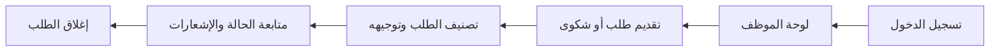

# Mihwar (محور) — Project Brief for AI Assistants

> **Version:** 1.2 · 2026-11-24 (phase 3 started: development until 2026-12-12 — plan in `reference/phase-3/phase-3-plan.md`). 1.1 · 2026-11-06: added Q-14. If the team shares a newer version, the newest one wins.
> **⚠️ Phase 3 (from 2026-11-24):** members now **write code** with Claude Code in the GitHub repo, following `CLAUDE.md`, `docs/` and the phase-3 plan. Sections 0–0.2 and the «documents only» rules below describe phase 2 and are kept as history; `docs/` files change only with the coordinator's approval.
> **Who this file is for:** any AI assistant (Claude, ChatGPT, …) helping the Mihwar team.
> **How it is used:** each team member gives an AI assistant **two files together**: the whole Mihwar package (zip, which contains this brief) and their **group guide** (a PDF called «دليل المجموعة …»). Then they explain their phase-2 task in their own words (usually informal Arabic). The AI does the task with them and hands over the finished files — see **section 0**, which applies to every conversation. Group leaders who need to check and merge their members' work use **section 0.1**.
> **Source of truth:** this brief summarizes the approved phase-1 analysis (`reference/phase-1-analysis/`) and the phase-2 plan (`reference/phase-2/phase-2-plan.pdf`). If the input contradicts them, point it out — never silently pick one.

---

## 0. Every time a member talks to you — read this first

The member may know nothing about Markdown, file names, or the process. Your job is to take them from «هذي مهمتي» to **finished files — every document paired with its Markdown file** — without them having to ask for anything or getting lost.

**Be a partner, not only an executor.** The member wants an AI that thinks with them. For anything this brief doesn't already fix:
- **Understand** — when it matters, ask one or two short questions about their view or context (not an interview).
- **Propose** — give your recommendation, and an alternative when there is a real choice, each with **why** (linked to the requirements, the plan or good practice).
- **Agree** — let the member choose or adjust. If they disagree, discuss briefly, then follow their decision and write it down.
- **Execute** — then produce the files.
- **Don't stall** on small choices: decide them yourself and list them as assumptions.

**Step 0 — Check the two files.** The member should attach the **project zip** and their **group guide**.
- **The group guide** gives the split of tasks between the group's members, the week-by-week plan, the hand-offs and the leader's checklist. Follow it for *who does what and when*. This brief wins on any conflict — and say so if you find one.
- **If the guide is missing**, ask for it once: «ارفع دليل مجموعتك (PDF) مع الملف المضغوط».
- **If you can't open the zip** (some tools can't read .zip), say it in one Arabic line and ask them to extract it and upload this brief plus the files their task needs (for example `docs/requirements.md`): «ما قدرت أفتح الملف المضغوط — فك الضغط وارفع الملفات». Never continue as if you had read files you couldn't open.

**Step 1 — Find their task.** Match what they say to the group guide and section 6 (group 1–4 and the sub-task, e.g. "Group 1 · 1.2 Screens & user flows"). If it isn't clear, ask **one** short question with the options. Then confirm in one Arabic line: «مهمتك: … · المطلوب منك: …». Numbers for screens, flows, tasks, decisions and questions are worked out by you from the task (section 8.4) — never ask the member for them.

**Step 2 — Do the task with them.** Produce the deliverable the plan asks for. If they brought material (notes, drafts, screenshots), build on it. If they brought nothing, write a complete first draft from the phase-1 analysis (section 5) and the plan (section 6), and ask them to review it. Explain simply, answer their questions, and improve the draft until they are satisfied. The member owns the decisions; mark every assumption you make.

**Step 3 — Always hand over the files in pairs — automatically.** Documents follow the same split as the Markdown files: **one document for each Markdown file** (the pairs and fixed document titles are in section 7.1). If the task touches two Markdown files, deliver two documents and two Markdown files. Deliver every pair in the same reply, even if the member only asked for one file:

| | File | What it is |
|---|---|---|
| **A** | **The document** (for people) | The content of one Markdown file, written for people, with the exact title from section 7.1, in the format the member wants (Word, PDF, Google Docs…). If they don't say, prepare a document ready to save as PDF. If you can't create files, give the content ready to paste into Word or Google Docs. |
| **B** | **The Markdown file** (for the AI) | The same content as the matching `docs/*.md` file, written with the templates and rules in section 8. Name it with its path, e.g. `docs/screens.md`. |

**Never merge different documents into one**, and never split one Markdown file's content across several documents. If the member covered only part of a document (for example only their roles' screens), give the document its normal title plus «(جزء: …)» — the group leader later merges the parts **of the same document** only.

**Step 4 — Tell them why the Markdown files matter and where they go.** End with this message in Arabic (fill in the brackets; one line per pair):

> ✅ **خلصنا. هذي ملفاتك:**
> - 📄 **[عنوان المستند]** ↔ 🧾 **[docs/….md]**
>
> المستند هو مخرج مهمتك في خطة المرحلة الثانية، وملف الـ Markdown هو نفس المحتوى بصيغة يقرأها الذكاء الاصطناعي (Claude Code) في مرحلة البرمجة عشان يبني محور صح، فهو **مهم مثل المستند نفسه**.
>
> 📤 **سلّم كل الملفات مع بعض لقائد مجموعتك.**
> ⚠️ ملاحظات: [الافتراضات · التعارضات · الأسئلة المفتوحة — أو «لا يوجد»]

**Rules for section 0**
- Never skip a Markdown file, and never ask «تبي ملف Markdown؟» — it is always part of the delivery.
- If the member worked on only part of their task, deliver the pair(s) for that part and say what is still missing.
- Speak to the member in simple Arabic. Don't lecture them about the process beyond the message above.
- Phase 2 is documents only: no code, no SQL, no OpenAPI, no prototype (section 6).
- The package also contains `reference/` (phase-1 PDFs, the plan PDF) and `brand/` (identity guide and logos) — use them when you can read them; this brief is the summary if you can't.

## 0.1 When a group leader asks you to check and merge

Use this section when the person says they are the group leader (قائد / مسؤول المجموعة) and uploads their members' files (documents + Markdown files) together with the zip and the group guide. The leader is not technical: do the checking for them and explain it simply.

**Step 1 — Sort the files.** Match every file to its document title and Markdown file (section 7.1) and to the member who made it (the split in the group guide).

**Step 2 — Check before merging.** Go through the leader's checklist in the group guide, plus these checks:
- **Complete:** every member's expected files are there, and everything the guide assigns is covered (for example all 71 requirements have a priority; every MVP requirement has a screen; every ERD entity has a table; every screen has its API operations).
- **Consistent:** templates followed (section 8.3); IDs follow section 8.4 with no duplicates; the same thing has the same name everywhere; phase-1 *Source text* unchanged; no new FR / NFR numbers.
- **Rules kept:** documents only — no code, SQL, OpenAPI or prototype; open questions recorded instead of guesses.

**Step 3 — Report first, in Arabic.** Before merging, give the leader a short table per member — ✅ كامل · ⚠️ ناقص · ❌ تعارض — saying exactly what and whose. If something blocks the merge (a missing part, two members contradicting each other), stop and ask the leader to decide or send it back to the member. Never pick one side silently.

**Step 4 — Merge.**
- Merge only **parts of the same document** (for example two members' API parts → one «مواصفات API»). Different documents stay separate (section 7.1).
- For a file that already exists in the package (like `docs/requirements.md`), apply the members' changes to it and output the **full updated file**.
- If IDs clash, renumber only with the leader's approval, and list every change (old → new) everywhere it appears.

**Step 5 — Hand over.** For each document: the merged document + its full Markdown file, then this message:
> ✅ **شغل المجموعة جاهز للتسليم:**
> - 📄 **[عنوان المستند]** ↔ 🧾 **[docs/….md]**
>
> 📤 **سلّمها في الدسكورد: كل مستند مع ملف الـ Markdown حقه.**
> ⚠️ ملاحظات للمنسق: [أسئلة مفتوحة · قرارات تحتاج اعتماد — أو «لا يوجد»]

## 0.2 When a member comes back to the same chat

Members keep **one chat (or one project) for the whole phase** and come back over several weeks, because their tasks are spread across the weeks in the group guide. When they come back — for example «وش باقي علي؟», «خلصت، وش الجاي؟» or «الأسبوع الثاني بدأ» — do this:

**Step 1 — Show where they stand**, in Arabic, from the group guide and this chat:
> ✅ **خلص:** [الملفات اللي سلّمتها في هذا الشات]
> ⏳ **باقي عليك:** [مهامك الجاية حسب دليل المجموعة، مع الأسبوع]
> 🔒 **تنتظر:** [ملفات لازم توصلك من مجموعة ثانية أو من زميلك قبل ما نكمل — أو «لا شيء»]

**Step 2 — Suggest the next step and start it.** If the next task needs a file from another group or a teammate (for example the database design from Group 3), ask them to upload it — never invent its content.

**Step 3 — Re-read before every delivery.** In a long chat, go back to section 0 and section 8 (templates, numbering, document ↔ Markdown pairs) before writing the files, so later deliveries follow the rules exactly like the first one.

**Step 4 — Keep numbers continuous.** New IDs continue after the highest number you already used for this member in this chat (section 8.4) — never restart and never reuse one.

Then deliver as in section 0, Step 3 and Step 4.

---

## 1. Project identity

| Item | Value |
|---|---|
| Name (Arabic) | **محور** |
| Name (English) | **Mihwar** — ✅ decided (Q-01). Phase-1 report files say "MEHWAR / Mehwar"; always write **Mihwar**. |
| What it is | An Arabic-first (RTL) AI platform for companies |
| Logo tagline | **من البيانات .. إلى القرارات الأفضل** — "From data to better decisions" |
| Other approved slogans | «بياناتك.. قرارات أذكى» · «من البيانات إلى الفهم... ومن الفهم إلى القرار» · «محور .. رؤية أوسع لبياناتك» |
| Core message | محور تحوّل البيانات واحتياجات الموظفين إلى فهم واضح وقرارات أكثر ذكاءً |
| Problem | Scattered data, many systems, and many channels for employee requests make it hard to follow issues, analyze them, and decide. |
| Goal | Move the company from knowing *what* happens to understanding *why* it happens and *what to do*, so decisions are data-based. |
| Value | Save time and effort · improve work efficiency · speed up data-based decisions |

---

## 2. The product — modules

Mihwar is one master brand with three modules under it (no separate logos for modules).

| Module | Arabic | Who uses it | What it does | Linked FRs |
|---|---|---|---|---|
| **Wasl** | **وصل** | Employee, Department Manager | Employees submit requests and complaints in natural language. AI understands, classifies, sets priority, and routes the request to the right department. The employee tracks it until it is closed. | FR-01 → FR-15 |
| **Operational Brain** | **العقل التشغيلي** | Top Management | Analyzes company data and KPIs, detects issues, anomalies, trends and opportunities, and gives evidence-based recommendations and reports. | FR-16, FR-18 → FR-32 |
| **Ask AI** | **اسأل محور** | **All roles**, each limited by their role (✅ Q-14) | A chat with Mihwar's AI, like ChatGPT: every user has their own conversation and asks about the data their role allows — Employee: own requests · Department Manager: own department · Top Management: the whole company · System Administrator: admin data only. The Employee can also start a request from the chat (they confirm before it is sent). | FR-17 (extended to all roles — Q-14), FR-32 |
| Platform services | — | All / System Administrator | Users, departments, roles & permissions, settings, notifications, system logs. | FR-33 → FR-44 |

> **One AI, not three (✅ Q-14).** Mihwar has **one** AI model. It works in the background for Wasl (understand, classify, prioritize, route) and for the Operational Brain (analyze, detect, recommend), and users talk to it through the Ask AI chat. Never design a separate AI system per module.

**How they connect:** Wasl collects the employee's voice (requests, problems, suggestions) → it becomes structured data → the Operational Brain links it with company/operations data → analysis and recommendations reach management → management decides and follows the impact.

**Wasl flow (company profile):** يرسل (employee writes) → يفهم (AI understands) → يصنّف (type & department) → يحدد الأولوية → يوجّه (route to the responsible party) → يُعالج (department works on it) → يُتابع (employee follows until closed).

**Operational Brain flow (company profile):** يجمع → يربط → يحلل → يكتشف → يقترح → يتابع.

> ⚠️ The company profile also mentions ideas that are **not** in the approved requirements (e.g. a "Projects / المشاريع" view, prediction / «يتنبأ», success-metric dashboards). Treat them as vision only. They enter scope only if Group 1 adds them to `mvp-scope.md` and a requirement is added.

---

## 3. Actors and roles

Use these names exactly (English in code/docs keys, Arabic in UI text).

| Role (English) | Arabic | Can access |
|---|---|---|
| Employee | موظف | Own requests, own notifications (request-status report: see Q-08), Ask AI chat about **own requests only** |
| Department Manager | مدير قسم | Requests of **their own department only** (NFR-03), Ask AI chat about **own department only** |
| Top Management | الإدارة العليا | Insights, KPIs, recommendations, issues, opportunities, Ask AI chat about **the whole company**, management reports |
| System Administrator | مدير النظام | Users, departments, roles & permissions, settings, system logs (admin functions are admin-only — NFR-04), Ask AI chat about **admin data only** |
| AI Analytics Engine | محرك التحليل (النظام) | System actor, not a user: classifies, prioritizes, routes, analyzes |

---

## 4. Project phases

| Phase | Name | Status |
|---|---|---|
| **1** | System Analysis — تحليل النظام | ✅ Done. Outputs in `reference/phase-1-analysis/` (section 5). |
| **2** | Solution Design & Implementation Preparation — تصميم الحل والاستعداد للتطوير | ✅ Done (2026-11-24). All documents approved and synced into `docs/`; the groups' submissions are archived in `reference/phase-2/المجموعات/`. |
| **3** | Development — التطوير (البرمجة) | ⏳ **Current: 2026-11-24 → 2026-12-12.** Same 16 members in 4 groups × 4. Each group builds whole units (backend + screens) from `docs/tasks.md` with Claude Code on one GitHub repo. Plan: `reference/phase-3/phase-3-plan.md`. |
| **4+** | Testing, launch — الاختبار والإطلاق | 🔜 After phase 3. |

---

## 5. Phase 1 — approved analysis (source of truth)

### 5.1 Functional requirements (FR-01 → FR-44)

**A. Employee**
- **FR-01 — Submit Request / Complaint:** the Employee can submit a request or complaint.
- **FR-02 — Add Supporting Documents:** the Employee can attach supporting documents to a request or complaint.
- **FR-03 — Track Request Status:** the Employee can track the status of submitted requests.
- **FR-04 — Receive Notifications:** the Employee receives notifications related to their requests.
- **FR-05 — Generate Request Status Report:** the Employee can generate a report of the status of their requests. ⚠️ The Use Case table assigns this to Top Management — see Q-08.

**B. Request management (system)**
- **FR-06 — Classify Request:** the system automatically classifies submitted requests by category.
- **FR-07 — Determine Priority:** the system determines the priority of each request.
- **FR-08 — Route Request to Department:** the system routes each request to the appropriate department.
- **FR-09 — Store Request:** stores employee, department, category, priority, status, description, and timestamps.
- **FR-10 — Store Supporting Documents:** stores supporting-document information linked to requests.
- **FR-11 — Send Status Notification:** sends a notification when a request's status is updated.

**C. Department Manager**
- **FR-12 — View Department Requests:** the manager views requests of their department.
- **FR-13 — Assign Request:** the manager assigns requests for handling.
- **FR-14 — Update Request Status:** the manager updates request status.
- **FR-15 — Maintain Request Workflow:** the system keeps the workflow going until the request is resolved or needs further action.

**D. Top Management**
- **FR-16 — View Company Insights**
- **FR-17 — Ask AI About Company Data:** submit questions about company data and receive AI-generated analysis.
- **FR-18 — Monitor Company KPIs**
- **FR-19 — View AI Recommendations**
- **FR-20 — View Operational Performance**
- **FR-21 — View Detected Issues** (detected by the AI Analytics Engine)
- **FR-22 — View Identified Opportunities**
- **FR-23 — Generate Management Report:** analysis, insights, KPIs, and operational information.

**E. AI analytics**
- **FR-24 — Analyze Company Data** (through the AI Analytics Engine)
- **FR-25 — Detect Operational Issues**
- **FR-26 — Detect Anomalies**
- **FR-27 — Identify Trends**
- **FR-28 — Generate Insights**
- **FR-29 — Store Analysis Runs:** record each run with its trigger and execution time.
- **FR-30 — Store Analysis Results:** issues, anomalies, trends, insights linked to a run.
- **FR-31 — Periodic Analysis**
- **FR-32 — On-Demand Analysis:** triggered by a Top Management request.

**F. System Administrator**
- **FR-33 — Manage Users** · **FR-34 — Manage Departments** · **FR-35 — Manage Roles and Permissions** · **FR-36 — Manage System Settings** · **FR-37 — View System Logs** · **FR-38 — Record System Logs**

**G. Data management**
- **FR-39 — User Data Management:** users, roles, department associations.
- **FR-40 — Request Data Management:** requests and their links to employees, departments, managers.
- **FR-41 — Notification Management:** notifications linked to users and requests, with read status.
- **FR-42 — Company Operational Data:** data used by the AI Analytics Engine.
- **FR-43 — Analysis Data Association:** results linked to their analysis run.
- **FR-44 — Management Report Storage:** reports and their analysis.

### 5.2 Non-functional requirements (NFR-01 → NFR-27)

| Group | Requirements |
|---|---|
| A. Security | **NFR-01** Authentication · **NFR-02** Role-Based Access Control · **NFR-03** Department Access Control (managers see only their department) · **NFR-04** Administrative Access Control (admin-only) · **NFR-05** Data Protection |
| B. Data integrity | **NFR-06** Data Consistency · **NFR-07** Referential Integrity · **NFR-08** Request Traceability (history + timestamps) |
| C. Performance | **NFR-09** System Responsiveness · **NFR-10** AI Processing Performance · **NFR-11** Concurrent Access |
| D. Reliability | **NFR-12** Error Handling (no data corruption) · **NFR-13** Reliable Request Processing · **NFR-14** Analysis Reliability |
| E. Availability & scalability | **NFR-15** Availability · **NFR-16** Scalability · **NFR-17** Modular Scalability (request mgmt, AI analytics, admin extend independently) |
| F. Usability | **NFR-18** Usability · **NFR-19** Role-Specific Interface · **NFR-20** Clear Status Information |
| G. Maintainability | **NFR-21** Modular Codebase · **NFR-22** Logging and Monitoring · **NFR-23** Configuration Management |
| H. AI analysis quality | **NFR-24** Structured AI Output · **NFR-25** Analysis Traceability (each result → its run) · **NFR-26** Consistent Processing · **NFR-27** Result Context (enough info to understand each result) |

### 5.3 Use cases (Use Case Diagram)

- **Employee:** Submit Request/Complaint · Add Supporting Document · Track Request Status · Receive Notification
- **Department Manager:** View Department Requests · Assign Request · Update Request Status
- **Top Management:** Generate Request Status Report ⚠️ · View Company Insights · Ask AI about Company Data · Monitor Company KPIs · View AI Recommendations · View Operational Performance · View Detected Issues · View Identified Opportunities · Generate Management Report
- **System Administrator:** View System Logs · Manage Users · Manage Department · Manage Roles and Permissions · Manage System Settings
- ⚠️ **Conflict (Q-08):** the Use Case table gives **Generate Request Status Report** to **Top Management**, but the Requirements report (FR-05) gives it to the **Employee**. Unresolved — do not choose one; flag it whenever FR-05 comes up.
- **«include»:** Classify Request, Determine Priority, Route Request are included in Submit Request. **«extend»:** Add Supporting Document extends Submit Request.

### 5.4 Business process (BPMN)

1. **Request lifecycle:** Start (Employee) → Submit Request/Complaint → Add Supporting Documents (optional) → *System:* Classify Request → Determine Priority → Route Request to Department → *Department Manager:* View Department Requests → Assign Request → Update Request Status → **Resolved?** No → keep updating · Yes → *System:* Send Status Notification → *Employee:* Track Request / Receive Notification → Request Closed.
2. **Analysis:** trigger = **Periodic Timer** (AI Engine) or **Ask AI about Company Data** (Top Management) → Analyze Company Data → Detect Operational Issues → Detect Anomalies → Identify Trends → Generate Insight → Generate Management Report → *Top Management:* View Company Insights → Monitor Company KPIs → View Operational Performance → Report Reviewed.
3. **Administration:** Manage Users → Manage Departments → Manage Roles and Permissions → Manage System Settings → View System Logs → End.

### 5.5 Data flow (DFD)

| Process | Data stores | Main flows |
|---|---|---|
| **P1. Submit & Route Request** | D1 Requests DB (write) | In: complaint/request + documents (Employee). Out: status/notifications (Employee), store request (D1), routed request (P2) |
| **P2. Manage Department Requests** | D1 (read/write) | In: routed request (P1), request records (D1), assign/update status (Manager). Out: updated status (D1), department request list (Manager), trigger analysis (P3) |
| **P3. AI Analyze Company Data** | D1 (read), D2 Company Operational Data (read/write), D4 System Logs (write) | In: request data, trigger, Ask-AI query (Top Mgmt). Out: insights/KPIs/reports (Top Mgmt), log anomalies (D4) |
| **P4. System Administration** | D3 Users & Roles DB (write) | In: manage users/roles/settings (Admin). Out: update records (D3). Admin reads D4 logs directly (View Logs) |

### 5.6 Data model (ERD) — 15 entities

| Entity | Attributes | Keys | Relationships |
|---|---|---|---|
| **User** | name, email, password | PK user_id · FK role_id, department_id | 1:M Request (as employee) · 1:M Request (as manager) · 1:M SystemLog · 1:M SystemSetting · 1:M Notification · 1:M AnalysisRun (Ask AI) |
| **Role** | role_name | PK role_id | 1:M User |
| **Department** | department_name | PK department_id | 1:M User · 1:M Request |
| **Request** | category, priority, status, description, created_at, updated_at | PK request_id · FK employee_id, department_id, assigned_manager_id | 1:M SupportingDocument · 1:M Notification |
| **SupportingDocument** | file_name, file_path, uploaded_at | PK document_id · FK request_id | M:1 Request |
| **Notification** | message, sent_at, is_read | PK notification_id · FK request_id, user_id | M:1 Request · M:1 User |
| **SystemLog** | action, details, logged_at | PK log_id · FK user_id | M:1 User |
| **SystemSetting** | setting_key, setting_value | PK setting_id · FK updated_by | M:1 User |
| **CompanyData** | source, metric_name, value, recorded_at | PK data_id | M:M AnalysisRun |
| **AnalysisRun** | trigger_type, run_at | PK analysis_id · FK request_id (nullable), triggered_by_user_id (nullable) | M:M CompanyData · 1:M DetectedIssue · 1:M Anomaly · 1:M Trend · 1:1 Insight · 1:1 ManagementReport |
| **ManagementReport** | generated_at, summary | PK report_id · FK analysis_id | 1:1 AnalysisRun |
| **DetectedIssue** | description, severity, detected_at | PK issue_id · FK analysis_id | M:1 AnalysisRun |
| **Anomaly** | description, detected_at | PK anomaly_id · FK analysis_id | M:1 AnalysisRun |
| **Trend** | description, period | PK trend_id · FK analysis_id | M:1 AnalysisRun |
| **Insight** | description | PK insight_id · FK analysis_id | 1:1 AnalysisRun |

---

## 6. Phase 2 — Solution Design & Implementation Preparation

**Idea:** turn the phase-1 analysis into a detailed design and an execution plan, so that when programming starts with Claude Code everyone knows what to build, how it works, and who owns what. No building by trial and guessing.

> **Phase 2 produces documents only.** Nothing is built: no prototype (the updated plan PDF removed it), no application code, no SQL, no OpenAPI/YAML. Group 2 delivers **static** Figma screens plus documents. The database and the API are **described in Markdown tables** (the updated plan PDF says the same). They are converted into `db/schema.sql` and `docs/api/openapi.yaml` in phase 3 (as listed in `CLAUDE.md`).

### 6.1 Groups

| # | Group | Plan steps | Tasks | Group deliverable |
|---|---|---|---|---|
| **1** | Project analysis & MVP — تحليل المشروع وMVP | 1 + 2 | Review requirements and the 4 diagrams; split functions into units; decide MVP vs deferred; list screens and user flows | Requirements & scope file |
| **2** | Figma design — تصميم Figma | 3 | Apply the approved visual identity, design screens per role permissions, design screen states and shared components | Figma screens approved for all roles (static, no prototype) + design-system document |
| **3** | Architecture & database — معمارية النظام وقاعدة البيانات | 4 + 5 | System architecture, technology choice, database design (as a document), data flow | Architecture, tech stack & database documents |
| **4** | API, AI & development plan — API والذكاء الاصطناعي وخطة التطوير | 6 + 7 + 8 | API operations (as a document), how AI works in Wasl and the Operational Brain, development & test plan, acceptance criteria | API, AI and development/test plan documents |

**Group 1 — functional units to define:** إدارة المستخدمين والصلاحيات · وصل وإدارة طلبات الموظفين · إدارة الأقسام ومعالجة الطلبات · العقل التشغيلي وتحليل بيانات الشركة · المساعد الذكي والتقارير والتوصيات · الإشعارات وسجلات العمليات.
Outputs: **Scope & MVP Definition** (in / deferred / constraints / approved decisions) · **Screen Inventory** · **User Flows** · **Screen Specifications**.
Example employee flow: تسجيل الدخول → لوحة الموظف → تقديم طلب أو شكوى → تصنيف الطلب وتوجيهه → متابعة الحالة والإشعارات → إغلاق الطلب.

**Group 2 — UI/UX design in Figma with the approved identity.** The visual identity is **approved and ready** (logo, colors, and the promotional dashboard design in `brand/`); the group applies it to every screen **without changing it**. The promotional dashboard is a reference, not a replacement for designing the real screens. Full design starts after Group 1 delivers the screens list.
Steps: turn the approved identity into a Design System in Figma (colors, fonts, spacing, icons, card style) · wireframes · team review for function coverage · hi-fi static screens · reusable components (lists, cards, tables, forms) · screen sizes, Arabic readability and RTL review · approve the final design before it becomes code.
Output: an approved Figma file with the Design System, the screens of every role, the shared components, and the states (error, loading, empty data, permissions). **No prototype** — screens are not linked into a clickable flow; navigation is described in `screens.md` / `user-flows.md` instead.

**Group 3 — outputs:** **System Architecture** (frontend, backend, database, AI service, storage, notifications; responsibilities; data flow; authentication & permission checks; Wasl ↔ Brain link without mixing responsibilities; errors, logs, background jobs; data isolation by permission) · **Tech Stack Decision** for Frontend, Backend, Database, Authentication & Authorization, File Storage, AI Services, Hosting & Deployment — criteria: ease of development, cost, security, scalability, tool integration, team experience. **The final technology is an open decision — do not assume Next.js or any stack until approved.** · **Database design document** (`docs/database.md`) from the ERD: tables, fields, types, keys, relations, constraints, indexes, data ownership, retention of attachments/logs/analysis results, and in words what migrations and seed data will be needed. No SQL in phase 2.

**Group 4 — outputs:** **API Specification** as a document (`docs/api.md`, tables — no OpenAPI/YAML in phase 2). Per operation: name & purpose, path & method (GET / POST / PATCH), request & response data, validation rules, required permissions, error codes, handling of sensitive or repeated operations. · **AI Architecture**: Wasl AI (understand text, classify type, priority by clear rules, suggest department / route by policy, handle unclear cases, log result and changes) and Brain AI (identify data sources, check data quality, compute KPIs and detect changes/patterns, detect issues and opportunities, evidence-based recommendations, show explanation + data source + analysis date); define when the system acts automatically vs. when a human reviews, and how quality is measured. RAG / embeddings / vector DB only if needed: structured records & numbers → normal queries; long text policies/reports → RAG; real semantic search → embeddings/vector DB. · **Development Task Breakdown** + test plan (units, dependencies, owner & reviewer per task, acceptance criteria, GitHub branches/PRs/reviews, tests: unit, integration, permissions, UI).

### 6.2 Timeline (3 weeks or less)

| Group | Week 1 | Week 2 | Week 3 |
|---|---|---|---|
| 1 | Requirements analysis, MVP scope, screens & flows inventory, hand over | Screen specs, support other groups | Check requirement coverage in all outputs |
| 2 | Prepare Figma components from the approved identity, initial wireframes | Final screens per permissions, screen states | Review fixes, approve Figma |
| 3 | Architecture draft, compare technologies | Database design document, data flow, deliver it | Check fit with API and screens |
| 4 | Study AI mechanism in Wasl & the Brain | API spec, dev & test plan, acceptance criteria | Check fit, prepare final execution plan |

**Hand-offs:** G1 → G2: screens & flows list (end of week 1) · G1 → G3 & G4: approved MVP scope (end of week 1) · G3 → G4: database design & tech choice (mid week 2) · G2 → G4: final screens to match API operations (week 2).

**Phase 2 is done when** all four groups' documents are approved and merged: Scope & MVP Definition · Screen Inventory + User Flows + Screen Specifications · approved Figma file with the screens of all roles + design-system document · System Architecture · Tech Stack Decision + database design document · API specification document · AI Architecture · Development Task Breakdown + test plan.

---

## 7. Output files (where each deliverable goes)

| File | Owner | Contents | IDs |
|---|---|---|---|
| `CLAUDE.md` | Coordinator | Short project summary and rules for Claude Code | — |
| `docs/glossary.md` | Coordinator + all | Exact names of entities, roles, request statuses, priorities, categories | — |
| `docs/requirements.md` | Group 1 | **Already in the package** — all 71 requirements from phase 1 (verbatim). Group 1 only fills *Priority (MVP)* and resolves the ⚠️ items; never rewrite or renumber it | `FR-01`, `NFR-01` |
| `docs/mvp-scope.md` | Group 1 | In MVP / deferred / constraints | references FR |
| `docs/screens.md` | Group 1 then 2 | Every screen: role, content, actions, states, Figma link | `SCR-201` (section 8.4) |
| `docs/user-flows.md` | Group 1 | Flows per role as Mermaid diagrams | `FLOW-201` (section 8.4) |
| `docs/design-system.md` | Group 2 | Colors, fonts, spacing, components, Figma link | — |
| `docs/architecture.md` | Group 3 | Components and data flow (Mermaid) | — |
| `docs/tech-stack.md` | Group 3 | Chosen technologies and why | references ADR |
| `docs/database.md` | Group 3 | Database design as tables (becomes `db/schema.sql` in phase 3) | — |
| `docs/api.md` | Group 4 | All API operations as tables (becomes `docs/api/openapi.yaml` in phase 3) | `operationId` e.g. `createRequest` |
| `docs/ai.md` | Group 4 | How AI works in Wasl and the Operational Brain | — |
| `docs/tasks.md` | Group 4 | Development tasks with dependencies and acceptance criteria | `T-230` (section 8.4) |
| `docs/test-plan.md` | Group 4 | Test types and what each covers | — |
| `docs/decisions.md` | All | Decisions with reasons, and open questions | `ADR-3001`, `Q-1201` (section 8.4) |

### 7.1 Documents ↔ Markdown files (one-to-one)

Every document has exactly one Markdown twin with the same content. Use these titles exactly.

| Group | Document title (for people) | Markdown file (for the AI) |
|---|---|---|
| Coordinator | «قاموس المصطلحات» | `docs/glossary.md` |
| 1 | «مراجعة المتطلبات» | `docs/requirements.md` |
| 1 | «نطاق المشروع (MVP)» | `docs/mvp-scope.md` |
| 1 → 2 | «قائمة ومواصفات الشاشات» | `docs/screens.md` |
| 1 | «مسارات المستخدمين» | `docs/user-flows.md` |
| 2 | «دليل نظام التصميم» | `docs/design-system.md` |
| 3 | «معمارية النظام» | `docs/architecture.md` |
| 3 | «قرار التقنيات» | `docs/tech-stack.md` |
| 3 | «تصميم قاعدة البيانات» | `docs/database.md` |
| 4 | «مواصفات API» | `docs/api.md` |
| 4 | «آلية الذكاء الاصطناعي» | `docs/ai.md` |
| 4 | «خطة التطوير (مهام البرمجة)» | `docs/tasks.md` |
| 4 | «خطة الاختبار» | `docs/test-plan.md` |

- **Group 2** also delivers the Figma file itself (link) and a PDF export of the screens; their documents are «دليل نظام التصميم» and the Figma links added to «قائمة ومواصفات الشاشات».
- **Decisions and open questions** (`docs/decisions.md`) have no separate document: each document ends with a section «قرارات وأسئلة مفتوحة» listing the ADR / Q items it raised, and the same items go into `docs/decisions.md`.
- **Group leaders** merge only parts of the *same* document (e.g. two members' API parts → one «مواصفات API»). Different documents stay separate.

---

## 8. Instructions for the AI — writing the Markdown file (file B in section 0)

### 8.1 Procedure
1. **Identify the target file(s)** from section 7 using the content (not only what the member calls it). One input may feed several files — e.g. a screen list feeds `screens.md` and maybe `user-flows.md`. If the file already exists in `docs/` (like `docs/requirements.md`), build on it and output only what changes.
2. **Link everything to phase 1:** cite the FR / NFR numbers each item implements. If something has no matching requirement, mark it `⚠️ لا يوجد متطلب مقابل` and add an open question.
3. **Use exact names** from sections 1–3 and `glossary.md` (e.g. always «طلب», never switch to «تذكرة»; roles exactly as in section 3).
4. **Number new items yourself** using section 8.4 (unit + role or work type). Never ask the member for numbers and never start at 01 by default.
5. **Write the file** using the template in 8.3.
6. **End with a short checklist in Arabic** for the member: what you assumed, conflicts found, and open questions. Questions also go into `docs/decisions.md` as `Q-GUNN` (section 8.4).

### 8.2 Rules
- **Never invent** requirements, features, numbers, statuses, or technology choices as if they were facts. Facts you don't have (names, numbers, company policies) become open questions, not guesses.
- **Propose answers to open questions.** When your task touches an open question (section 10), suggest an answer with the reason, agree on it with the member, and record it in the document's «قرارات وأسئلة مفتوحة» section and in `docs/decisions.md` as a decision with `Status: proposed`. The coordinator approves it; until then it is clearly marked as proposed. Decisions marked ✅ in section 10 are final — apply them.
- **Conflicts:** if the input contradicts phase 1 or another file, stop and state both versions; do not pick one silently.
- **Language:** file names, IDs, field keys, table/column names, API fields and code in **English**; content and descriptions in clear Arabic. UI text in Arabic, RTL.
- **Diagrams:** Mermaid inside the Markdown, never images.
- **Every screen** lists all five states: `loading · success · error · empty · no-permission`.
- **Permissions** are enforced on the server for every operation, not only hidden in the UI (NFR-02/03/04). Department managers only see their department.
- **AI outputs** (recommendations, insights) always show the data source and the analysis date, and are linked to their analysis run (NFR-25, NFR-27). Only send the AI model data the current role may see.
- **Acceptance criteria** must be testable (pass/fail), written as checkboxes.
- **Documents only** — phase 3 has not started. Do not write application code, SQL, OpenAPI/YAML, or prototypes. Describe the database and the API in Markdown tables; Mermaid diagrams are fine.
- **Output format:** start with the file path on its own line (e.g. `docs/screens.md`), then the full content in one Markdown block. If the input only covers part of a file, output only the new section and say where it goes.

### 8.3 Templates

**`docs/requirements.md`**
```markdown
## FR-01 · تقديم طلب أو شكوى
- Actor: Employee
- Description: …
- Module: Wasl
- Priority (MVP): Must | Should | Later
- Source: Phase 1 — System Requirements Report
```

**`docs/mvp-scope.md`**
```markdown
## داخل النسخة الأولى (MVP)
| Unit | Requirements | Notes |
## مؤجّل
| Item | Requirements | Reason |
## القيود
## القرارات المعتمدة (→ ADR-xxx)
```

**`docs/screens.md`** (Figma frame names start with the same number, e.g. `SCR-201 تقديم طلب`)
```markdown
## SCR-201 · تقديم طلب جديد
- Role: Employee
- Requirements: FR-01, FR-02, FR-06
- Content: نوع الطلب، الوصف، المرفقات
- Actions: إرسال · حفظ كمسودة · إلغاء
- States: loading · success · error · empty · no-permission
- Flows: FLOW-201
- Figma: (frame link)
```

**`docs/user-flows.md`**
````markdown
## FLOW-201 · مسار الموظف: تقديم طلب حتى الإغلاق
- Role: Employee · Screens: SCR-080, SCR-001, SCR-201 · Requirements: FR-01, FR-03, FR-04

````

**`docs/glossary.md`**
```markdown
| Term (EN, used in code) | المصطلح (UI) | Definition | Allowed values |
|---|---|---|---|
| Request | طلب | … | — |
| RequestStatus | حالة الطلب | … | (to be approved) |
```

**`docs/design-system.md`** — tokens table (name · value · usage), typography scale, spacing, radius, components, Figma link. Start from section 9.

**`docs/architecture.md`** — components and responsibilities, a Mermaid component diagram, data-flow diagram, auth & permission checks, Wasl ↔ Brain boundary, errors/logs/background jobs, decisions needing approval (→ ADR).

**`docs/tech-stack.md`**
```markdown
| Layer | Choice | Alternatives considered | Why | ADR |
|---|---|---|---|---|
| Frontend | (pending) | … | ease · cost · security · scalability · integration · team experience | ADR-30NN |
```

**`docs/database.md`** — follow the ERD (section 5.6); snake_case English table and column names; one section per table; include a junction table for CompanyData ↔ AnalysisRun (M:M).
```markdown
## requests  (ERD: Request · FR-01, FR-09, FR-40)
| Column | Type | Key / constraint | Description |
|---|---|---|---|
| request_id | uuid | PK | |
| employee_id | uuid | FK → users.user_id, NOT NULL | مقدّم الطلب |
| status | text | NOT NULL, values from glossary | حالة الطلب |
- Indexes: (department_id, status)
- Who can read / write: Employee (own), Department Manager (own department), …
- Retention: …
```

**`docs/api.md`** — one section per operation; `operationId` in camelCase (`createRequest`, `listDepartmentRequests`, `updateRequestStatus` …).
```markdown
## createRequest · تقديم طلب
- Method & path: POST /requests
- Roles: Employee · Requirements: FR-01, FR-02, FR-06, FR-07, FR-08 · Screen: SCR-201
| Request field | Type | Required | Validation |
|---|---|---|---|
| Response | … |
| Errors | 400 حقل ناقص · 401 غير مسجّل · 403 لا توجد صلاحية |
- Notes: sensitive / repeated-call handling
```

**`docs/ai.md`**
```markdown
## Wasl AI — inputs · steps (understand, classify, priority, route) · rules · confidence & human review · logging
## Operational Brain AI — data sources · data quality checks · KPIs · issues/anomalies/trends/opportunities · recommendations (source + date) · human review
## Ask AI (اسأل محور) — question handling · data the role may see · answer format
## RAG / embeddings decision — needed or not, and why
## Quality measurement
```

**`docs/tasks.md`**
```markdown
## T-230 · نموذج تقديم الطلب
- Links: SCR-201 · createRequest · FR-01
- Depends on: T-201
- Owner: … · Reviewer: …
- Acceptance criteria:
  - [ ] الموظف يرسل طلب بالحقول المطلوبة ويظهر في «طلباتي» بحالة «جديد»
  - [ ] رسالة خطأ واضحة لو فيه حقل ناقص
  - [ ] مستخدم بدون صلاحية ما يوصل للصفحة
```

**`docs/test-plan.md`** — test types (unit, integration, permissions, UI/RTL, AI quality), what each covers, linked T-xx / FR-xx, exit criteria.

**`docs/decisions.md`**
```markdown
## ADR-3001 · <decision>
- Status: proposed | approved | replaced
- Context: … · Decision: … · Reason: … · Consequences: …
- Date: YYYY-MM-DD · Owner group: …

## Open questions
| ID | Question | Raised by | Affects | Status |
|---|---|---|---|---|
| Q-1201 | … | Group 1 | FR-xx / file | open |
```

### 8.4 Numbering — you decide the ID from the task

Members work in parallel, each with their own AI, so nobody sees the others' numbers. **Never ask the member for a number.** Work the ID out from *what the item is*, using the codes below — two AIs following these rules give different items different numbers.

**Step A — the unit digit `U`** (the six functional units from the plan, section 6.1, plus 0 for shared items). Pick it from the FRs the item covers:

| U | Unit | FRs |
|---|---|---|
| 0 | General / shared — login, home shell, profile, architecture, tech stack | cross-cutting |
| 1 | Users & permissions — إدارة المستخدمين والصلاحيات | FR-33, FR-35, FR-36, FR-39 · NFR-01 → NFR-05 |
| 2 | Wasl, employee requests — وصل وإدارة طلبات الموظفين | FR-01 → FR-03, FR-05 → FR-10, FR-40 |
| 3 | Departments & request handling — إدارة الأقسام ومعالجة الطلبات | FR-12 → FR-15, FR-34 |
| 4 | Operational Brain — العقل التشغيلي وتحليل بيانات الشركة | FR-16, FR-18, FR-20 → FR-22, FR-24 → FR-31, FR-42, FR-43 |
| 5 | Ask AI, reports & recommendations — المساعد الذكي والتقارير والتوصيات | FR-17, FR-19, FR-23, FR-32, FR-44 |
| 6 | Notifications & system logs — الإشعارات وسجلات العمليات | FR-04, FR-11, FR-37, FR-38, FR-41 |

If an item touches several units, use the unit of its main FR (the action the user is doing).

**Step B — the block, then the next number in it**

| ID | Format | Block (the two digits `NN`) | Example |
|---|---|---|---|
| `SCR` · `FLOW` | `SCR-U NN` | by role: Employee **01–19** · Department Manager **20–39** · Top Management **40–59** · System Administrator **60–79** · all roles **80–99** | `SCR-201` = Wasl · Employee · 1st screen (تقديم طلب) · `SCR-080` = login (shared) |
| `T` | `T-U NN` | by work type: database & backend **01–29** · frontend / screens **30–59** · AI **60–79** · tests & setup **80–99** | `T-201` = backend of creating a request · `T-230` = its form |
| `ADR` · `Q` | `ADR-G U NN` | `G` = the member's group (1–4), then the unit, then 01, 02… | `ADR-3001` = Group 3 · general (tech stack) · 1st decision · `Q-1201` = Group 1 · Wasl · 1st question |
| `FR` · `NFR` | fixed | never create new ones — reuse phase-1 numbers; a new requirement is proposed as an open question | `FR-01` |

Inside a block, number items in the order they appear, starting at the block's first number. If the member gives you an existing file for that unit, continue after its highest number.

**Rules**
- Use the same ID everywhere it appears (links, dependencies, flows, tasks, Figma frame names).
- IDs never change once delivered and are never reused, even if an item is deleted.
- `Q-01` → `Q-14` (section 10) are reserved for the coordinator.
- In the closing checklist, list the IDs you created («الأرقام: SCR-201 → SCR-204 …») so the leader can spot any overlap when merging. Rare overlaps (two members, same unit and role) are fixed by the coordinator at merge time — not by the member.

---

## 9. Brand and design summary (full guide: `brand/mihwar-brand-guide.html`)

- **Logo:** the M ribbon symbol (cyan → blue → violet) + the wordmark «محور» (Tajawal, with kashida «محــور») + tagline. Logo files: `brand/logo/` → `COLOR` (light backgrounds), `COLOR_DARK` (dark backgrounds), `NAVY`, `BLACK`, `WHITE`; each has `SYMBOL`, `HORIZONTAL` (symbol + Arabic name with English under it), `STACKED` (symbol above the names). No vector (SVG/AI) master exists yet.
- **Primary colors:** Cyan `#22D3EE` · Blue `#3B82F6` · Violet `#7B5CF6` · Lavender `#A78BFA` · Night navy `#0A1238` · Cloud `#F7F9FF`. Main gradient: `#22D3EE 0% → #3B82F6 42% → #7B5CF6 78% → #A78BFA 100%`.
- **Text & neutrals:** headings `#0F1B4D` · body `#3A4572` · secondary `#5B6690` · borders `#E3E8FA` · backgrounds `#E9ECFF`. Blue text and links on white: `#2563EB`.
- **Status colors:** success `#10B981` · warning `#F59E0B` · danger `#EF4444` · info `#3B82F6` · indigo `#6366F1` · slate `#64748B`.
- **Fonts:** Tajawal (Arabic) · Inter (Latin and dashboard numbers).
- **UI scale:** Display 40/48 · H1 32/40 · H2 24/32 · H3 18/28 · Body 16/26 · Small 14/22 · Caption 12/18. Spacing in multiples of 4. Radius: 8 for fields, 12 for buttons, 16 for cards, 24 for large cards.
- **Icons:** 24px grid, 1.75 stroke, rounded, outline; arrows follow RTL.

---

## 10. Known inconsistencies and open questions (carry into `decisions.md`)

✅ = decided by the coordinator — apply it. The others are open: Q-03, Q-04 and Q-07 belong to their groups; for the rest, propose an answer when your task touches it (section 8.2).

| ID | Question |
|---|---|
| Q-01 | ✅ **Decided: Mihwar.** Always write "Mihwar" in English, even though the phase-1 report files say "MEHWAR / Mehwar". |
| Q-02 | Request statuses, priority levels, and request categories are not defined yet (needed for `glossary.md`). Brand examples use جديد / قيد التنفيذ / مكتمل / متأخر / مغلق — not approved. |
| Q-03 | MVP scope is not decided yet (Group 1). |
| Q-04 | Tech stack is open (Group 3). |
| Q-05 | ERD has no entities for **KPIs** (FR-18), **Recommendations** (FR-19), **Opportunities** (FR-22), or the **Ask-AI question and answer text** (FR-17). Decide whether they are stored and where. |
| Q-06 | CompanyData ↔ AnalysisRun is M:M and needs a junction table. AnalysisRun.request_id is nullable — confirm what it means (a run triggered by a request?). |
| Q-07 | When should AI act automatically vs. require human review (classification / priority / routing confidence)? (Group 4) |
| Q-08 | **FR-05 — who generates the request status report?** The Requirements report says the **Employee**; the Use Case table says **Top Management**. Decide the actor (or both), then confirm it is in the MVP and its format. |
| Q-09 | ✅ **Decided — two steps, the employee chooses neither.** (1) **Department:** the system (AI) routes the request to the right department automatically from its content (FR-06 → FR-08); the employee does not pick it. (2) **Person:** inside that department, the Department Manager decides who handles it — themselves or an employee of their department (FR-13). The ERD's `assigned_manager_id` alone is not enough: Group 3 adds an assignee field (the person handling it), and screens, API and tasks follow this. |
| Q-10 | **Request status history.** NFR-08 requires tracking the request lifecycle, but the ERD has no status-history table (only `created_at` / `updated_at`). Add a history table, or decide that SystemLog covers it. |
| Q-11 | **Permissions.** FR-35 requires managing roles *and permissions*, but the ERD has Role only — no Permission entity or role-permission link. |
| Q-12 | **Insight cardinality.** Insight is 1:1 with AnalysisRun, but one analysis usually produces several insights (FR-28 "insights"). Should it be 1:M? |
| Q-13 | **Where are anomalies stored?** The DFD logs anomalies to System Logs (D4), while the ERD has a separate Anomaly table. Pick one (or both, with a clear purpose for each). |
| Q-14 | ✅ **Decided — one AI, and Ask AI is a chat for every role.** Mihwar has a single AI model (background work for Wasl and the Operational Brain, plus the chat). Ask AI (اسأل محور) is open to **all roles**, each user with their own conversation, seeing only what their role allows (section 3). This extends FR-17, which phase 1 wrote for Top Management only; the FR text stays unchanged. The role is checked on the server **before** any data reaches the model (NFR-02, NFR-05). Group 1 adds it to the MVP scope and screens (one shared chat screen), Group 3 stores each user's conversations (with Q-05), Group 4 defines the data each role may ask about (`docs/ai.md`, ADR-4502). |

---

## 11. Folder structure

```
Mihwar/
├── CLAUDE.md          ← rules for Claude Code (coordinator)
├── AI_BRIEF.md        ← this file
├── README.md          ← short note for members (Arabic)
├── brand/             ← brand guide (html + pdf), identity board, logo/
├── reference/         ← phase-1-analysis/ (5 PDFs) · phase-2/ (phase-2-plan.pdf · المجموعات/ = the groups' original submissions) · company-profile.pdf
└── docs/              ← phase-2 Markdown outputs (written from members' inputs)
```
