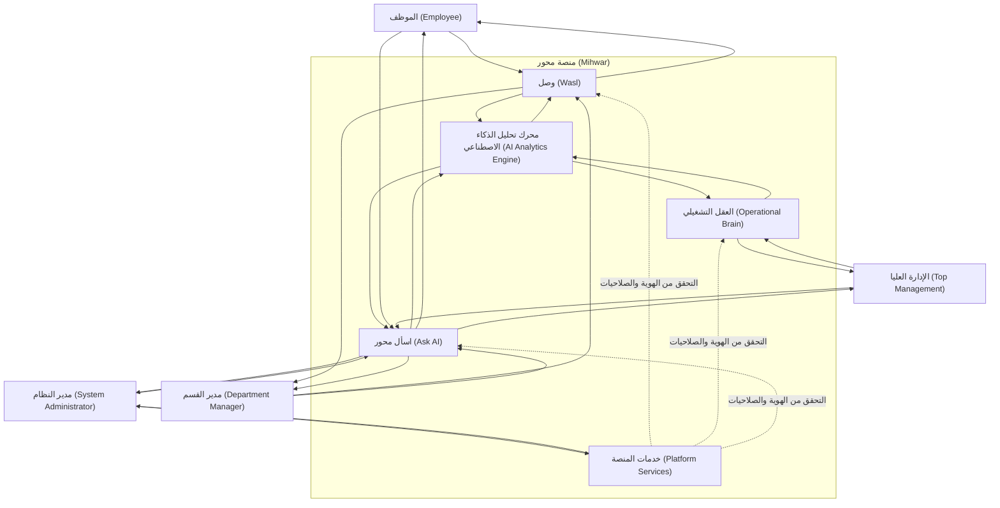
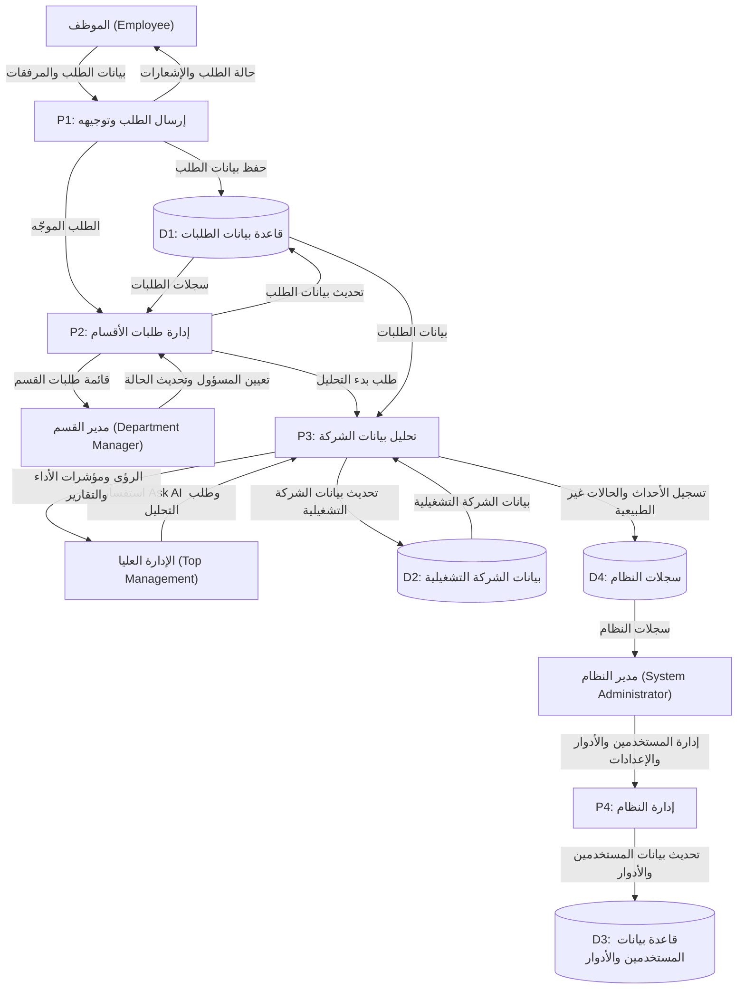

# معمارية النظام

## 1. مقدمة

يهدف هذا المستند إلى توضيح معمارية نظام محور (Mihwar)، من خلال تحديد المكونات الرئيسية للنظام، ومسؤوليات كل مكون، والعلاقات بينها، وآلية تدفق البيانات، والتحقق من صلاحيات المستخدمين.

تعتمد المعمارية على المتطلبات الوظيفية وغير الوظيفية المحددة في وثيقة المشروع AI_BRIEF.md، مع المحافظة على التكامل بين وحدات النظام الرئيسية.

## 2. نطاق المعمارية

تشمل معمارية النظام المكونات التالية:

- وصل (Wasl).
- العقل التشغيلي (Operational Brain).
- اسأل محور (Ask AI).
- خدمات المنصة (Platform Services).

كما توضح المعمارية تفاعل المستخدمين مع هذه المكونات، وآلية انتقال البيانات بينها، وضوابط الوصول إلى وظائف النظام وبياناته.

## 3. المكونات الرئيسية للنظام ومسؤولياتها

يتكون نظام محور (Mihwar) من أربعة مكونات رئيسية، تتكامل فيما بينها لتقديم وظائف المنصة وفق المتطلبات المعتمدة.

### 3.1 وصل (Wasl)

**المسؤولية:**

إدارة طلبات الموظفين وشكاواهم، بدءًا من استقبال الطلبات باللغة الطبيعية، وفهمها وتصنيفها وتحديد أولويتها وتوجيهها إلى القسم المناسب، وصولًا إلى متابعة الطلب حتى إغلاقه.

**المستخدمون:**
- الموظف (Employee).
- مدير القسم (Department Manager).

**المهام الرئيسية:**
- استقبال طلبات الموظفين وشكاواهم.
- استقبال المرفقات الداعمة للطلبات.
- تصنيف الطلبات وتحديد أولويتها باستخدام الذكاء الاصطناعي.
- توجيه الطلب تلقائيًا إلى القسم المناسب بواسطة النظام (الذكاء الاصطناعي) من محتواه، دون أن يختار الموظف القسم (FR-06 إلى FR-08).
- تمكين الموظف من متابعة حالة طلبه.
- تمكين مدير القسم من الاطلاع على طلبات قسمه.
- تمكين مدير القسم من تحديد الشخص المسؤول عن معالجة الطلب، سواء نفسه أو موظف من قسمه (FR-13)، وتحديث حالة الطلب.
- إرسال إشعارات عند تحديث حالة الطلب.

**المتطلبات المرتبطة:**

FR-01 إلى FR-15.

### 3.2 العقل التشغيلي (Operational Brain)

**المسؤولية:**

تحليل بيانات الشركة ومؤشرات الأداء بهدف اكتشاف المشكلات التشغيلية والحالات غير الطبيعية والاتجاهات والفرص، وتوليد الرؤى والتوصيات والتقارير التي تساعد الإدارة العليا على اتخاذ قرارات مبنية على البيانات.

**المستخدمون:**
- الإدارة العليا (Top Management).

**المهام الرئيسية:**
- تحليل بيانات الشركة.
- مراقبة مؤشرات الأداء الرئيسية (KPIs).
- اكتشاف المشكلات التشغيلية.
- اكتشاف الحالات غير الطبيعية (Anomalies).
- تحديد الاتجاهات والفرص.
- توليد الرؤى والتوصيات.
- إعداد التقارير الإدارية.
- حفظ عمليات التحليل ونتائجها وربط النتائج بعملية التحليل المقابلة.
- دعم التحليل الدوري والتحليل عند الطلب.
- عرض مصدر البيانات وتاريخ التحليل مع كل رؤية أو توصية، وربط كل نتيجة بعملية التحليل الخاصة بها.

**المتطلبات المرتبطة:**

FR-16، وFR-18 إلى FR-32، وNFR-25، وNFR-27.

### 3.3 اسأل محور (Ask AI)

**المسؤولية:**

محادثة (شات) واحدة لكل مستخدم مع ذكاء محور الواحد، يسأل فيها باللغة الطبيعية عن البيانات اللي يسمح بها دوره، ويستلم إجابة مولّدة بالذكاء الاصطناعي مع مصدرها وتاريخها (✅ Q-14 · ADR-4502). ⟵ عُدّل بقرار المنسق 2026-11-22.

**المستخدمون (كل الأدوار، كل دور حسب صلاحيته):**
- الموظف (Employee): عن طلباته فقط، ويقدر يجهّز مسودة طلب من الشات ولا تُرسل إلا بعد تأكيده.
- مدير القسم (Department Manager): عن طلبات قسمه فقط (NFR-03).
- الإدارة العليا (Top Management): عن الشركة كلها، وسؤالها التحليلي يطلق تحليلًا عند الطلب (FR-32).
- مدير النظام (System Administrator): عن بيانات الإدارة فقط (NFR-04).

**المهام الرئيسية:**
- استقبال سؤال المستخدم، وفحص هويته ودوره على الخادم **قبل** وصول أي بيانات للنموذج (NFR-02، NFR-05).
- تجهيز البيانات المسموحة للدور فقط (قائمة مؤشرات معتمدة لكل دور — «آلية الذكاء الاصطناعي» 3.5) وتمريرها لمحرك تحليل الذكاء الاصطناعي.
- تقديم الإجابة مع مصدر البيانات وتاريخ التحليل، ورفض السؤال خارج صلاحية الدور برد مهذب.
- دعم التحليل عند الطلب لأسئلة الإدارة العليا التحليلية.
- حفظ محادثة كل مستخدم، ولا يقرأها غيره (`ask_ai_questions` في «تصميم قاعدة البيانات» — ADR-3502).

**المتطلبات المرتبطة:**

FR-17 (موسّع لكل الأدوار بـ ✅ Q-14)، وFR-32، وNFR-02، وNFR-05، وNFR-27.

### 3.4 خدمات المنصة (Platform Services)

**المسؤولية:**

توفير الخدمات المشتركة اللازمة لتشغيل المنصة وإدارة المستخدمين والأقسام والأدوار والصلاحيات والإعدادات والإشعارات وسجلات النظام.

**المستخدمون:**
- مدير النظام (System Administrator).
- المستخدمون الآخرون بحسب صلاحياتهم المحددة.

**المهام الرئيسية:**
- إدارة المستخدمين.
- إدارة الأقسام.
- إدارة الأدوار والصلاحيات.
- إدارة إعدادات النظام.
- إدارة الإشعارات.
- عرض سجلات النظام وتسجيل الأحداث.
- دعم إدارة بيانات المستخدمين والطلبات والبيانات التشغيلية وبيانات التحليل والتقارير الإدارية.

**المتطلبات المرتبطة:**

FR-33 إلى FR-44.

### 3.5 محرك تحليل الذكاء الاصطناعي (AI Analytics Engine)

يعمل محرك تحليل الذكاء الاصطناعي بوصفه مكونًا نظاميًا مساندًا، وليس دورًا لمستخدم بشري.

**مسؤولياته:**
- فهم طلبات الموظفين وتصنيفها وتحديد أولويتها والمساعدة في توجيهها.
- تحليل بيانات الشركة.
- اكتشاف المشكلات والحالات غير الطبيعية والاتجاهات.
- توليد الرؤى والتوصيات ونتائج التحليل.

**المتطلبات المرتبطة:**

FR-06 إلى FR-08، وFR-24 إلى FR-28.

### 3.6 الطبقات التقنية (Technical Layers)

تعمل المكونات السابقة فوق الطبقات التقنية التالية. لا يذكر هذا المستند أسماء التقنيات؛ التقنيات لكل طبقة في `docs/tech-stack.md`، و✅ اعتمدها المنسق (2026-11-22، Q-04 محسوم)، واسم مزود الاستضافة ونموذج الذكاء الاصطناعي لم يُحددا بعد.

| الطبقة | المسؤولية | المتطلبات المرتبطة | قرار التقنية |
|---|---|---|---|
| الواجهة (Frontend) | عرض شاشات كل دور وإتاحة وظائفه فقط. لا تُعتمد الواجهة وحدها في التحقق من الصلاحيات. | NFR-02 | ADR-3001 |
| الخادم (Backend) | تنفيذ منطق وصل والعقل التشغيلي واسأل محور وخدمات المنصة، والتحقق من الهوية والصلاحيات عند تنفيذ كل عملية، والتعامل مع قاعدة البيانات والتخزين والإشعارات وخدمة الذكاء الاصطناعي. | NFR-01 إلى NFR-04 | ADR-3002، وADR-3004 للمصادقة والصلاحيات |
| قاعدة البيانات (Database) | حفظ بيانات الطلبات (D1)، وبيانات الشركة التشغيلية (D2)، والمستخدمين والأدوار (D3)، وسجلات النظام (D4)، ونتائج التحليل وربطها بعملية التحليل. تفاصيل الجداول في docs/database.md. | FR-10، FR-29، NFR-05 | ADR-3003 |
| خدمة الذكاء الاصطناعي (AI Service) | هي محرك تحليل الذكاء الاصطناعي (3.5)، ولا يصل إلا إلى البيانات التي يسمح بها دور المستخدم الحالي. | FR-06 إلى FR-08، FR-24 إلى FR-28 | ADR-3006 |
| تخزين الملفات (File Storage) | حفظ المستندات الداعمة المرفقة بالطلبات. | FR-02، FR-10 | ADR-3005 |
| الإشعارات (Notifications) | إرسال إشعار عند تغيّر حالة الطلب، وتخزين الإشعارات وحالتها، واستلام الموظف إشعارات طلباته. | FR-04، FR-11، FR-41 | — (قنوات الإشعار: Q-3005) |

## 4. الرسم المعماري للمكونات (Component Diagram)

## 5. تدفق البيانات (Data Flow)

يوضح تدفق البيانات كيفية انتقال المعلومات بين مكونات نظام محور (Mihwar)، بدءًا من استقبال طلبات الموظفين ومعالجتها، مرورًا بإدارة الطلبات وتحليل بيانات الشركة، وصولًا إلى تقديم النتائج للإدارة العليا.

يعتمد تدفق البيانات على العمليات الرئيسية المحددة في مخطط تدفق البيانات (DFD)، وهي:

- P1: إرسال الطلب وتوجيهه (Submit & Route Request).
- P2: إدارة طلبات الأقسام (Manage Department Requests).
- P3: تحليل بيانات الشركة باستخدام الذكاء الاصطناعي (AI Analyze Company Data).
- P4: إدارة النظام (System Administration).

### 5.1 مخطط تدفق البيانات (Data Flow Diagram)

### 5.2 ربط مخازن البيانات بجداول قاعدة البيانات

يربط هذا القسم مخازن D1 إلى D4 في مخطط التدفق بجداول `docs/database.md`. المخطط نفسه لم يتغير.

| المخزن في المخطط | الجداول في docs/database.md | الجزء |
|---|---|---|
| D1: قاعدة بيانات الطلبات | `requests`، `request_status_history`، `request_ai_decisions`، `supporting_documents` | الأول |
| D2: بيانات الشركة التشغيلية | `company_data` | الثاني |
| D3: قاعدة بيانات المستخدمين والأدوار | `users`، `roles`، `permissions`، `role_permissions`، `departments` | الأول |
| D4: سجلات النظام | `system_logs`، والحالات غير الطبيعية في `anomalies` أو في `system_logs` حسب Q-13 | الأول والثاني |
| بدون مخزن في المخطط | `notifications`، `system_settings`، `analysis_runs`، `analysis_run_company_data`، `detected_issues`، `trends`، `insights`، `management_reports`، `kpi_results`، `opportunities`، `recommendations`، `ask_ai_questions` | الأول والثاني |

الجداول في الصف الأخير تظهر في المخطط كمخرجات فقط: P1 يرسل الإشعارات للموظف، وP3 يرسل الرؤى والمؤشرات والتقارير للإدارة العليا. أما حفظ نتائج التحليل وربطها بعملية التحليل فمذكور في القسم 8.3. وسؤال مكانها في المخطط مكتوب في Q-3405.

## 6. التكامل بين وصل والعقل التشغيلي (Wasl and Operational Brain Integration)

يتكامل مكون وصل (Wasl) مع مكون العقل التشغيلي (Operational Brain) من خلال بيانات الطلبات التي يتم تسجيلها وإدارتها داخل النظام.

تتم عملية التكامل وفق التسلسل التالي:

1. يستقبل مكون وصل طلبات الموظفين ويعالجها، ويوجهها النظام تلقائيًا إلى القسم المناسب من محتواها.
2. تُحفظ بيانات الطلبات في مخزن البيانات D1.
3. يدير مدير القسم الطلبات الموجهة إلى قسمه، ويحدد الشخص المسؤول عن معالجة الطلب (نفسه أو موظف من قسمه) ويحدّث حالة الطلب.
4. يمكن أن يؤدي التعامل مع الطلبات إلى إرسال محفز لبدء عملية التحليل في مكون العقل التشغيلي.
5. يقرأ العقل التشغيلي بيانات الطلبات من D1، إلى جانب بيانات الشركة التشغيلية من D2، لإجراء التحليلات المطلوبة.
6. تُعرض الرؤى ومؤشرات الأداء والتقارير الناتجة على الإدارة العليا.

يراعي هذا التكامل الفصل بين إدارة طلبات الموظفين وتحليل بيانات الشركة، مع الاستفادة من البيانات المتاحة لدعم اتخاذ القرارات.

المتطلبات المرتبطة: FR-01 إلى FR-15، وFR-16، وFR-24 إلى FR-32.

## 7. التحقق من الهوية والصلاحيات (Authentication & Authorization)

تعتمد منصة محور (Mihwar) على التحقق من هوية المستخدم وإدارة صلاحياته لضمان وصول كل مستخدم إلى الوظائف والبيانات المسموح بها وفق دوره في النظام.

تتم آلية التحقق من الهوية والصلاحيات وفق المبادئ التالية:

1. التحقق من هوية المستخدم قبل السماح له بالوصول إلى وظائف النظام.
2. تحديد صلاحيات المستخدم بناءً على الدور المسند إليه (Role-Based Access Control - RBAC).
3. التحقق من الصلاحيات على مستوى النظام والخادم عند تنفيذ العمليات، وليس الاكتفاء بإخفاء الوظائف من واجهة المستخدم.
4. تقييد وصول مدير القسم (Department Manager) على الطلبات التابعة لقسمه فقط.
5. قصر وظائف إدارة المستخدمين والأقسام والأدوار والصلاحيات والإعدادات على مدير النظام (System Administrator).
6. حماية بيانات المستخدمين والطلبات والبيانات التشغيلية ونتائج التحليل من الوصول غير المصرح به.
7. التأكد من أن محرك تحليل الذكاء الاصطناعي لا يصل إلا إلى البيانات التي يسمح دور المستخدم الحالي بالوصول إليها.

**المتطلبات المرتبطة:**

- NFR-01: Authentication.
- NFR-02: Role-Based Access Control.
- NFR-03: Department Access Control.
- NFR-04: Administrative Access Control.
- NFR-05: Data Protection.

## 8. معالجة الأخطاء والسجلات والمهام الخلفية (Errors, Logs & Background Jobs)

### 8.1 معالجة الأخطاء (Error Handling)

تراعي معمارية نظام محور (Mihwar) التعامل مع الأخطاء أثناء تنفيذ العمليات المختلفة، مع المحافظة على سلامة البيانات وعدم تأثر السجلات المحفوظة عند حدوث خطأ.

تشمل المبادئ التالية:

- التعامل مع الأخطاء التي تحدث أثناء تنفيذ العمليات.
- منع حدوث تلف أو فقدان للبيانات نتيجة الأخطاء.
- المحافظة على معلومات الطلبات طوال دورة حياتها.
- إتاحة التعامل مع الأخطاء دون التأثير على اتساق بيانات النظام.

**المتطلبات المرتبطة:**

- NFR-12: Error Handling.
- NFR-13: Reliable Request Processing.

### 8.2 سجلات النظام (System Logs)

تُستخدم سجلات النظام لتسجيل الأحداث المتعلقة بتشغيل المنصة والعمليات التي تتم داخلها، بما يدعم مراقبة النظام وتتبع الأحداث.

تشمل مسؤوليات السجلات:

- تسجيل أحداث النظام.
- تمكين مدير النظام (System Administrator) من الاطلاع على سجلات النظام.
- تسجيل الأحداث والحالات غير الطبيعية الناتجة عن عمليات التحليل وفق تدفق البيانات المعتمد.

**المتطلبات المرتبطة:**

- FR-37: View System Logs.
- FR-38: Record System Logs.
- NFR-22: Logging and Monitoring.

### 8.3 المهام الخلفية (Background Jobs)

تدعم معمارية النظام تنفيذ التحليل الدوري لبيانات الشركة، والتحليل عند الطلب بناءً على طلب الإدارة العليا.

تشمل هذه العمليات:

- تنفيذ التحليل الدوري لبيانات الشركة.
- تنفيذ التحليل عند الطلب بناءً على طلب الإدارة العليا.
- تسجيل عمليات التحليل مع تحديد محفز التنفيذ ووقت التنفيذ.
- حفظ نتائج التحليل وربطها بعملية التحليل المقابلة.

**المتطلبات المرتبطة:**

- FR-29: Store Analysis Runs.
- FR-31: Periodic Analysis.
- FR-32: On-Demand Analysis.
- NFR-14: Analysis Reliability.
- NFR-26: Consistent Processing.

## 9. قرارات وأسئلة مفتوحة (Decisions & Open Questions)

### 9.1 القرارات المعتمدة المطبّقة في هذا المستند

- **Q-09 (معتمد): توجيه الطلب وإسناده يتمان على خطوتين، والموظف لا يختار أيًا منهما.**
  1. القسم: يوجّه النظام (الذكاء الاصطناعي) الطلب إلى القسم المناسب تلقائيًا من محتواه (FR-06 إلى FR-08).
  2. الشخص: يحدد مدير القسم داخل قسمه من يعالج الطلب، نفسه أو موظفًا من قسمه (FR-13).

  الحقل `assigned_manager_id` في مخطط ERD وحده لا يكفي، وقد أضافت المجموعة الثالثة حقل المسؤول `assignee_id` في `docs/database.md` (✅ ADR-3301، معتمد 2026-11-24).

- **Q-14 (معتمد): ذكاء اصطناعي واحد، و«اسأل محور» شات لكل الأدوار** حسب صلاحية كل دور (القسم 3.3).
- **Q-04 و Q-02 (معتمدان 2026-11-22):** التقنيات في `docs/tech-stack.md`، وأسماء الحالات والأولويات والتصنيفات في `docs/glossary.md`.

### 9.2 القرارات التي تتطلب اعتمادًا

لا يحدد هذا المستند تقنية أو نمط نشر (Q-04). مقارنة التقنيات واختيارها في `docs/tech-stack.md` (ADR-3001 إلى ADR-3007)، و✅ اعتمدها المنسق (2026-11-22)، واسم مزود الاستضافة ونموذج الذكاء الاصطناعي لم يُحددا بعد.

أي قرار معماري يؤثر في مكونات النظام أو طريقة تكاملها يجب توثيقه واعتماده قبل اعتباره قرارًا نهائيًا.

### 9.3 الأسئلة المفتوحة

- ✅ **(محسوم 2026-11-24 — `docs/decisions.md`)** **Q-05: ما الذي يُخزَّن من المؤشرات والتوصيات والفرص ونص سؤال وإجابة اسأل محور؟** مخطط ERD لا يحتوي كيانات لمؤشرات الأداء (FR-18)، ولا للتوصيات (FR-19)، ولا للفرص (FR-22)، ولا لنص سؤال اسأل محور وإجابته (FR-17). يجب تحديد هل تُخزَّن وأين. المقترح في `docs/database.md` (الجزء الثاني): جداول `kpi_results` و`opportunities` و`recommendations` و`ask_ai_questions` (ADR-3405 وADR-3406 وADR-3501 وADR-3502). ✅ اعتمد المنسق جدول المؤشرات `kpi_results` (ADR-3405 · 2026-11-22)، والباقي proposed.
- **Q-08 ✅ (محسوم 2026-11-22): تقرير حالة الطلبات للاثنين.** الموظف يولّد تقرير طلباته (SCR-204)، والإدارة العليا تشوف ملخص حالة الطلبات داخل التقرير الإداري (SCR-542) — ADR-1204.
- ✅ **(محسوم 2026-11-24 — `docs/decisions.md`)** **Q-10: سجل حالات الطلب.** يتطلب NFR-08 تتبع دورة حياة الطلب، لكن مخطط ERD لا يحتوي جدول سجل حالات (يحتوي created_at وupdated_at فقط). يجب إضافة جدول سجل، أو اعتماد أن سجلات النظام (SystemLog) تغطي ذلك. المقترح في `docs/database.md`: جدول مستقل `request_status_history` (ADR-3201)، بحالة proposed.
- ✅ **(محسوم 2026-11-24 — `docs/decisions.md`)** **Q-11: الصلاحيات.** يتطلب FR-35 إدارة الأدوار والصلاحيات، لكن مخطط ERD يحتوي كيان الدور فقط، دون كيان للصلاحيات أو ربط بين الدور والصلاحية. المقترح في `docs/database.md`: جدولان `permissions` و`role_permissions` (ADR-3101)، بحالة proposed.
- ✅ **(محسوم 2026-11-24 — `docs/decisions.md`)** **Q-13: أين تُحفظ الحالات غير الطبيعية؟** يسجّلها مخطط DFD في سجلات النظام (D4)، بينما يحتوي مخطط ERD جدولًا مستقلًا للحالات الشاذة (Anomaly). يجب اختيار أحدهما، أو الاثنين مع غرض واضح لكل منهما. المقترح في `docs/database.md`: الاحتفاظ بالاثنين، فجدول `anomalies` مصدر التفاصيل، و`system_logs` يحمل إشارة مختصرة فقط (ADR-3404)، بحالة proposed.
- **Q-3405: ما مخزن البيانات في مخطط التدفق للجداول غير المربوطة بـ D1 إلى D4؟** يعرض القسم 5.2 اثني عشر جدولًا (الإشعارات والإعدادات ونتائج التحليل وما يتبعها) بدون مخزن في مخطط DFD المعتمد. يجب تحديد هل تُضاف لها مخازن، أو تُدمج مع D1 إلى D4.
- ✅ **(محسوم 2026-11-24 — `docs/decisions.md`)** **Q-3102: وين تنحفظ جلسات تسجيل الدخول؟** سؤال مفتوح من `docs/database.md` (الجزء الأول): ADR-3004 يعتمد جلسات آمنة داخل الخادم، ولا يوجد جدول للجلسات. يتعلق بآلية الدخول في القسم 7.
- **Q-3502 ✅ (محسوم 2026-11-22): من يستخدم اسأل محور؟** كل الأدوار حسب صلاحية كل دور (✅ Q-14 · ADR-4502). طُبّق في هذا المستند (3.3 والمخطط 4)، وفي `docs/screens.md` (SCR-580) و`docs/user-flows.md` (FLOW-580) و`docs/mvp-scope.md` (0.2) و«تصميم قاعدة البيانات» المدموج (`ask_ai_questions` لكل الأدوار). ⟵ عُدّل بقرار المنسق 2026-11-22.

### 9.4 حدود هذا المستند

يركز هذا المستند على معمارية النظام ومكوناته ومسؤولياتها وتدفق البيانات والتحقق من الهوية والصلاحيات ومعالجة الأخطاء والسجلات والمهام الخلفية.

أما المقارنة التفصيلية للتقنيات وتصميم قاعدة البيانات، فهما ضمن مخرجات الأعضاء المسؤولين عنهما في المجموعة الثالثة.
