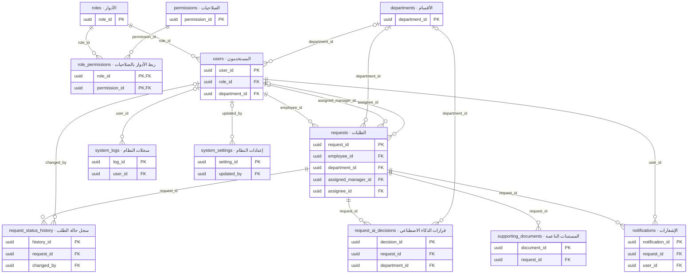
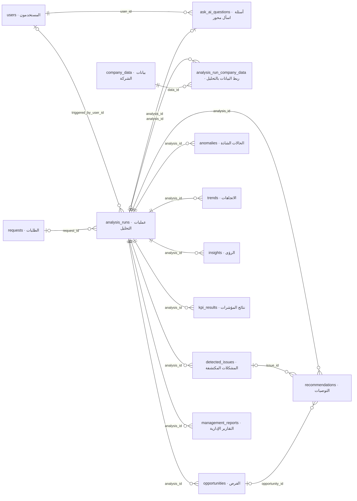

docs/database.md

# تصميم قاعدة البيانات

> **النسخة المدموجة · 2026-11-22:** الجزء الأول (المجموعة 3 · العضو 3: 12 جدول) والجزء الثاني (المجموعة 3 · العضو 4: 12 جدول) في ملف واحد، ودمجها المنسق بدون تغيير التصميم.
> **قرارات المنسق المطبّقة:** ✅ Q-09 (`assignee_id`) · ✅ Q-14 (`ask_ai_questions` لكل الأدوار) · ✅ Q-02 (القيم في الجزء الأول، القسم 1) · ✅ Q-04 (PostgreSQL — ADR-3003) · ✅ ADR-3405 (`kpi_results`). كل تعديل معلّم بـ «⟵».
> **✅ Q-3404 (2026-11-22):** `severity` أربع درجات `low` · `medium` · `high` · `critical`. **✅ 2026-11-24:** اعتمد المنسق كل قرارات هذا الملف (ADR-3101 → ADR-3301 · ADR-3401 → ADR-3409 · ADR-3501)، وQ-3102 يُحسم في بداية المرحلة 3. ⟵ كان: القرارات المعلّمة proposed باقية مفتوحة.
> **✅ ADR-1003 (2026-11-23):** `users.must_change_password` و`users.password_changed_at` لصفحة «حسابي» والكلمة المؤقتة (Q-1003 · Q-4103).
> **✅ الدفعة الثانية (2026-11-22):** `users.review_sensitive` و`requests.sensitive_reviewed_by/at` (Q-3204) · إغلاق الطلب من الموظف وإعداد `auto_close_days` (Q-1201) · بيانات الشركة بملف من مدير النظام (Q-3401).
> Phase 2 = documents only — no SQL. This file becomes `db/schema.sql` in phase 3.

# الجزء الأول: المستخدمون والطلبات والإشعارات والسجلات والإعدادات

> **Group 3 · Member 3 · Week 3 final** · 2026-11-20 · Status: final (Q-02 ✅ 2026-11-22) · Part 1 of 2
> Q-02 ✅ approved by the coordinator (2026-11-22) — values in section 1 and `docs/glossary.md`.
> Applies decision ✅ Q-09: the system routes the request to the department; the Department Manager decides who handles it (`assignee_id`).
> Built on Group 1 `docs/mvp-scope.md` (approved) · Group 3 `docs/tech-stack.md` (final, approved: ADR-3003 → ADR-3006) · Group 4 files: `docs/api.md` (v0.5, 2026-11-12 — الحالية v0.7) and `docs/ai.md` (v0.2, 2026-11-12) — operations, AI output fields and decisions ADR-4001, ADR-4201, ADR-4202.
> Phase 2 = documents only — no SQL. This file becomes `db/schema.sql` in phase 3.

---

## 0. نطاق هذا الجزء

يغطي 8 كيانات من الـ ERD، ويضيف 4 جداول (✅ ADR-3101 و ADR-3201 و ADR-3202 — معتمدة 2026-11-24). أما بيانات الشركة وعمليات التحليل ونتائجها والتقارير فهي في الجزء الثاني.

| Table | ERD | Requirements | Data owner | MVP |
|---|---|---|---|---|
| `roles` | Role | FR-35, FR-39, NFR-02 | System Administrator | Must |
| `permissions` | جديد (Q-11) | FR-35, NFR-02, NFR-04 | System Administrator | Must |
| `role_permissions` | جديد (Q-11) | FR-35, NFR-02 | System Administrator | Must |
| `departments` | Department | FR-34, FR-39, FR-40, NFR-03 | System Administrator | Must |
| `users` | User | FR-33, FR-39, NFR-01, NFR-05 | System Administrator | Must |
| `requests` | Request | FR-01, FR-03, FR-06 → FR-09, FR-12 → FR-15, FR-40, NFR-03, NFR-13 | System (Wasl) | Must |
| `request_status_history` | جديد (Q-10) | FR-03, FR-14, FR-15, NFR-08, NFR-20 | System (Wasl) | Must |
| `request_ai_decisions` | جديد (Q-4204) | FR-06 → FR-08, NFR-24, NFR-08, NFR-22 | System (Wasl) | Must |
| `supporting_documents` | SupportingDocument | FR-02, FR-10 | Employee مقدّم الطلب | Should |
| `notifications` | Notification | FR-04, FR-11, FR-41 | System | Must |
| `system_logs` | SystemLog | FR-37, FR-38, NFR-22 | System | Must |
| `system_settings` | SystemSetting | FR-36, NFR-23 | System Administrator | Must |

عمود MVP حسب «نطاق المشروع (MVP)» المعتمد من المجموعة 1: المرفقات `Should` لأن FR-02 و FR-10 `Should`. سجلات النظام والإعدادات `Must` كجداول لأن التسجيل (FR-38) والإعدادات الأساسية مطلوبة من أول يوم، أما واجهتا العرض والتعديل (FR-37, FR-36) فـ `Should`. سجل حالة الطلب `Must` لأن النطاق المعتمد يعده قيدًا لازمًا (NFR-08). لا يُحذف أي جدول، ويُعلَّم المؤجل فقط.

## 1. قواعد عامة

- **قاعدة البيانات:** PostgreSQL (ADR-3003 معتمد). يصير `decimal` بنوع `numeric`، و `timestamp` بنوع `timestamptz`، وباقي الأنواع بنفس أسمائها.
- **الأوقات:** كل الأوقات تُحفظ مع المنطقة الزمنية.
- **الأسماء:** أسماء الجداول والأعمدة بالإنجليزية بصيغة `snake_case`، وأسماء الجداول المشتركة مع الجزء الثاني هي `users.user_id` و `requests.request_id`.
- **القيم المعتمدة (✅ Q-02 · 2026-11-22):** تُؤخذ من `docs/glossary.md` فقط. ⟵ عُدّل بقرار المنسق 2026-11-22.
  - `status`: `new` · `under_review` · `in_progress` · `resolved` · `closed` (و«متأخر» علامة محسوبة `overdue` وليست قيمة في العمود).
  - `priority`: `urgent` · `high` · `medium` · `low` (أربع درجات).
  - `category`: التصنيفات الـ 13 من «آلية الذكاء الاصطناعي» 1.4 (`leave` · `employee_affairs` · `training` · `workplace_conduct` · `payroll` · `expenses` · `accounts_access` · `devices_software` · `network` · `information_security` · `maintenance` · `admin_services` · `procurement`)، وربطها بالقسم جدول في الإعدادات (ADR-4201).
  - `request_type`: `request` طلب · `complaint` شكوى.
- **الحذف:** لا يُسمح بحذف سجل مرتبط بسجلات أخرى، ولا يوجد حذف متسلسل إلا في `role_permissions` (NFR-07). المستخدمون والأقسام يُوقَفون بدل حذفهم (ADR-4001 · المجموعة 4)، حتى يبقى تاريخ الطلبات صحيحًا.
- **الصلاحيات:** كل صلاحيات القراءة والكتابة المذكورة هنا تُطبَّق في الخادم في كل عملية، ولا تكفي في الواجهة (NFR-02 و NFR-03 و NFR-04).
- **الأعمدة المضافة:** أي عمود غير موجود في الـ ERD مكتوب في وصفه «إضافة».
- **API:** كل جدول مكتوب معه عمليات `docs/api.md` اللي تستخدمه.

## 2. مخطط العلاقات

كل مستطيل جدول، وفيه مفاتيحه فقط (باقي الأعمدة في القسم 3): PK المفتاح الأساسي، و FK عمود الربط بجدول ثاني. والخط يربط الجدول الأصل بالجدول المرتبط فيه، والمكتوب عليه عمود الربط. `||` واحد · `|o` واحد اختياري · `o{` صفر أو أكثر.

---

## 3. الجداول

### 3.1 roles  (ERD: Role · FR-35, FR-39, NFR-02)

| Column | Type | Key / constraint | Description |
|---|---|---|---|
| role_id | uuid | PK | معرّف الدور |
| role_name | text | NOT NULL, UNIQUE | اسم الدور بالإنجليزية كما في `glossary.md` |

- Indexes: `role_name` (فريد)
- Who can read / write: System Administrator يقرأ. يقرأ الخادم الدور للتحقق من الصلاحيات.
- Rules: الأدوار الأربعة ثابتة في النسخة الأولى، ومدير النظام يعدّل صلاحياتها فقط (Q-4101). لا يوجد دور لـ AI Analytics Engine لأنه جزء من النظام وليس مستخدمًا.
- API: `listRoles`
- Retention: يبقى طوال عمر النظام.

### 3.2 permissions  (جديد · Q-11 · FR-35, NFR-02, NFR-04)

| Column | Type | Key / constraint | Description |
|---|---|---|---|
| permission_id | uuid | PK | معرّف الصلاحية |
| permission_key | text | NOT NULL, UNIQUE | اسم العملية في `docs/api.md`، ويستخدمه الخادم للتحقق |
| description | text | NULL | وصف بالعربية يظهر لمدير النظام |

- Indexes: `permission_key` (فريد)
- Who can read / write: System Administrator يقرأ. تُضاف الصلاحيات مع تطوير النظام لأن كل صلاحية يقابلها فحص في الخادم، ولا تُنشأ من الواجهة.
- Rules: مفتاح الصلاحية هو اسم العملية في `docs/api.md` (operationId)، مثل `createRequest` و `assignRequest`، فتطابق الصلاحيات عمليات API مباشرة.
- API: `listPermissions`
- Retention: يبقى طوال عمر النظام.

### 3.3 role_permissions  (جديد · Q-11 · FR-35, NFR-02)

| Column | Type | Key / constraint | Description |
|---|---|---|---|
| role_id | uuid | PK, FK → roles.role_id, NOT NULL | الدور |
| permission_id | uuid | PK, FK → permissions.permission_id, NOT NULL | الصلاحية الممنوحة |

- Indexes: المفتاح الأساسي `(role_id, permission_id)` · `permission_id`
- Who can read / write: System Administrator يقرأ ويكتب (FR-35).
- Rules: يرفض الخادم منح صلاحيات إدارة النظام لأي دور غير System Administrator (NFR-04). يُحذف السطر تلقائيًا عند حذف الدور أو الصلاحية.
- API: `updateRolePermissions`
- Retention: يبقى ما دام المنح قائمًا، ويُسجَّل كل تغيير في `system_logs` (FR-38).

### 3.4 departments  (ERD: Department · FR-34, FR-39, FR-40, NFR-03)

| Column | Type | Key / constraint | Description |
|---|---|---|---|
| department_id | uuid | PK | معرّف القسم |
| department_name | text | NOT NULL, UNIQUE | اسم القسم |
| is_active | boolean | NOT NULL, default true | إضافة (ADR-4001): القسم الموقوف لا تُوجَّه له طلبات جديدة |

- Indexes: `department_name` (فريد)
- Who can read / write: System Administrator يقرأ ويكتب (FR-34). يقرأ النظام الأقسام النشطة لتوجيه الطلبات (FR-08). يرى باقي المستخدمين اسم القسم فقط.
- Rules: مدير القسم يُعرف من `users` (الدور Department Manager مع `department_id`)، فلا يوجد عمود مدير هنا. عدد المدراء لكل قسم: Q-3302. جدول ربط الفئة بالقسم (ADR-4201) يُحفظ في `system_settings`.
- API: `listDepartments` · `createDepartment` · `updateDepartment` · `deactivateDepartment`
- Retention: يبقى طوال عمر النظام، ويُوقَف بدل حذفه.

### 3.5 users  (ERD: User · FR-33, FR-39, NFR-01, NFR-05)

| Column | Type | Key / constraint | Description |
|---|---|---|---|
| user_id | uuid | PK | معرّف المستخدم. يرتبط به الجزء الثاني |
| review_sensitive | boolean | NOT NULL, DEFAULT false | إضافة (✅ Q-3204): صلاحية «مراجعة الحساس» لهذا الشخص بعينه، يعطيها مدير النظام (`createUser` · `updateUser`). ليست دورًا جديدًا ⟵ أُضيف بقرار المنسق 2026-11-22 |
| name | text | NOT NULL | اسم المستخدم |
| email | text | NOT NULL, UNIQUE | البريد الإلكتروني، ولا يتكرر حتى مع اختلاف حالة الأحرف |
| password_hash | text | NOT NULL | بديل `password` في الـ ERD: تُحفظ بصمة كلمة المرور ولا تُحفظ كنص صريح (NFR-05) |
| role_id | uuid | FK → roles.role_id, NOT NULL | دور واحد لكل مستخدم كما في الـ ERD |
| department_id | uuid | FK → departments.department_id, NULL | القسم. فارغ لمن لا يتبع قسمًا، مثل مدير النظام |
| is_active | boolean | NOT NULL, default true | إضافة (ADR-4001): الحساب الموقوف لا يسجّل دخول، وتبقى طلباته القديمة |
| must_change_password | boolean | NOT NULL, DEFAULT false | إضافة (✅ ADR-1003): `true` بعد كلمة مؤقتة من مدير النظام (`resetUserPassword`)، فيلزم المستخدم تغييرها أول دخول، وترجع `false` بعد `changeMyPassword` ⟵ أُضيف بقرار المنسق 2026-11-23 |
| failed_login_count | integer | NOT NULL, DEFAULT 0 | إضافة (✅ Q-4102): عدد محاولات الدخول الفاشلة المتتالية، ويرجع 0 بعد دخول صحيح ⟵ أُضيف بقرار المنسق 2026-11-24 |
| locked_until | timestamp | NULL | إضافة (✅ Q-4102): لو وصلت المحاولات `max_failed_logins` يتوقف الدخول لين هذا الوقت (`login_lockout_minutes`) ⟵ أُضيف بقرار المنسق 2026-11-24 |
| password_changed_at | timestamp | NULL | إضافة (✅ ADR-1003): آخر تغيير لكلمة المرور. تُنهى الجلسات اللي بدأت قبله ⟵ أُضيف بقرار المنسق 2026-11-23 |

- Indexes: `email` (فريد) · `role_id` · `department_id`
- Who can read / write: System Administrator يقرأ ويكتب (FR-33). المستخدم يقرأ بياناته. Department Manager يقرأ أسماء مستخدمي قسمه حتى يسند لهم الطلبات (FR-13). لا تعيد أي عملية `password_hash`.
- Rules: Department Manager يجب أن يكون له `department_id` (NFR-03). قرار التقنيات المعتمد تسجيل دخول داخل الخادم (ADR-3004)، فيبقى `password_hash`. مكان حفظ الجلسات: Q-3102.
- API: `login` · `getCurrentUser` · `changeMyPassword` · `listUsers` · `createUser` · `getUser` · `updateUser` · `deactivateUser` · `resetUserPassword` · `listDepartmentMembers`
- Retention: يبقى الحساب الموقوف ما دامت سجلاته مرتبطة به. المدة النهائية: Q-3203.

### 3.6 requests  (ERD: Request · FR-01, FR-03, FR-06 → FR-09, FR-12 → FR-15, FR-40)

| Column | Type | Key / constraint | Description |
|---|---|---|---|
| request_id | uuid | PK | معرّف الطلب. يرتبط به الجزء الثاني |
| request_number | text | NOT NULL, UNIQUE | إضافة (SCR-201, SCR-202): رقم قصير يظهر للموظف، يولّده النظام عند التقديم. الصيغة المقترحة `REQ-YYYY-NNNNN` (Q-4206) |
| employee_id | uuid | FK → users.user_id, NOT NULL | مقدّم الطلب |
| department_id | uuid | FK → departments.department_id, NULL | القسم الذي وجّه النظام الطلب إليه. فارغ إلى أن يتحدد (FR-08، Q-3202) |
| assigned_manager_id | uuid | FK → users.user_id, NULL | مدير القسم الذي أسند الطلب (ADR-3301) |
| assignee_id | uuid | FK → users.user_id, NULL | إضافة (Q-09): الشخص المسؤول عن المعالجة، وهو المدير أو موظف في قسمه |
| request_type | text | NULL، القيم من `glossary.md` | إضافة (Q-3201): طلب أو شكوى، يحدده النظام (FR-01). فارغ إلى أن يتم التصنيف |
| category | text | NULL، القيم من `glossary.md` | الفئة التي يحددها النظام (FR-06). فارغة إلى أن يتم التصنيف |
| priority | text | NULL، القيم من `glossary.md` | الأولوية التي يحددها النظام (FR-07). فارغة إلى أن تتحدد |
| status | text | NOT NULL، القيم من `glossary.md` | الحالة الحالية للطلب |
| description | text | NOT NULL | نص الطلب كما كتبه الموظف |
| created_at | timestamp | NOT NULL | وقت التقديم |
| updated_at | timestamp | NOT NULL | وقت آخر تغيير |
| sensitive_reviewed_by | uuid | FK → users.user_id, NULL | إضافة (✅ Q-3204): من راجع الشكوى الحساسة وحوّلها (`releaseSensitiveRequest`) ⟵ أُضيف بقرار المنسق 2026-11-22 |
| sensitive_reviewed_at | timestamp | NULL | إضافة (✅ Q-3204): وقت المراجعة. الطلب `human_review` ما يظهر لمدير القسم إلا بعد تعبئته |

- Indexes: `request_number` (فريد) · `(department_id, status)` · `(employee_id, created_at)` · `(assignee_id, status)`
- Who can read / write:
  - Employee: يُنشئ طلبه ويقرأ طلباته فقط (FR-01, FR-03)، ولا يرى `priority` و `assignee_id` في النسخة الأولى (Q-1203).
  - Department Manager: يقرأ طلبات قسمه فقط، ويسند ويحدّث الحالة (FR-12 → FR-14, NFR-03).
  - المعالج (`assignee_id`): لا يحدّث الحالة، ومدير القسم هو من يحدّثها (FR-14, Q-3301, Q-4302).
  - System: يكتب `request_type` و `category` و `priority` و `department_id` (FR-06 → FR-08).
  - AI Analytics Engine: يقرأ للتحليل (DFD P3).
  - System Administrator: لا يقرأ محتوى الطلبات، لأن أدواره في FR-33 → FR-38 لا تشملها.
- Rules:
  - الموظف لا يختار القسم ولا المعالج ولا النوع (Q-09, Q-1201).
  - يُملأ `assigned_manager_id` و `assignee_id` معًا عند الإسناد، ويبقيان فارغين قبله.
  - يجب أن يكون `assigned_manager_id` مدير القسم نفسه، وأن يتبع `assignee_id` قسم الطلب. يفحص الخادم هذا عند الإسناد وعند تغيير قسم الطلب (إعادة التوجيه، Q-4301).
  - كل تغيير في `status` يكتب سطرًا في `request_status_history` في العملية نفسها، فإما ينجحان معًا أو يفشلان معًا (NFR-06, NFR-12).
  - كل إعادة إسناد، وكل تعديل بشري على القسم أو الأولوية أو الفئة بعد قرار الذكاء الاصطناعي، يُسجَّل في `system_logs` (FR-38, Q-1302, Q-4204).
  - ✅ الطلبات الحساسة (`decision = human_review` في `request_ai_decisions`): لا يراها مدير القسم قبل ما يراجعها صاحب `users.review_sensitive = true` ويحوّلها (`releaseSensitiveRequest` يعبّي `sensitive_reviewed_by` و`sensitive_reviewed_at`)، والشكوى على مدير ما تتحول لقسمه (✅ Q-3204 · ADR-4203). ⟵ أُضيف بقرار المنسق 2026-11-22.
  - ✅ إغلاق الطلب (Q-1201 · 2026-11-22): الموظف يغلق طلبه بعد الحل (`resolved` ← `closed`) عبر `closeRequest`، وينكتب سطر في `request_status_history`. ولو ما أكد خلال الإعداد `auto_close_days` تقفله مهمة خلفية باسم النظام. لا إعادة فتح في النسخة الأولى.
  - ⚠️ FR-05: تقرير حالة الطلبات يُبنى من هذا الجدول ولا يحتاج عمودًا إضافيًا، وصاحب التقرير غير محسوم رسميًا (Q-08)، والمجموعة 1 اتفقت مبدئيًا إنه للـ Employee و Top Management معًا، ونطاق MVP المعتمد يجعله `Later`.
- API: `createRequest` · `listMyRequests` · `getRequest` · `getRequestStatusReport` · `listDepartmentRequests` · `assignRequest` · `updateRequestStatus` · `rerouteRequest`
- Retention: لا يُحذف الطلب بعد إغلاقه (NFR-13). المدة النهائية: Q-3203.

### 3.7 request_status_history  (جديد · Q-10 · FR-03, FR-14, FR-15, NFR-08, NFR-20)

| Column | Type | Key / constraint | Description |
|---|---|---|---|
| history_id | uuid | PK | معرّف السطر |
| request_id | uuid | FK → requests.request_id, NOT NULL | الطلب |
| old_status | text | NULL، القيم من `glossary.md` | الحالة السابقة. فارغة في أول سطر |
| new_status | text | NOT NULL، القيم من `glossary.md` | الحالة الجديدة |
| changed_by | uuid | FK → users.user_id, NULL | من غيّر الحالة. فارغ إذا كان التغيير من النظام |
| changed_at | timestamp | NOT NULL | وقت التغيير |
| note | text | NULL | ملاحظة اختيارية |

- Indexes: `(request_id, changed_at)`
- Who can read / write: يقرأ كل من يحق له قراءة الطلب نفسه. يكتب النظام فقط، ولا يوجد تعديل أو حذف.
- Rules: يُكتب أول سطر عند إنشاء الطلب، فيكون الخط الزمني كاملًا من البداية. لا تعديل ولا حذف من أي عملية، وفي المرحلة 3 يُفرض هذا في القاعدة أيضًا: مستخدم التطبيق ما عنده صلاحية تعديل أو حذف على هذا الجدول (Q-4008). يُستخدم أيضًا لحساب متوسط وقت المعالجة في العقل التشغيلي (`docs/ai.md`).
- API: `getRequestHistory`
- Retention: بنفس مدة الطلب (Q-3203).

### 3.8 request_ai_decisions  (جديد · Q-4204 · FR-06 → FR-08, NFR-24, NFR-08, NFR-22)

| Column | Type | Key / constraint | Description |
|---|---|---|---|
| decision_id | uuid | PK | معرّف القرار |
| request_id | uuid | FK → requests.request_id, NOT NULL | الطلب |
| request_type | text | NULL، القيم من `glossary.md` | النوع الذي اقترحه الذكاء الاصطناعي |
| category | text | NULL، القيم من `glossary.md` | الفئة التي اقترحها |
| priority | text | NULL، القيم من `glossary.md` | الأولوية التي اقترحها |
| department_id | uuid | FK → departments.department_id, NULL | القسم الناتج من جدول الربط (ADR-4201) |
| confidence_category | decimal | NULL، من 0 إلى 1 | ثقة التصنيف |
| confidence_department | decimal | NULL، من 0 إلى 1 | ثقة التوجيه |
| decision | text | NOT NULL، القيم: `auto` · `auto_review` · `clarify` · `human_review` | وش سوّى النظام (`docs/ai.md` 1.6 · ADR-4202) |
| flags | text | NULL، القيم: `sensitive` · `urgent` · `unclear` · `multiple_requests` · `not_a_request` · `security_incident` | الإشارات (`docs/ai.md` 1.3) |
| summary_ar | text | NULL | ملخص الطلب في سطر |
| reason_ar | text | NULL | سبب التصنيف، يشوفه مدير القسم |
| model_version | text | NOT NULL | نسخة النموذج المستخدم |
| prompt_version | text | NOT NULL | نسخة التعليمات المستخدمة |
| created_at | timestamp | NOT NULL | وقت القرار |

- Indexes: `(request_id, created_at)` · `(decision, created_at)`
- Who can read / write: يكتب النظام فقط، ولا يوجد تعديل أو حذف. يقرأ Department Manager قرارات طلبات قسمه فقط (NFR-03). يقرأ AI Analytics Engine لقياس الجودة. لا يقرؤه Employee (Q-1203).
- Rules: سطر لكل مرة يحلل فيها الذكاء الاصطناعي الطلب. الطلب اللي جاه سؤال توضيحي له سطران، ويُحفظان مع الطلب بعد جواب الموظف، لأن الطلب ما ينحفظ قبل الجواب (Q-4208). لا تعديل ولا حذف من أي عملية، وفي المرحلة 3 يُفرض هذا في القاعدة أيضًا: مستخدم التطبيق ما عنده صلاحية تعديل أو حذف على هذا الجدول (Q-4008). يُنسخ الناتج المعتمد إلى `requests`. التعديل البشري بعده لا يغيّر هذا الجدول، ويُسجَّل في `system_logs`، فنقارن بين الاثنين لقياس الجودة (`docs/ai.md` القسم 5). لا يُنسخ نص الطلب هنا (NFR-05).
- API: لا توجد عملية مستقلة. يُكتب داخل `createRequest`.
- Retention: بنفس مدة الطلب (Q-3203).

### 3.9 supporting_documents  (ERD: SupportingDocument · FR-02, FR-10)

| Column | Type | Key / constraint | Description |
|---|---|---|---|
| document_id | uuid | PK | معرّف المستند |
| request_id | uuid | FK → requests.request_id, NOT NULL | الطلب المرتبط |
| file_name | text | NOT NULL | اسم الملف كما رفعه الموظف |
| file_path | text | NOT NULL | مكان الملف في التخزين. الملف نفسه لا يُحفظ في هذا الجدول |
| uploaded_at | timestamp | NOT NULL | وقت الرفع |

- Indexes: `request_id`
- Who can read / write: يرفع Employee المستندات على طلبه فقط (FR-02). يقرأ كل من يحق له قراءة الطلب، عبر الخادم وليس برابط مفتوح (NFR-05).
- Rules: أنواع الملفات وحجمها لم تُحدد بعد (Q-1202, Q-3006). التخزين متوافق مع S3 حسب قرار التقنيات المعتمد (ADR-3005)، والقاعدة تحفظ مسار الملف فقط، والتنزيل بروابط مؤقتة بعد فحص الصلاحية. الذكاء الاصطناعي لا يقرأ محتوى الملفات في النسخة الأولى (Q-4205).
- API: `uploadRequestDocument` · `downloadRequestDocument`
- Retention: بنفس مدة الطلب (Q-3203).

### 3.10 notifications  (ERD: Notification · FR-04, FR-11, FR-41)

| Column | Type | Key / constraint | Description |
|---|---|---|---|
| notification_id | uuid | PK | معرّف الإشعار |
| request_id | uuid | FK → requests.request_id, NOT NULL | الطلب المرتبط |
| user_id | uuid | FK → users.user_id, NOT NULL | مستلم الإشعار |
| message | text | NOT NULL | نص الإشعار |
| sent_at | timestamp | NOT NULL | وقت الإرسال |
| is_read | boolean | NOT NULL, default false | هل قرأه المستلم؟ |

- Indexes: `(user_id, is_read, sent_at)` · `request_id`
- Who can read / write: يقرأ المستلم إشعاراته فقط، ولا يغيّر إلا `is_read`. يُنشئ النظام الإشعارات (FR-11).
- API: `listMyNotifications` · `markNotificationRead` · `markAllNotificationsRead`
- Retention: Q-3601.

### 3.11 system_logs  (ERD: SystemLog · FR-37, FR-38, NFR-22)

| Column | Type | Key / constraint | Description |
|---|---|---|---|
| log_id | uuid | PK | معرّف السجل |
| user_id | uuid | FK → users.user_id, NULL | من نفّذ الإجراء. فارغ لإجراءات النظام |
| action | text | NOT NULL | نوع الإجراء |
| details | text | NULL | التفاصيل، مثل القيمة القديمة والجديدة، بدون كلمات مرور أو بيانات سرية (NFR-05) |
| logged_at | timestamp | NOT NULL | وقت التسجيل |

- Indexes: `logged_at` · `(user_id, logged_at)` · `(action, logged_at)`
- Who can read / write: يقرأ System Administrator فقط (FR-37, NFR-04). يكتب النظام فقط في كل عملية تغيّر البيانات، ولا يوجد تعديل أو حذف من الواجهة.
- Rules: تسجيل الحالات الشاذة هنا إشارة مختصرة فقط (✅ ADR-3404 · Q-13). لا تعديل ولا حذف من أي عملية، وفي المرحلة 3 يُفرض هذا في القاعدة أيضًا: مستخدم التطبيق ما عنده صلاحية تعديل أو حذف على هذا الجدول (Q-4008). أسماء `action` تُعتمد في `glossary.md` (Q-4605)، والمقترح من هذا الجزء: `login_failed` · `user_created` · `user_updated` · `user_deactivated` · `department_created` · `department_updated` · `department_deactivated` · `role_permissions_updated` · `setting_updated` · `request_assigned` · `request_rerouted` · `request_ai_overridden`.
- API: `listSystemLogs` · `getSystemLog`
- Retention: Q-3601.

### 3.12 system_settings  (ERD: SystemSetting · FR-36, NFR-23)

| Column | Type | Key / constraint | Description |
|---|---|---|---|
| setting_id | uuid | PK | معرّف الإعداد |
| setting_key | text | NOT NULL, UNIQUE | مفتاح الإعداد |
| setting_value | text | NOT NULL | قيمة الإعداد |
| updated_by | uuid | FK → users.user_id, NULL | آخر من عدّله. فارغ للقيم الأولية |

- Indexes: `setting_key` (فريد)
- Who can read / write: System Administrator يقرأ ويكتب (FR-36, NFR-04). يقرأ الخادم الإعدادات لتشغيل النظام.
- Rules: لا تُحفظ هنا مفاتيح أو كلمات مرور الخدمات الخارجية (NFR-05). كل تعديل يُسجَّل في `system_logs`. القيمة تُحفظ نصًا، والخادم يفحص صيغتها حسب المفتاح، والمفاتيح وصيغها تُكتب مع البيانات الأولية (Q-4105). المفاتيح المتوقعة: ربط الفئة بالقسم (ADR-4201) · قسم الاستقبال الافتراضي `default_department_id` (Q-4211) · حدّا الثقة `ai_auto_threshold` و `ai_clarify_threshold` (ADR-4202) · قواعد كلمة المرور ومحاولات الدخول (✅ Q-4102: `password_min_length` = 8 · `max_failed_logins` = 5 · `login_lockout_minutes` = 15) · موعد التحليل الدوري (FR-31) · مدد الحفظ (Q-3601) · حدود الاستخدام (Q-4505). إعداد جديد: `auto_close_days` (عدد أيام العمل قبل الإغلاق التلقائي، مقترح 3 — ✅ Q-1201). ⟵ أُضيف بقرار المنسق 2026-11-22.
- API: `listSettings` · `updateSetting`
- Retention: تبقى القيمة الحالية، وتاريخ التعديلات في `system_logs`.

---

## 4. الربط مع الجزء الثاني

| From part 2 | To part 1 | Note |
|---|---|---|
| `request_id` في جدول عمليات التحليل | `requests.request_id` | فارغ حسب الـ ERD، ومعناه في Q-06 |
| `triggered_by_user_id` في جدول عمليات التحليل | `users.user_id` | فارغ حسب الـ ERD (FR-17, FR-32) |

## 5. الترحيلات والبيانات الأولية (وصف فقط)

**ترتيب إنشاء الجداول:**

1. `roles` و `permissions` و `departments`
2. `role_permissions` و `users`
3. `requests` و `system_settings` و `system_logs`
4. `request_status_history` و `request_ai_decisions` و `supporting_documents` و `notifications`
5. جداول الجزء الثاني

**البيانات الأولية (للتشغيل الفعلي):**

- الأدوار الأربعة: Employee و Department Manager و Top Management و System Administrator.
- الصلاحيات: مفتاح لكل عملية من عمليات `docs/api.md` الـ 59 (v0.8)، وتُمنح للأدوار حسب عمود Roles فيه.
- أول حساب System Administrator، وتُحدَّد كلمة مروره وقت التشغيل ولا تُكتب في الملفات.
- الأقسام وقيم الإعدادات الأولية تأتي من الشركة، وليست معروفة الآن.

**البيانات التجريبية (للتطوير والاختبار فقط):** أقسام ومستخدمون لكل دور وطلبات بكل حالة، ببيانات وهمية لا تتضمن أي بيانات حقيقية، ولا تُحمَّل في التشغيل الفعلي. يمكن استخدام الـ 50 طلبًا في `docs/ai.md` (القسم 5.2) كطلبات تجريبية.

---

## 6. قرارات وأسئلة مفتوحة

### القرارات (✅ معتمدة من المنسق 2026-11-24)

#### ADR-3101 · إجابة Q-11: الصلاحيات
- Status: approved (المنسق · 2026-11-24)
- Context: FR-35 يطلب إدارة الأدوار والصلاحيات، والـ ERD فيه Role فقط.
- Decision: جدولان `permissions` و `role_permissions`، مع بقاء دور واحد لكل مستخدم.
- Reason: يحقق FR-35 من داخل النظام، بينما الصلاحيات الثابتة في الكود لا تحققه. ويتفق مع اقتراح المجموعة 1 ومع Q-4101.
- Consequences: يرفض الخادم منح صلاحيات الإدارة لغير مدير النظام (NFR-04). وقيد القسم في NFR-03 يبقى فحصًا منفصلًا في الخادم، لأن الصلاحية تحدد نوع العملية ولا تحدد القسم.
- Date: 2026-11-05 · Owner group: 3

#### ADR-3201 · إجابة Q-10: سجل حالة الطلب
- Status: approved (المنسق · 2026-11-24)
- Context: NFR-08 يطلب تتبّع دورة حياة الطلب، والـ ERD فيه `created_at` و `updated_at` فقط.
- Decision: جدول مستقل `request_status_history`.
- Reason: يسهّل عرض الخط الزمني للموظف (FR-03)، بينما غرض `system_logs` هو المراقبة وحل المشكلات (NFR-22) ولا يقرؤه إلا مدير النظام.
- Consequences: كل تغيير حالة يكتب في جدولين في عملية واحدة.
- Date: 2026-11-05 · Owner group: 3

#### ADR-3202 · إجابة Q-4204: سجل قرارات الذكاء الاصطناعي
- Status: approved (المنسق · 2026-11-24)
- Context: `docs/ai.md` (1.8) يطلب حفظ مخرج الذكاء الاصطناعي لكل طلب مع الثقة والنسخة، وأي تعديل بشري بعده.
- Decision: جدول مستقل `request_ai_decisions` لمخرج الذكاء الاصطناعي، والتعديلات البشرية في `system_logs`.
- Reason: يحفظ ما اقترحه الذكاء الاصطناعي بدون ما يضيع عند التعديل، فنقدر نقيس الجودة ونسبة إعادة التوجيه (`docs/ai.md` القسمان 2.3 و 5).
- Consequences: `createRequest` يكتب في `requests` و `request_ai_decisions` في عملية واحدة. القيم مأخوذة من `docs/ai.md` (1.3 و 1.6).
- Date: 2026-11-07 · Owner group: 3

#### ADR-3301 · تطبيق Q-09: حقل الشخص المسؤول عن المعالجة
- Status: approved (المنسق · 2026-11-24)
- Context: الـ ERD فيه `assigned_manager_id` فقط، وقرار Q-09 يطلب حقلًا للشخص الذي يعالج الطلب.
- Decision: إبقاء `assigned_manager_id` لمدير القسم الذي أسند الطلب، وإضافة `assignee_id` للشخص المسؤول عن المعالجة.
- Reason: يحفظ من أسند الطلب حتى لو تغيّر مدير القسم، ويغطي علاقة الطلبات بالمدراء في FR-40.
- Consequences: `assignRequest` يكتب الحقلين، ويفحص الخادم تبعية الشخص للقسم.
- Date: 2026-11-05 · Owner group: 3

### أسئلة مفتوحة

| ID | Question | Proposed answer | Raised by | Affects | Status |
|---|---|---|---|---|---|
| Q-3102 | وين تنحفظ جلسات تسجيل الدخول؟ قرار التقنيات (ADR-3004) يعتمد «جلسات آمنة داخل الخادم»، والجداول ما فيها جدول جلسات. | تُحدد في المرحلة 3 حسب طريقة التنفيذ. إذا انحفظت في القاعدة نضيف جدول `user_sessions` (معرّف الجلسة، `user_id`، وقت الانتهاء). ما نضيف جدول الحين. | Group 3 | `users`, ADR-3004, NFR-01 | ✅ closed 2026-11-24 — يُحسم في بداية المرحلة 3 (قرار المنسق) |
| Q-3201 | هل التفريق بين «طلب» و«شكوى» (FR-01) عمود مستقل؟ | نعم، عمود `request_type` يحدده النظام، لأن ذكاء وصل يخرجه منفصلًا عن الفئة ويُحسب منه مؤشر نسبة الشكاوى (`docs/ai.md`). الموظف لا يختاره (Q-1201). | Group 3 | `requests`, Q-02, Q-1201, Q-4203 | open |
| Q-3202 | من يتولى الطلب إذا لم يستطع النظام تحديد القسم؟ | ما يبقى بدون قسم: إذا ما توقّع النظام أي قسم بعد جولة التوضيح، يروح الطلب لـ «قسم الاستقبال الافتراضي»، وهو إعداد `default_department_id` في `system_settings` يحدده مدير النظام (`docs/ai.md` 1.6 · Q-4211). | Group 3 | `requests`, `docs/ai.md`, FR-08 | ✅ decided 2026-11-22 (ADR-4202): قسم الاستقبال الافتراضي `default_department_id` |
| Q-3203 | ما مدة حفظ الطلبات ومرفقاتها وسجل حالاتها وقرارات الذكاء الاصطناعي وحسابات المستخدمين الموقوفة؟ | لا حذف تلقائي في النسخة الأولى إلى أن تحددها سياسة الشركة. مدة حفظ المرفقات نفس سؤال Q-3006 في «قرار التقنيات»، فيُجاب عنهما معًا. | Group 3 | `requests`, `request_status_history`, `request_ai_decisions`, `supporting_documents`, `users`, Q-3006 | open |
| Q-3204 | من يرى الطلبات الحساسة؟ ADR-4203 (المجموعة 4) يقصرها على «مراجع مختص» ويمنع وصول الشكوى عن المدير له، ولا يوجد دور مراجع في الأدوار الأربعة. | لا يرى مدير القسم الطلب الحساس قبل مراجعته، والمراجع صلاحية تُمنح لمستخدم في الموارد البشرية بدل دور جديد، لأن الأدوار الأربعة ثابتة (Q-4101). يحتاج قرار المنسق قبل إضافة أي عمود. | Group 3 | `requests`, `request_ai_decisions`, `permissions`, ADR-4203 | ✅ decided 2026-11-22: `users.review_sensitive` + `releaseSensitiveRequest` |
| Q-3301 | عند إسناد الطلب لموظف، هل يحدّث حالته؟ | لا، مدير القسم هو من يحدّث الحالة (FR-14)، ولا شاشة للمعالج في النسخة الأولى. يتفق مع Q-1301 و Q-4302، ولا يحتاج تغييرًا في الجداول. | Group 3 | `requests`, FR-13, FR-14, Q-1301, Q-4302 | open |
| Q-3302 | هل للقسم مدير واحد أو أكثر؟ وهل يدير المدير أكثر من قسم؟ | إبقاء التصميم الحالي: أكثر من مدير للقسم مسموح، وقسم واحد لكل مدير. | Group 3 | `users`, `departments`, NFR-03 | open |
| Q-3601 | ما مدة حفظ الإشعارات وسجلات النظام؟ | لا حذف تلقائي في النسخة الأولى، وتصبح المدة إعدادًا في `system_settings` بعد أن تحددها سياسة الشركة. | Group 3 | `notifications`, `system_logs`, NFR-22 | open |

**Existing questions this file depends on:** Q-02 (status, priority, category names) · Q-06 · Q-07 · Q-08 (FR-05 actor) · Q-13 · Q-4201 (categories list) · Q-4203 (messages that are not a request) · Q-4301 (re-routing).

**الأرقام المنشأة في هذا الجزء:** ADR-3101 · ADR-3201 · ADR-3202 · ADR-3301 · Q-3102 · Q-3201 → Q-3204 · Q-3301 · Q-3302 · Q-3601

# الجزء الثاني: بيانات الشركة وعمليات التحليل ونتائجها والتقارير

> **Group 3 · Member 4 · Week 3 check** · 2026-11-22 · Status: draft for review · Part 2 of 2
> Applies: Q-05, Q-06, Q-12, Q-13 (answers below — ✅ approved 2026-11-24) · Built on Group 1 `docs/mvp-scope.md` (MVP) · Group 3 `docs/tech-stack.md` (approved: ADR-3003 PostgreSQL, ADR-3004, ADR-3005) · Part 1 by Member 3 (`users.user_id`, `requests.request_id`, `system_logs`, `system_settings`).
> Checked against: Part 1 (Member 3) and Group 1 `docs/screens.md` + `docs/user-flows.md` (version 2, 2026-11-12). `docs/api.md` (v0.7) and `docs/ai.md` (v0.3) were checked at merge time (2026-11-22).
> Phase 2 = documents only — no SQL. This file is merged with Part 1 into `docs/database.md` by the Group 3 leader.

---

## 0. نطاق هذا الجزء

يغطي 7 كيانات من الـ ERD، ويضيف جدول ربط و4 جداول (✅ معتمدة 2026-11-24 — ADR-3401 و ADR-3405 و ADR-3406 و ADR-3501 و ADR-3502). أما المستخدمون والطلبات والإشعارات والسجلات والإعدادات فهي في الجزء الأول.

| Table | ERD | Requirements | Data owner | MVP |
|---|---|---|---|---|
| `company_data` | CompanyData | FR-24, FR-42 | System (AI Analytics Engine) | Must |
| `analysis_runs` | AnalysisRun | FR-24, FR-29, FR-32 (FR-31 Later) | System (AI Analytics Engine) | Must |
| `analysis_run_company_data` | جديد (Q-06) | FR-43, NFR-25, NFR-27 | System | Must |
| `detected_issues` | DetectedIssue | FR-21, FR-25, FR-30 | System | Must |
| `insights` | Insight | FR-16, FR-28, FR-30 | System | Must |
| `kpi_results` | جديد (Q-05) | FR-18, FR-20 | System | Must |
| `ask_ai_questions` | جديد (Q-05) | FR-17, FR-32 | صاحب السؤال — كل الأدوار (✅ Q-14) | Must |
| `anomalies` | Anomaly | FR-26, FR-30 | System | Should |
| `trends` | Trend | FR-27, FR-30 | System | Should |
| `management_reports` | ManagementReport | FR-23, FR-44 | System | Should |
| `recommendations` | جديد (Q-05) | FR-19 | System | Should |
| `opportunities` | جديد (Q-05) | FR-22 | System | Later |

عمود MVP حسب مسودة نطاق المجموعة 1 (النسخة 0.1 في الملف المرفق ما زالت مسودة وأولويات FR فيها مؤقتة). `ask_ai_questions` مشروط لأن النطاق لا يعتمد حفظ نص السؤال والجواب إلا بعد حسم Q-05. و`anomalies` و`trends` `Should` لأن الكشف مؤجل، لكن FR-30 (`Must`) يذكر حفظهما، فيبقى تصميمهما كاملًا. لا يُحذف أي جدول، ويُعلَّم المؤجل فقط (ADR-3408).

## 1. قواعد عامة

- القواعد العامة في الجزء الأول تنطبق هنا: PostgreSQL (`decimal` يصير `numeric`، و`timestamp` يصير `timestamptz`)، والأسماء `snake_case`، والصلاحيات تُطبَّق في الخادم.
- **الحذف:** لا يُحذف سجل مرتبط بسجلات أخرى، ولا يوجد حذف متسلسل في هذا الجزء.
- **القيم الجديدة:** قيم `trigger_type` و`status` و`severity` غير موجودة في `docs/glossary.md`، وهي مقترحة وتُضاف له بعد الاعتماد (Q-3404).
- **الأعمدة المضافة:** أي عمود غير موجود في الـ ERD مكتوب في وصفه «إضافة».
- **API:** ⚠️ لم نطابق هذا الجزء مع عمليات `docs/api.md` بعد. تُضاف عمليات كل جدول عند وصوله. والمطابقة مع الشاشات تمت في القسم 4.2.

## 2. مخطط العلاقات

كل مستطيل جدول، وأعمدته ومفاتيحه (PK و FK) في القسم 3. والمكتوب على كل خط عمود الربط. الجدولان `users` و`requests` من الجزء الأول وذُكرا للربط فقط. `||` واحد · `|o` واحد اختياري · `o{` صفر أو أكثر.

---

## 3. الجداول

### 3.13 company_data  (ERD: CompanyData · FR-24, FR-42)

| Column | Type | Key / constraint | Description |
|---|---|---|---|
| data_id | uuid | PK | معرّف السجل |
| source | text | NOT NULL | مصدر البيانات (اسم النظام أو الملف الذي جاءت منه) |
| metric_name | text | NOT NULL | اسم المقياس، مثل المبيعات أو زمن التسليم |
| value | decimal | NOT NULL | قيمة المقياس. افتراض: قيم رقمية فقط (Q-3401) |
| recorded_at | timestamp | NOT NULL | وقت تسجيل القيمة في مصدرها |
| created_at | timestamp | NOT NULL | إضافة: وقت دخول السجل إلى محور، للتمييز عن وقت القيمة |

- Indexes: `(metric_name, recorded_at)` · `(source, recorded_at)` · فريد `(source, metric_name, recorded_at)`
- Who can read / write: System (AI Analytics Engine) يكتب ويقرأ (DFD: P3 ↔ D2). لا يقرؤه أي مستخدم مباشرة، والإدارة العليا ترى نتائج التحليل فقط. جهة تحميل البيانات غير محسومة (Q-3401).
- Rules: الفهرس الفريد يمنع تكرار القيمة عند إعادة التحميل (NFR-06)، وقد يتغير حسب Q-3401. لا يُحذف سجل مرتبط بتشغيل تحليل. وبيانات الطلبات التي يحتاجها التحليل تدخل هنا بمصدر مستقل ولا تُقرأ مباشرة من `requests` (Q-3405).
- API: بانتظار المطابقة مع `docs/api.md`
- Retention: لا حذف تلقائي في النسخة الأولى، والمدة النهائية Q-3402.

### 3.14 analysis_runs  (ERD: AnalysisRun · FR-24, FR-29, FR-32 · FR-31 Later)

| Column | Type | Key / constraint | Description |
|---|---|---|---|
| analysis_id | uuid | PK | معرّف التشغيل |
| trigger_type | text | NOT NULL، القيم أدناه | سبب التشغيل |
| run_at | timestamp | NOT NULL | وقت بدء التشغيل |
| completed_at | timestamp | NULL | إضافة (ADR-3407): وقت الانتهاء. فارغ ما دام التشغيل جاريًا. به يُحسب زمن التنفيذ (FR-29) |
| status | text | NOT NULL، القيم أدناه | إضافة (ADR-3407): حالة التشغيل (NFR-14) |
| request_id | uuid | FK → requests.request_id, NULL | الطلب الذي أطلق التشغيل (ADR-3402) |
| triggered_by_user_id | uuid | FK → users.user_id, NULL | مستخدم الإدارة العليا الذي طلب التحليل (FR-17, FR-32) |

- Indexes: `(trigger_type, run_at)` · `(status, completed_at)` · `triggered_by_user_id` · `request_id`
- Who can read / write: System (AI Analytics Engine) يكتب ويحدّث الحالة. Top Management يقرأ. بقية الأدوار لا وصول لها، ومنهم System Administrator لأن أدواره في FR-33 → FR-38 لا تشمل التحليل.
- Rules:
  - `trigger_type` (مقترحة): `periodic` (FR-31، مؤجل) · `on_demand` (FR-32، ADR-1501 عند المجموعة 1) · `request` (DFD: P2 يشغّل P3).
  - `status` (مقترحة): `running` · `completed` · `failed`.
  - `periodic`: `request_id` و`triggered_by_user_id` فارغان. `on_demand`: `triggered_by_user_id` إلزامي و`request_id` فارغ. `request`: `request_id` إلزامي و`triggered_by_user_id` فارغ.
  - `completed_at` لا يسبق `run_at`.
  - «تاريخ آخر تحليل» في SCR-040 يؤخذ من آخر تشغيل `completed`.
  - ⚠️ لو حُسم Q-3204 بقيود على الطلبات الحساسة، يُراجع الربط بـ `request_id` حتى لا يكشف تشغيلٌ وجود طلب حساس لمن لا يحق له.
- API: بانتظار المطابقة مع `docs/api.md`
- Retention: لا حذف تلقائي في النسخة الأولى (Q-3402).

### 3.15 analysis_run_company_data  (جديد · Q-06 · FR-43, NFR-25, NFR-27)

| Column | Type | Key / constraint | Description |
|---|---|---|---|
| analysis_id | uuid | PK, FK → analysis_runs.analysis_id, NOT NULL | التشغيل |
| data_id | uuid | PK, FK → company_data.data_id, NOT NULL | سجل البيانات الذي استخدمه التشغيل |

- Indexes: المفتاح الأساسي `(analysis_id, data_id)` · `data_id`
- Who can read / write: System (AI Analytics Engine) يكتب عند بدء التشغيل ويقرأ. الخادم يقرؤه لعرض «مصدر البيانات» مع كل نتيجة. لا وصول مباشر للمستخدمين.
- Rules: يسجل أي بيانات أنتجت كل نتيجة (ADR-3401). لا حذف متسلسل: لا يُحذف تشغيل أو سجل بيانات ما دام مرتبطًا هنا.
- API: لا توجد عملية مستقلة. يُكتب مع بدء التشغيل.
- Retention: بنفس مدة التشغيل (Q-3402).

### 3.16 detected_issues  (ERD: DetectedIssue · FR-21, FR-25, FR-30)

| Column | Type | Key / constraint | Description |
|---|---|---|---|
| issue_id | uuid | PK | معرّف المشكلة |
| analysis_id | uuid | FK → analysis_runs.analysis_id, NOT NULL | التشغيل الذي اكتشفها |
| description | text | NOT NULL | وصف المشكلة التشغيلية |
| severity | text | NOT NULL، القيم: `low` · `medium` · `high` · `critical` | درجة الخطورة. ✅ معتمدة (Q-3404 · 2026-11-22) |
| detected_at | timestamp | NOT NULL | وقت الاكتشاف |

- Indexes: `analysis_id` · `(severity, detected_at)`
- Who can read / write: System (AI Analytics Engine) يكتب فقط، ولا يوجد تعديل أو حذف. Top Management يقرأ (FR-21).
- Rules: مقياس `severity` منفصل عن أولوية الطلب (Q-02). SCR-443 يرتب بالخطورة ثم بالأحدث، والنص لا يرتّب `low` و`high` ترتيبًا صحيحًا، فيحوّل الخادم القيمة إلى رتبة معرّفة في `glossary.md` (Q-3404). والحالات الشاذة المعروضة معها هي حالات نفس التشغيل (`analysis_id`).
- API: بانتظار المطابقة مع `docs/api.md`
- Retention: بنفس مدة التشغيل (Q-3402).

### 3.17 anomalies  (ERD: Anomaly · FR-26, FR-30 · Q-13)

| Column | Type | Key / constraint | Description |
|---|---|---|---|
| anomaly_id | uuid | PK | معرّف الحالة الشاذة |
| analysis_id | uuid | FK → analysis_runs.analysis_id, NOT NULL | التشغيل الذي اكتشفها |
| description | text | NOT NULL | وصف القيمة أو السلوك الشاذ |
| detected_at | timestamp | NOT NULL | وقت الاكتشاف |

- Indexes: `analysis_id` · `detected_at`
- Who can read / write: System (AI Analytics Engine) يكتب فقط. Top Management يقرأ ضمن نتائج التشغيل (SCR-443).
- Rules: هذا الجدول هو المصدر الوحيد لتفاصيل الشذوذ، و`system_logs` يحمل إشارة مختصرة فقط (ADR-3404).
- API: بانتظار المطابقة مع `docs/api.md`
- Retention: بنفس مدة التشغيل (Q-3402).

### 3.18 trends  (ERD: Trend · FR-27, FR-30)

| Column | Type | Key / constraint | Description |
|---|---|---|---|
| trend_id | uuid | PK | معرّف الاتجاه |
| analysis_id | uuid | FK → analysis_runs.analysis_id, NOT NULL | التشغيل الذي استخرجه |
| description | text | NOT NULL | وصف الاتجاه |
| period | text | NOT NULL | الفترة التي يغطيها. الصيغة تُتفق مع المجموعة 4 (NFR-24) |

- Indexes: `analysis_id`
- Who can read / write: System (AI Analytics Engine) يكتب فقط. Top Management يقرأ (SCR-442).
- API: بانتظار المطابقة مع `docs/api.md`
- Retention: بنفس مدة التشغيل (Q-3402).

### 3.19 insights  (ERD: Insight · FR-16, FR-28, FR-30 · Q-12)

| Column | Type | Key / constraint | Description |
|---|---|---|---|
| insight_id | uuid | PK | معرّف الرؤية |
| analysis_id | uuid | FK → analysis_runs.analysis_id, NOT NULL | التشغيل الذي ولّدها. بدون قيد UNIQUE |
| description | text | NOT NULL | نص الرؤية |

- Indexes: `analysis_id`
- Who can read / write: System (AI Analytics Engine) يكتب فقط. Top Management يقرأ (FR-16).
- Rules: ✅ العلاقة 1:M، والـ ERD الأصلي كان 1:1 (ADR-3403 معتمد 2026-11-24). تاريخ الرؤية في SCR-440 هو `analysis_runs.run_at` للتشغيل المرتبط، فلا عمود تاريخ هنا.
- API: بانتظار المطابقة مع `docs/api.md`
- Retention: بنفس مدة التشغيل (Q-3402).

### 3.20 management_reports  (ERD: ManagementReport · FR-23, FR-44)

| Column | Type | Key / constraint | Description |
|---|---|---|---|
| report_id | uuid | PK | معرّف التقرير |
| analysis_id | uuid | FK → analysis_runs.analysis_id, NOT NULL | التشغيل الذي بُني عليه التقرير. بدون UNIQUE (ADR-3409) |
| generated_at | timestamp | NOT NULL | وقت إنشاء التقرير |
| summary | text | NOT NULL | ملخص التقرير الإداري |

- Indexes: `analysis_id` · `generated_at`
- Who can read / write: System ينشئه بطلب من Top Management (FR-23، SCR-542). Top Management يقرأ فقط.
- Rules: ✅ العلاقة 1:M، والـ ERD الأصلي كان 1:1 (ADR-3409 معتمد 2026-11-24). نص فقط، والعرض داخل المنصة (Q-1204 عند المجموعة 1). `summary` يتضمن ملخص حالة الطلبات (ADR-1201 عند المجموعة 1)، ويُحسب من `requests` وقت `generated_at` دون ربط مباشر بالجدول (Q-3405). حفظ ملف سؤال مفتوح Q-3501.
- API: بانتظار المطابقة مع `docs/api.md`
- Retention: بنفس مدة التشغيل (Q-3402).

### 3.21 kpi_results  (جديد · Q-05 · FR-18, FR-20)

| Column | Type | Key / constraint | Description |
|---|---|---|---|
| kpi_result_id | uuid | PK | معرّف النتيجة |
| analysis_id | uuid | FK → analysis_runs.analysis_id, NOT NULL | التشغيل الذي حسبها |
| kpi_name | text | NOT NULL | اسم المؤشر |
| value | decimal | NOT NULL | قيمة المؤشر |
| source | text | NOT NULL | إضافة: مصدر البيانات الذي حُسب منه المؤشر، ويعرضه SCR-441 |
| unit | text | NULL | وحدة القياس إن وجدت |
| period | text | NOT NULL | الفترة التي تغطيها القيمة |
| calculated_at | timestamp | NOT NULL | وقت الحساب |

- Indexes: `analysis_id` · `(kpi_name, calculated_at)`
- Who can read / write: System (AI Analytics Engine) يكتب فقط. Top Management يقرأ (FR-18, FR-20).
- Rules: تعريف المؤشرات ومصدرها مفتوح عند المجموعة 1 (Q-1401). الجدول يحفظ نتائجها فقط (ADR-3405). «التغير عن القراءة السابقة» و«القراءات السابقة» في SCR-441 تُقرأ من نفس `kpi_name` عبر الفهرس.
- API: بانتظار المطابقة مع `docs/api.md`
- Retention: بنفس مدة التشغيل (Q-3402).

### 3.22 opportunities  (جديد · Q-05 · FR-22)

| Column | Type | Key / constraint | Description |
|---|---|---|---|
| opportunity_id | uuid | PK | معرّف الفرصة |
| analysis_id | uuid | FK → analysis_runs.analysis_id, NOT NULL | التشغيل الذي حدد الفرصة |
| description | text | NOT NULL | وصف الفرصة |
| expected_impact | text | NULL | إضافة: الأثر المتوقع إن وُجد في المصدر (SCR-444) |
| identified_at | timestamp | NOT NULL | وقت تحديد الفرصة |

- Indexes: `analysis_id`
- Who can read / write: System (AI Analytics Engine) يكتب فقط. Top Management يقرأ (FR-22).
- Rules: `Later` في النطاق، ويُنشأ في المرحلة 3 (ADR-3406).
- API: بانتظار المطابقة مع `docs/api.md`
- Retention: بنفس مدة التشغيل (Q-3402).

### 3.23 recommendations  (جديد · Q-05 · FR-19, NFR-25, NFR-27)

| Column | Type | Key / constraint | Description |
|---|---|---|---|
| recommendation_id | uuid | PK | معرّف التوصية |
| analysis_id | uuid | FK → analysis_runs.analysis_id, NOT NULL | التشغيل الذي ولّدها |
| issue_id | uuid | FK → detected_issues.issue_id, NULL | المشكلة التي تعالجها التوصية إن وجدت |
| opportunity_id | uuid | FK → opportunities.opportunity_id, NULL | الفرصة التي تبنيها التوصية إن وجدت |
| description | text | NOT NULL | نص التوصية |
| explanation | text | NOT NULL | سبب التوصية والدليل عليها |
| created_at | timestamp | NOT NULL | وقت الإنشاء |

- Indexes: `analysis_id` · `issue_id` · `opportunity_id`
- Who can read / write: System (AI Analytics Engine) يكتب فقط. Top Management يقرأ (FR-19، SCR-541).
- Rules: لا يُملأ `issue_id` و`opportunity_id` معًا في الصف نفسه، ويجوز أن يكونا فارغين (توصية عامة). ويتبع المرتبط منهما نفس `analysis_id`. المصدر وتاريخ التحليل يُعرضان عبر `analysis_run_company_data` و`analysis_runs.run_at`، فلا يتكرران هنا. ويبقى `opportunity_id` غير مستخدم حتى تُنشأ `opportunities` (ADR-3408).
- API: بانتظار المطابقة مع `docs/api.md`
- Retention: بنفس مدة التشغيل (Q-3402).

### 3.24 ask_ai_questions  (جديد · Q-05 · FR-17, FR-32 · ✅ Q-14)

> ⟵ عُدّل بقرار المنسق 2026-11-22 (✅ Q-14): «اسأل محور» شات لكل الأدوار، فالجدول يحفظ محادثة كل مستخدم من أي دور (كان للإدارة العليا فقط).

| Column | Type | Key / constraint | Description |
|---|---|---|---|
| question_id | uuid | PK | معرّف السؤال |
| user_id | uuid | FK → users.user_id, NOT NULL | من سأل (أي دور) |
| question_text | text | NOT NULL | نص السؤال |
| answer_text | text | NULL | نص الإجابة. فارغ حتى تكتمل المعالجة |
| analysis_id | uuid | FK → analysis_runs.analysis_id, NULL, UNIQUE | التشغيل `on_demand` الذي أنتج الإجابة — يُعبّأ فقط لسؤال الإدارة العليا التحليلي (FR-32) |
| status | text | NOT NULL، القيم: `pending` · `answered` · `insufficient_data` · `failed` | حالة السؤال. مقترحة. `insufficient_data` للرسالة المستقلة في FLOW-580 |
| asked_at | timestamp | NOT NULL | وقت السؤال |
| answered_at | timestamp | NULL | وقت الإجابة |

- Indexes: `(user_id, asked_at)` · `status`
- Who can read / write: كل مستخدم يقرأ أسئلته هو فقط، من أي دور، ولا يراها مستخدم آخر ولو بنفس الدور (محادثة خاصة — ✅ Q-14). System يكتب السؤال والجواب.
- Rules: عند `answered` تكون `answer_text` و`answered_at` معبّأة. `analysis_id` معبّأ فقط لسؤال الإدارة العليا التحليلي، ويطابق عندها `user_id` قيمة `analysis_runs.triggered_by_user_id`؛ وباقي الأسئلة بدون تشغيل، وإجابتها تعرض مصدرها وتاريخها («آلية الذكاء الاصطناعي» 3.3). يُرسل للنموذج ما يحق لدور السائل رؤيته فقط، والدور يُفحص في الخادم قبل أي شيء (NFR-02، NFR-05). مسودة الطلب اللي يجهّزها الموظف من الشات لا تُحفظ هنا، ولا يُنشأ طلب إلا بعد تأكيده عبر `createRequest`. SCR-580 يعرض محادثات المستخدم السابقة من هذا الجدول.
- API: `askAi` · `listAskAiQuestions` (`docs/api.md`)
- Retention: بنفس مدة التشغيل (Q-3402).

---

## 4. الربط مع الجزء الأول ومع الشاشات

### 4.1 الربط مع الجزء الأول

| From part 2 | To part 1 | Note |
|---|---|---|
| `analysis_runs.request_id` | `requests.request_id` | فارغ حسب الـ ERD. يُعبّأ فقط عند `trigger_type = request` (ADR-3402) |
| `analysis_runs.triggered_by_user_id` | `users.user_id` | يُعبّأ عند `on_demand` (FR-17, FR-32) |
| `ask_ai_questions.user_id` | `users.user_id` | صاحب السؤال |
| إجراءات التحليل | `system_logs.action` | `analysis_run_failed` و`anomaly_detected`، مختصرة مع `analysis_id` أو `anomaly_id` في `details` (ADR-3404) |
| موعد التحليل الدوري (FR-31، مؤجل) | `system_settings` | المفتاح يحدده `docs/ai.md` |

### 4.2 مطابقة الشاشات (Group 1 · `docs/screens.md` الإصدار 2)

| Screen | يقرأ من | Result |
|---|---|---|
| SCR-040 لوحة الإدارة العليا | `analysis_runs` (آخر تشغيل `completed`) · `detected_issues` · `opportunities` · `insights` · `kpi_results` | ✅ بعد الفهرس `(status, completed_at)` |
| SCR-440 رؤى الشركة | `insights` · `analysis_runs.run_at` · `kpi_results` | ⚠️ «ملخص حالة الشركة» و«تنبيهات مهمة» بلا حقل (Q-3406) |
| SCR-441 مؤشرات الأداء | `kpi_results` | ✅ بعد إضافة `source`. ✅ ADR-3405 معتمد (2026-11-22). |
| SCR-442 الأداء التشغيلي | `trends` · `kpi_results` | ✅ |
| SCR-443 المشكلات التشغيلية | `detected_issues` · `anomalies` | ✅ مع قاعدة ترتيب الخطورة |
| SCR-444 الفرص المحددة | `opportunities` | ✅ بعد إضافة `expected_impact` |
| SCR-580 اسأل محور (كل الأدوار) | `analysis_runs` (`on_demand` لسؤال الإدارة العليا التحليلي) · `ask_ai_questions` | ✅ ADR-3502 (✅ Q-14)، والحالة `insufficient_data` للرسالة المستقلة |
| SCR-541 التوصيات الذكية | `recommendations` · `detected_issues` · `opportunities` | ✅ |
| SCR-542 التقارير الإدارية | `management_reports` · جداول النتائج | ✅ بعد جعل العلاقة 1:M (ADR-3409) |
| SCR-660 سجلات النظام | `system_logs` (الجزء الأول) | ✅ إجراءان جديدان فقط |

بقية الشاشات (SCR-001 إلى SCR-204 وSCR-020 إلى SCR-321 وSCR-060 إلى SCR-162 وSCR-360 وSCR-080 وSCR-680) لا تقرأ من جداول هذا الجزء.

## 5. الترحيلات والبيانات الأولية (وصف فقط)

**ترتيب إنشاء الجداول** (بعد جداول الجزء الأول، ومعها `users` و`requests`):
1. المرحلة 1 (Must): `company_data` ثم `analysis_runs` ثم `analysis_run_company_data` ثم `detected_issues` و`insights` و`kpi_results` و`anomalies` و`trends`، و`ask_ai_questions` (✅ ADR-3502).
2. المرحلة 2 (Should): `management_reports` ثم `recommendations`.
3. المرحلة 3 (Later): `opportunities`.

**البيانات الأولية (للتشغيل الفعلي):** لا توجد بيانات أعمال. القيم المسموحة (`trigger_type` و`status` و`severity`) بعد اعتمادها، ومصادر بيانات الشركة تأتي من الشركة وليست معروفة الآن (Q-1401).

**البيانات التجريبية (للتطوير والاختبار فقط):** سجلات `company_data` وهمية تكفي لتشغيل تحليل `on_demand` واحد، وتحددها المجموعة 4 في خطة الاختبار.

## 6. قرارات وأسئلة مفتوحة

### القرارات (✅ معتمدة من المنسق 2026-11-24)

#### ADR-3401 · إجابة Q-06: جدول الربط
- Status: approved (المنسق · 2026-11-24)
- Context: علاقة `CompanyData` و`AnalysisRun` M:M ولا يكفيها مفتاح أجنبي مباشر.
- Decision: جدول `analysis_run_company_data` بمفتاح مركّب `(analysis_id, data_id)`.
- Reason: يحقق NFR-25 وNFR-27: نعرف أي بيانات أنتجت كل نتيجة.
- Consequences: لا حذف لتشغيل أو سجل بيانات مرتبط.
- Date: 2026-11-22 · Owner group: 3

#### ADR-3402 · إجابة Q-06: معنى `request_id` في التشغيل
- Status: approved (المنسق · 2026-11-24)
- Context: الحقل اختياري في الـ ERD، ومعناه غير مكتوب. والـ DFD يظهر أن P2 يشغّل P3.
- Decision: يُعبّأ فقط عند `trigger_type = request`، وفي بقية الأنواع يبقى فارغًا.
- Reason: يمنع الاستخدام الملتبس للحقل.
- Consequences: يلزم تأكيد المجموعة 4 هل يشغّل تحديث الطلب تحليلًا (Q-3403).
- Date: 2026-11-22 · Owner group: 3

#### ADR-3403 · إجابة Q-12: الرؤى 1:M
- Status: approved (المنسق · 2026-11-24)
- Context: الـ ERD يجعل `Insight` 1:1 مع `AnalysisRun`، وFR-28 يتكلم عن «رؤى».
- Decision: علاقة 1:M، و`insights.analysis_id` بدون UNIQUE.
- Reason: التشغيل الواحد ينتج أكثر من رؤية، ودمجها في نص واحد يضيّع الفصل بينها.
- Consequences: تعديل على الـ ERD المعتمد يحتاج المنسق.
- Date: 2026-11-22 · Owner group: 3

#### ADR-3404 · إجابة Q-13: الشذوذ والسجلات
- Status: approved (المنسق · 2026-11-24)
- Context: الـ DFD يسجل الشذوذ في سجلات النظام، والـ ERD فيه `Anomaly` مستقل.
- Decision: `anomalies` هو المصدر الوحيد للتفاصيل. و`system_logs` يحمل إشارة مختصرة فقط (`anomaly_detected`، `analysis_run_failed`) مع المعرّف في `details`.
- Reason: بدون تكرار للمحتوى، والنتائج تبقى مرتبطة بتشغيلها (NFR-25)، والمراقبة التشغيلية تبقى في السجلات (NFR-22).
- Consequences: العضو 3 يوافق على اسمي الإجراءين.
- Date: 2026-11-22 · Owner group: 3

#### ADR-3405 · إجابة Q-05: المؤشرات
- Status: ✅ approved (المنسق · 2026-11-22)
- Context: الـ ERD لا فيه كيان للمؤشرات (FR-18).
- Decision: جدول `kpi_results` يحفظ قيمة كل مؤشر كما حسبها كل تشغيل، مع مصدره.
- Reason: القيم تتغير مع الزمن، وحفظها مع تشغيلها يجعلها قابلة للتتبع. حسابها وقت العرض يعطي أرقامًا تتغير بأثر رجعي.
- Consequences: SCR-441 يقرأ المؤشرات من `kpi_results`. ويحل محل ADR-1404 (المجموعة 1: «بدون كيان للمؤشرات») بقرار المنسق.
- Date: 2026-11-22 · Owner group: 3

#### ADR-3406 · إجابة Q-05: الفرص
- Status: approved (المنسق · 2026-11-24)
- Context: الـ ERD لا فيه كيان للفرص (FR-22)، والنطاق يجعلها `Later`.
- Decision: جدول `opportunities` مرتبط بالتشغيل على نمط `detected_issues`، ويُنشأ في المرحلة 3.
- Reason: FR-22 يعرض الفرص للإدارة العليا، وFR-30 يربط النتائج بتشغيلها.
- Consequences: جدول جديد خارج الـ ERD الأصلي.
- Date: 2026-11-22 · Owner group: 3

#### ADR-3407 · حقلا الحالة في `analysis_runs`
- Status: approved (المنسق · 2026-11-24)
- Context: FR-29 يطلب زمن التنفيذ، والـ ERD فيه `run_at` فقط. وNFR-14 يطلب موثوقية التحليل. وSCR-040 يعرض تاريخ آخر تحليل.
- Decision: إضافة `completed_at` و`status`.
- Reason: زمن التنفيذ = `completed_at − run_at`، والحالة تفرّق بين الجاري والمكتمل والفاشل.
- Consequences: تفاصيل الخطأ تذهب إلى `system_logs`.
- Date: 2026-11-22 · Owner group: 3

#### ADR-3408 · ترتيب إنشاء الجداول حسب النطاق
- Status: approved (المنسق · 2026-11-24)
- Context: النطاق يجعل التوصيات والتقارير والفرص والتحليل الدوري `Should` أو `Later`.
- Decision: يبقى التصميم كاملًا، وتُنشأ الجداول على ثلاث مراحل (القسم 5).
- Reason: يقلل عمل النسخة الأولى دون تغيير التصميم لو تغيّر النطاق.
- Consequences: عند تغيّر النطاق تُراجع المراحل فقط.
- Date: 2026-11-22 · Owner group: 3

#### ADR-3409 · التقارير الإدارية 1:M
- Status: approved (المنسق · 2026-11-24)
- Context: الـ ERD يجعل `ManagementReport` 1:1 مع `AnalysisRun`. لكن SCR-542 وFLOW-542 (Q-1503) يسمحان بإنشاء التقرير عند الطلب وحفظه، وملخص حالة الطلبات فيه يتغير بين مرة وأخرى (ADR-1201).
- Decision: علاقة 1:M، و`management_reports.analysis_id` بدون UNIQUE.
- Reason: مع 1:1 يفشل إنشاء تقرير ثانٍ من نفس التشغيل، ولا يصح تشغيل تحليل جديد عند كل ضغطة.
- Consequences: تعديل على الـ ERD المعتمد يحتاج المنسق، مثل ADR-3403.
- Date: 2026-11-22 · Owner group: 3

#### ADR-3501 · إجابة Q-05: التوصيات
- Status: approved (المنسق · 2026-11-24)
- Context: الـ ERD لا فيه كيان للتوصيات (FR-19)، وكل توصية تعرض مصدر بياناتها وتاريخ التحليل.
- Decision: جدول `recommendations` مرتبط بالتشغيل، وبمشكلة أو فرصة اختياريًا، وفيه `explanation`.
- Reason: يربط التوصية بسببها ويحقق NFR-25 وNFR-27.
- Consequences: المصدر والتاريخ يُستخرجان من التشغيل ولا يتكرران في الجدول.
- Date: 2026-11-22 · Owner group: 3

#### ADR-3502 · إجابة Q-05: أسئلة «اسأل محور» (تطبيق ✅ Q-14)
- Status: ✅ approved (تطبيق قرار المنسق Q-14 · 2026-11-22) ⟵ كان proposed وللإدارة العليا فقط
- Context: الـ ERD يربط التشغيل بالمستخدم فقط، ولا يحفظ نص السؤال ولا الجواب. وQ-14 يجعل «اسأل محور» محادثة خاصة لكل مستخدم من كل الأدوار.
- Decision: جدول `ask_ai_questions` يحفظ السؤال والجواب وحالتهما لكل مستخدم من أي دور، ويشير لتشغيل `on_demand` فقط في سؤال الإدارة العليا التحليلي.
- Reason: كل مستخدم يرجع لمحادثته السابقة، وتبقى الإجابة التحليلية مع تشغيلها (NFR-25).
- Consequences: النص قد يحوي بيانات حساسة، فالقراءة لصاحب السؤال فقط. يتفق مع ADR-1502 (المجموعة 1) وQ-4507 (المجموعة 4) — وبهذا يُغلق Q-4507.
- Date: 2026-11-22 · Owner group: 3
### أسئلة مفتوحة

| ID | Question | Proposed answer | Raised by | Affects | Status |
|---|---|---|---|---|---|
| Q-3401 | من أين تأتي بيانات الشركة (FR-42) وكيف تدخل محور وبأي حجم؟ وهل القيم رقمية فقط، وهل لها أبعاد مثل القسم؟ | نفترض قيمًا رقمية بلا أبعاد حتى تحدد المجموعة 1 المصادر (Q-1401). | Group 3 | `company_data` | ✅ decided 2026-11-22: ملف Excel/CSV يرفعه مدير النظام |
| Q-3402 | ما مدة حفظ بيانات الشركة ونتائج التحليل والتقارير وأسئلة «اسأل محور»؟ | لا حذف تلقائي في النسخة الأولى حتى تحدد سياسة الشركة، وتُجاب مع Q-3203 وQ-3601 في الجزء الأول. | Group 3 | كل جداول هذا الجزء | open |
| Q-3403 | هل كل تحديث لحالة طلب يشغّل تحليلًا (`trigger_type = request`)؟ | لا يُستخدم في النسخة الأولى، والقيمة محجوزة حتى تقرر المجموعة 4. | Group 3 | `analysis_runs` · `docs/ai.md` | open |
| Q-3404 | ما قيم `severity` وترتيبها؟ | `low` · `medium` · `high` · `critical` بهذا الترتيب، وتُضاف إلى `glossary.md` مع رتبة لكل قيمة (مرتبط بـ Q-02). | Group 3 | `detected_issues` · SCR-443 | ✅ decided 2026-11-22 |
| Q-3405 | الجزء الأول يقول إن التحليل يقرأ الطلبات (DFD P3) ويحسب متوسط وقت المعالجة، وملخص حالة الطلبات داخل التقرير (ADR-1201). فمن أين تأتي بيانات الطلبات ولا يوجد ربط بينها وبين التشغيل؟ | بيانات الطلبات التي يحتاجها التحليل تدخل `company_data` بمصدر مستقل (مثل `wasl`)، فيكفي جدول الربط. وملخص الطلبات في التقرير يُحسب من `requests` وقت الإنشاء. | Group 3 | `company_data` · `management_reports` · `docs/ai.md` | open |
| Q-3406 | من أين تأتي «ملخص حالة الشركة» و«تنبيهات مهمة» في SCR-440؟ لا يوجد حقل لهما. | يجمعهما الخادم من آخر الرؤى والمؤشرات، والتنبيهات هي المشكلات `high` و`critical`، دون عمود جديد. | Group 3 | SCR-440 · `insights` | open |
| Q-3501 | هل يُحفظ التقرير الإداري كنص فقط أم كملف أيضًا؟ | نص فقط والعرض داخل المنصة، ويتبع Q-1204 عند المجموعة 1. | Group 3 | `management_reports` · SCR-542 | open |

أسئلة قائمة يعتمد عليها هذا الملف: Q-02 (القيم) · Q-05 · Q-06 · Q-12 · Q-13 · Q-1204 · Q-1401 (مصادر البيانات والمؤشرات) · Q-1503 · Q-3204 (الطلبات الحساسة).

الأرقام المنشأة في هذا الجزء: ADR-3401 → ADR-3409 · ADR-3501 · ADR-3502 · Q-3401 → Q-3406 · Q-3501.
