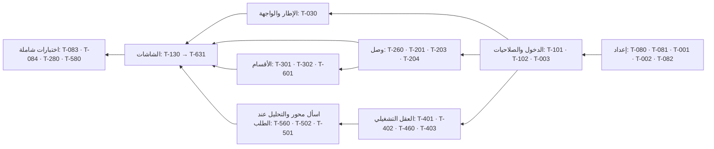

docs/tasks.md

# خطة التطوير (مهام البرمجة)

> **المجموعة 4** · قائمة المهام (T-xx): كتبها المنسق 2026-11-22 من المستندات المعتمدة · «آلية إدارة الكود» (القسم 3): العضو 4 (القائد) 2026-11-07، مع تصحيح أرقام متكررة.
> **المراجع:** `docs/requirements.md` · `docs/mvp-scope.md` (معتمد) · `docs/screens.md` (الإصدار 4) · `docs/api.md` (v0.8) · `docs/database.md` (مدموج) · `docs/ai.md` (v0.3) · `docs/tech-stack.md` (معتمد) · `docs/test-plan.md`.
> **معايير القبول:** كل مهمة فيها أهم معاييرها كمربعات، ومعها أرقام `AC-…` من الملحق «معايير القبول» (`acceptance-criteria.md`) — المهمة ما تُقفل إلا لما تنجح كلها.
> **العدد:** 70 مهمة — Must 56 · Should 10 · Later 4. ⟵ 2026-11-23: أُضيفت T-003 وT-035 (✅ ADR-1003 «حسابي»). نبدأ بـ Must كلها، ثم Should، وLater بعد النسخة الأولى.
> **المرحلة الثانية مستندات فقط:** هذا الملف يُنفَّذ في المرحلة الثالثة. صاحب كل مهمة في دليل مجموعته (`reference/phase-3/المجموعات/`)، والمراجع زميل من نفس المجموعة ثم القائد (✅ Q-4010 · 2026-11-28).

## 1. ترتيب التنفيذ

## 2. قائمة المهام

### الوحدة 0 · عام وإعداد

| ID | المهمة | النوع | MVP | الشاشة | يعتمد على |
|---|---|---|---|---|---|
| T-001 | قاعدة البيانات: الجداول والترحيلات | خلفية | Must | — | T-080 |
| T-002 | قواعد الردود والأخطاء المشتركة في الـ API | خلفية | Must | — | T-080 |
| T-003 | حسابي: تغيير كلمة المرور والكلمة المؤقتة (API) | خلفية | Must | SCR-081 · SCR-160 | T-101 |
| T-030 | الإطار العام للواجهة (RTL والتصميم والحالات الخمس) | واجهة | Must | SCR-001/020/040/060 (الإطار) | T-080، T-101 |
| T-031 | لوحة الموظف | واجهة | Must | SCR-001 | T-030، T-203 |
| T-032 | لوحة مدير القسم | واجهة | Must | SCR-020 | T-030، T-301 |
| T-033 | لوحة الإدارة العليا | واجهة | Must | SCR-040 | T-030، T-403، T-501 |
| T-034 | لوحة مدير النظام | واجهة | Must | SCR-060 | T-030 |
| T-035 | شاشة «حسابي» وبطاقة المستخدم وزر الخروج في القائمة | واجهة | Must | SCR-081 · الإطار | T-030، T-003 |
| T-080 | إعداد المستودع وبيئة التطوير | اختبار وإعداد | Must | — | — |
| T-081 | الفحص التلقائي (CI) للاختبارات والتنسيق | اختبار وإعداد | Must | — | T-080 |
| T-082 | بيانات أولية للاختبار (seed) | اختبار وإعداد | Must | — | T-001 |
| T-083 | اختبار مصفوفة الصلاحيات لكل العمليات | اختبار وإعداد | Must | — | T-102 |
| T-084 | اختبارات التكامل من البداية للنهاية | اختبار وإعداد | Must | كل شاشات MVP | T-230، T-331، T-530، T-440 |

### الوحدة 1 · المستخدمون والصلاحيات

| ID | المهمة | النوع | MVP | الشاشة | يعتمد على |
|---|---|---|---|---|---|
| T-101 | تسجيل الدخول والجلسات | خلفية | Must | SCR-080 | T-001، T-002 |
| T-102 | فحص الصلاحيات على الخادم (الدور والقسم) | خلفية | Must | — | T-101 |
| T-103 | إدارة المستخدمين (API) | خلفية | Must | SCR-160 | T-102 |
| T-104 | الأدوار والصلاحيات (API) | خلفية | Must | SCR-161 | T-102 |
| T-105 | إعدادات النظام (API) | خلفية | Must | SCR-162 | T-102 |
| T-130 | شاشة تسجيل الدخول | واجهة | Must | SCR-080 | T-030، T-101 |
| T-131 | شاشة إدارة المستخدمين | واجهة | Must | SCR-160 | T-030، T-103 |
| T-132 | شاشة الأدوار والصلاحيات | واجهة | Must | SCR-161 | T-030، T-104 |
| T-133 | شاشة إعدادات النظام | واجهة | Should | SCR-162 | T-030، T-105 |

### الوحدة 2 · وصل وطلبات الموظفين

| ID | المهمة | النوع | MVP | الشاشة | يعتمد على |
|---|---|---|---|---|---|
| T-201 | تقديم الطلب (API) | خلفية | Must | SCR-201 | T-102، T-260 |
| T-202 | المرفقات (API) | خلفية | Should | SCR-201 · SCR-203 · SCR-321 | T-201 |
| T-203 | طلباتي وتفاصيل الطلب وسجل الحالة (API) | خلفية | Must | SCR-202 · SCR-203 | T-201 |
| T-204 | تقرير حالة الطلبات (API) | خلفية | Must | SCR-204 · SCR-542 | T-203 |
| T-205 | إغلاق الطلب من الموظف والإغلاق التلقائي (API) | خلفية | Must | SCR-203 | T-203، T-105 |
| T-206 | مراجعة الشكاوى الحساسة (API) | خلفية | Must | SCR-280 | T-260، T-103 |
| T-230 | شاشة تقديم الطلب | واجهة | Must | SCR-201 | T-030، T-201 |
| T-231 | شاشة طلباتي | واجهة | Must | SCR-202 | T-030، T-203 |
| T-232 | شاشة تفاصيل الطلب ومتابعة الحالة | واجهة | Must | SCR-203 | T-030، T-203، T-205 |
| T-233 | شاشة تقرير حالة طلباتي | واجهة | Must | SCR-204 | T-030، T-204 |
| T-234 | شاشة مراجعة الشكاوى الحساسة | واجهة | Must | SCR-280 | T-030، T-206 |
| T-260 | ذكاء وصل: الفهم والتصنيف والأولوية والتوجيه | ذكاء اصطناعي | Must | — | T-001، T-105 |
| T-280 | اختبار جودة ذكاء وصل على 50 طلب | اختبار وإعداد | Must | — | T-260 |

### الوحدة 3 · الأقسام ومعالجة الطلبات

| ID | المهمة | النوع | MVP | الشاشة | يعتمد على |
|---|---|---|---|---|---|
| T-301 | طلبات القسم وموظفوه (API) | خلفية | Must | SCR-320 · SCR-321 | T-203 |
| T-302 | الإسناد وتحديث الحالة (API) | خلفية | Must | SCR-321 | T-301، T-601 |
| T-303 | إدارة الأقسام (API) | خلفية | Must | SCR-360 | T-102 |
| T-304 | إعادة توجيه الطلب لقسم آخر (API) | خلفية | Later | SCR-321 | T-302 |
| T-330 | شاشة طلبات القسم | واجهة | Must | SCR-320 | T-030، T-301 |
| T-331 | شاشة تفاصيل طلب القسم (الإسناد وتحديث الحالة) | واجهة | Must | SCR-321 | T-030، T-302 |
| T-332 | شاشة إدارة الأقسام | واجهة | Must | SCR-360 | T-030، T-303 |

### الوحدة 4 · العقل التشغيلي

| ID | المهمة | النوع | MVP | الشاشة | يعتمد على |
|---|---|---|---|---|---|
| T-401 | بيانات الشركة: الاستيراد وفحص الجودة | خلفية | Must | SCR-060 (Q-4408) | T-102 |
| T-402 | عمليات التحليل وحفظ نتائجها (API) | خلفية | Must | SCR-040 | T-001، T-102 |
| T-403 | عرض نتائج التحليل (API) | خلفية | Must | SCR-040 · SCR-440 → SCR-443 | T-402 |
| T-404 | الحالات الشاذة والاتجاهات (API) | خلفية | Should | SCR-442 · SCR-443 | T-403 |
| T-405 | الفرص (API) | خلفية | Later | SCR-444 | T-403 |
| T-440 | شاشة رؤى الشركة | واجهة | Must | SCR-440 | T-030، T-403 |
| T-441 | شاشة مؤشرات الأداء | واجهة | Must | SCR-441 | T-030، T-403 |
| T-442 | شاشة الأداء التشغيلي | واجهة | Must | SCR-442 | T-030، T-403 |
| T-443 | شاشة المشكلات التشغيلية | واجهة | Must | SCR-443 | T-030، T-403 |
| T-444 | شاشة الفرص المحددة | واجهة | Later | SCR-444 | T-030، T-405 |
| T-460 | محرك التحليل: المؤشرات والاكتشاف والرؤى | ذكاء اصطناعي | Must | — | T-401، T-402 |
| T-461 | التحليل الدوري المجدول | ذكاء اصطناعي | Later | — | T-460 |

### الوحدة 5 · اسأل محور والتقارير والتوصيات

| ID | المهمة | النوع | MVP | الشاشة | يعتمد على |
|---|---|---|---|---|---|
| T-501 | تشغيل التحليل عند الطلب (API) | خلفية | Must | SCR-040 | T-460 |
| T-502 | اسأل محور (API) | خلفية | Must | SCR-580 | T-102، T-560 |
| T-503 | التوصيات (API) | خلفية | Should | SCR-541 | T-403 |
| T-504 | التقارير الإدارية (API) | خلفية | Should | SCR-542 | T-403، T-204 |
| T-530 | شاشة اسأل محور (لكل الأدوار) | واجهة | Must | SCR-580 | T-030، T-502 |
| T-531 | شاشة التوصيات الذكية | واجهة | Should | SCR-541 | T-030، T-503 |
| T-532 | شاشة التقارير الإدارية | واجهة | Should | SCR-542 | T-030، T-504 |
| T-560 | ذكاء اسأل محور: البيانات المسموحة لكل دور والإجابة | ذكاء اصطناعي | Must | — | T-460 |
| T-561 | توليد التوصيات | ذكاء اصطناعي | Should | — | T-460 |
| T-580 | اختبار «اسأل محور» بأسئلة كل دور | اختبار وإعداد | Must | — | T-502 |

### الوحدة 6 · الإشعارات والسجلات

| ID | المهمة | النوع | MVP | الشاشة | يعتمد على |
|---|---|---|---|---|---|
| T-601 | الإشعارات (API) | خلفية | Must | SCR-680 | T-102 |
| T-602 | تسجيل العمليات في سجلات النظام | خلفية | Must | — | T-001 |
| T-603 | عرض سجلات النظام (API) | خلفية | Should | SCR-660 | T-602 |
| T-630 | شاشة الإشعارات | واجهة | Must | SCR-680 | T-030، T-601 |
| T-631 | شاشة سجلات النظام | واجهة | Should | SCR-660 | T-030، T-603 |

## 3. تفاصيل المهام

## T-001 · قاعدة البيانات: الجداول والترحيلات
- Links: — · — · FR-09, FR-39 → FR-44, NFR-06, NFR-07
- Type: خلفية · MVP: Must
- Depends on: T-080
- Owner: حسب دليل المجموعة · Reviewer: زميل من المجموعة + القائد (✅ Q-4010)
- Acceptance criteria:
  - [ ] كل جداول MVP في `docs/database.md` (المرحلة الأولى في §5) تُنشأ من الصفر بالترتيب بدون أخطاء
  - [ ] القيم المسموحة للحالة والأولوية والفئة ونوع الطلب مطابقة لـ `docs/glossary.md`
  - [ ] تنجح معايير الملحق: AC-016 · AC-017 · AC-018 · AC-019 · AC-020
  - [ ] لكل معيار اختبار يبدأ اسمه برقم المهمة (ADR-4007)

## T-002 · قواعد الردود والأخطاء المشتركة في الـ API
- Links: — · كل العمليات · NFR-12, NFR-20
- Type: خلفية · MVP: Must
- Depends on: T-080
- Owner: حسب دليل المجموعة · Reviewer: زميل من المجموعة + القائد (✅ Q-4010)
- Acceptance criteria:
  - [ ] كل خطأ 4xx يرجع `code` بالإنجليزي و`messageAr` بالعربي
  - [ ] القوائم ترجع `items` و`total` و`page` و`pageSize`
  - [ ] تنجح معايير الملحق: AC-005 · AC-006 · AC-007 · AC-008 · AC-015
  - [ ] لكل معيار اختبار يبدأ اسمه برقم المهمة (ADR-4007)

## T-003 · حسابي: تغيير كلمة المرور والكلمة المؤقتة (API)
- Links: SCR-081 · SCR-160 · `changeMyPassword` · `resetUserPassword` · `login` · NFR-01, NFR-05, FR-39, FR-33 · ✅ ADR-1003
- Type: خلفية · MVP: Must
- Depends on: T-101
- Owner: حسب دليل المجموعة · Reviewer: زميل من المجموعة + القائد (✅ Q-4010)
- Acceptance criteria:
  - [ ] المستخدم يغيّر كلمة مروره بالحالية والجديدة، وتنتهي جلساته الثانية، ولا تظهر كلمة المرور في أي رد أو سجل
  - [ ] مدير النظام فقط يعيّن كلمة مؤقتة، وصاحبها ما يقدر يسوي شي غير تغييرها والخروج حتى يغيّرها
  - [ ] تنجح معايير الملحق: AC-125 · AC-126 · AC-127 · AC-128 · AC-129 · AC-130
  - [ ] لكل معيار اختبار يبدأ اسمه برقم المهمة (ADR-4007)

## T-030 · الإطار العام للواجهة (RTL والتصميم والحالات الخمس)
- Links: SCR-001/020/040/060 (الإطار) · `getCurrentUser` · `logout` · `listMyNotifications` · NFR-18, NFR-19, NFR-20
- Type: واجهة · MVP: Must
- Depends on: T-080, T-101
- Owner: حسب دليل المجموعة · Reviewer: زميل من المجموعة + القائد (✅ Q-4010)
- Acceptance criteria:
  - [ ] الواجهة RTL بالكامل وبألوان وخطوط ومكوّنات `docs/design-system.md` فقط
  - [ ] مكوّنات جاهزة للحالات الخمس (loading · success · error · empty · no-permission) تستخدمها كل الشاشات
  - [ ] القائمة تعرض فقط ما يسمح به دور المستخدم
  - [ ] تنجح معايير الملحق: AC-009 · AC-010 · AC-011 · AC-013 · AC-014
  - [ ] لكل معيار اختبار يبدأ اسمه برقم المهمة (ADR-4007)

## T-031 · لوحة الموظف
- Links: SCR-001 · `listMyRequests` · `listMyNotifications` · FR-03, FR-04, NFR-19
- Type: واجهة · MVP: Must
- Depends on: T-030, T-203
- Owner: حسب دليل المجموعة · Reviewer: زميل من المجموعة + القائد (✅ Q-4010)
- Acceptance criteria:
  - [ ] الملخص حسب الحالة يطابق `listMyRequests`
  - [ ] روابط تقديم طلب وطلباتي والإشعارات و«اسأل محور» (SCR-580) تعمل
  - [ ] تنجح معايير الملحق: AC-218 · AC-012
  - [ ] لكل معيار اختبار يبدأ اسمه برقم المهمة (ADR-4007)

## T-032 · لوحة مدير القسم
- Links: SCR-020 · `listDepartmentRequests` · FR-12, NFR-03, NFR-19
- Type: واجهة · MVP: Must
- Depends on: T-030, T-301
- Owner: حسب دليل المجموعة · Reviewer: زميل من المجموعة + القائد (✅ Q-4010)
- Acceptance criteria:
  - [ ] تعرض ملخص طلبات قسم المدير فقط
  - [ ] روابط طلبات القسم والإشعارات و«اسأل محور» تعمل
  - [ ] تنجح معايير الملحق: AC-009
  - [ ] لكل معيار اختبار يبدأ اسمه برقم المهمة (ADR-4007)

## T-033 · لوحة الإدارة العليا
- Links: SCR-040 · `listKpis` · `listInsights` · `listDetectedIssues` · `listAnalysisRuns` · `runAnalysis` · FR-16, FR-18, FR-21, FR-32, NFR-19
- Type: واجهة · MVP: Must
- Depends on: T-030, T-403, T-501
- Owner: حسب دليل المجموعة · Reviewer: زميل من المجموعة + القائد (✅ Q-4010)
- Acceptance criteria:
  - [ ] تعرض أبرز الرؤى والمؤشرات والمشكلات وتاريخ آخر تحليل
  - [ ] زر «تشغيل التحليل» وآخر التشغيلات داخل اللوحة (مقترح Q-4408)
  - [ ] فشل قسم واحد في اللوحة لا يمنع بقية الأقسام
  - [ ] تنجح معايير الملحق: AC-402 · AC-403
  - [ ] لكل معيار اختبار يبدأ اسمه برقم المهمة (ADR-4007)

## T-034 · لوحة مدير النظام
- Links: SCR-060 · `getCurrentUser` · NFR-04, NFR-19
- Type: واجهة · MVP: Must
- Depends on: T-030
- Owner: حسب دليل المجموعة · Reviewer: زميل من المجموعة + القائد (✅ Q-4010)
- Acceptance criteria:
  - [ ] تنقل لشاشات الإدارة الخمس و«اسأل محور»
  - [ ] غير مدير النظام يرى «لا تملك صلاحية هذه الصفحة»
  - [ ] تنجح معايير الملحق: AC-009
  - [ ] لكل معيار اختبار يبدأ اسمه برقم المهمة (ADR-4007)

## T-035 · شاشة «حسابي» وبطاقة المستخدم وزر الخروج في القائمة
- Links: SCR-081 · الإطار (SCR-001/020/040/060) · `getCurrentUser` · `changeMyPassword` · `logout` · FR-39, NFR-01, NFR-05 · ✅ ADR-1003
- Type: واجهة · MVP: Must
- Depends on: T-030, T-003
- Owner: حسب دليل المجموعة · Reviewer: زميل من المجموعة + القائد (✅ Q-4010)
- Acceptance criteria:
  - [ ] بطاقة المستخدم (الاسم والدور) وزر «تسجيل الخروج» أسفل القائمة الجانبية لكل الأدوار، وفي القائمة المخفية تبقى الأيقونات
  - [ ] SCR-081 تعرض بيانات الحساب للقراءة فقط، ونموذج تغيير كلمة المرور يتحقق من تطابق الكلمتين قبل الإرسال
  - [ ] من دخل بكلمة مؤقتة يتوجّه إلى SCR-081 ولا يفتح غيرها حتى يغيّرها
  - [ ] الحالات الخمس ظاهرة
  - [ ] تنجح معايير الملحق: AC-009 · AC-107 · AC-131
  - [ ] لكل معيار اختبار يبدأ اسمه برقم المهمة (ADR-4007)

## T-080 · إعداد المستودع وبيئة التطوير
- Links: — · — · NFR-21, NFR-23
- Type: اختبار وإعداد · MVP: Must
- Depends on: —
- Owner: حسب دليل المجموعة · Reviewer: زميل من المجموعة + القائد (✅ Q-4010)
- Acceptance criteria:
  - [ ] المستودع فيه مجلد للواجهة (Next.js) ومجلد للخادم (NestJS) حسب ADR-3001 وADR-3002، ويشتغلان محليًا بأمر واحد عبر Docker (ADR-3007)
  - [ ] أوامر التثبيت والتشغيل والاختبار مكتوبة في `CLAUDE.md` (قسم Commands)
  - [ ] لا توجد كلمات سر أو مفاتيح في المستودع، والإعدادات من متغيرات البيئة (NFR-05)
  - [ ] لكل معيار اختبار يبدأ اسمه برقم المهمة (ADR-4007)

## T-081 · الفحص التلقائي (CI) للاختبارات والتنسيق
- Links: — · — · NFR-21
- Type: اختبار وإعداد · MVP: Must
- Depends on: T-080
- Owner: حسب دليل المجموعة · Reviewer: زميل من المجموعة + القائد (✅ Q-4010)
- Acceptance criteria:
  - [ ] كل Pull Request يشغّل الاختبارات والتنسيق تلقائيًا، والفشل يمنع الدمج
  - [ ] `main` محمي ولا يقبل رفعًا مباشرًا (ADR-4008)
  - [ ] لكل معيار اختبار يبدأ اسمه برقم المهمة (ADR-4007)

## T-082 · بيانات أولية للاختبار (seed)
- Links: — · — · NFR-02
- Type: اختبار وإعداد · MVP: Must
- Depends on: T-001
- Owner: حسب دليل المجموعة · Reviewer: زميل من المجموعة + القائد (✅ Q-4010)
- Acceptance criteria:
  - [ ] مستخدم اختبار لكل دور، وقسمان على الأقل، وطلبات بكل الحالات، وبيانات شركة اختبارية ثابتة
  - [ ] الأقسام الأربعة وجدول ربط التصنيفات الـ 13 بالأقسام محمّلة (ADR-4201)
  - [ ] تنجح معايير الملحق: AC-020
  - [ ] لكل معيار اختبار يبدأ اسمه برقم المهمة (ADR-4007)

## T-083 · اختبار مصفوفة الصلاحيات لكل العمليات
- Links: — · كل العمليات · NFR-02, NFR-03, NFR-04
- Type: اختبار وإعداد · MVP: Must
- Depends on: T-102
- Owner: حسب دليل المجموعة · Reviewer: زميل من المجموعة + القائد (✅ Q-4010)
- Acceptance criteria:
  - [ ] كل عملية × كل دور تعطي النتيجة المتوقعة في جدول الصلاحيات (`docs/test-plan.md` 4.1)
  - [ ] تنجح معايير الملحق: AC-001 · AC-002 · AC-303 · AC-124
  - [ ] لكل معيار اختبار يبدأ اسمه برقم المهمة (ADR-4007)

## T-084 · اختبارات التكامل من البداية للنهاية
- Links: كل شاشات MVP · — · FR-01 → FR-17
- Type: اختبار وإعداد · MVP: Must
- Depends on: T-230, T-331, T-530, T-440
- Owner: حسب دليل المجموعة · Reviewer: زميل من المجموعة + القائد (✅ Q-4010)
- Acceptance criteria:
  - [ ] سيناريو كامل: موظف يرسل طلب ← يتوجّه ← المدير يسنده ويحدّثه ← الموظف يستلم إشعار ← الإدارة العليا تشوف أثره في التحليل
  - [ ] سيناريوهات INT في `docs/test-plan.md` 4.6 تنجح
  - [ ] تنجح معايير الملحق: AC-021 · AC-022 · AC-023
  - [ ] لكل معيار اختبار يبدأ اسمه برقم المهمة (ADR-4007)

## T-101 · تسجيل الدخول والجلسات
- Links: SCR-080 · `login` · `logout` · `getCurrentUser` · NFR-01, NFR-05, FR-39
- Type: خلفية · MVP: Must
- Depends on: T-001, T-002
- Owner: حسب دليل المجموعة · Reviewer: زميل من المجموعة + القائد (✅ Q-4010)
- Acceptance criteria:
  - [ ] دخول صحيح يفتح جلسة آمنة داخل الخادم (ADR-3004)، وخطأ البريد أو كلمة المرور يرجع رسالة واحدة
  - [ ] كلمات المرور محفوظة مشفّرة ولا تظهر في أي رد أو سجل
  - [ ] تنجح معايير الملحق: AC-001 · AC-003 · AC-101 · AC-102 · AC-103 · AC-104 · AC-105 · AC-106 · AC-107 · AC-108 · AC-109
  - [ ] لكل معيار اختبار يبدأ اسمه برقم المهمة (ADR-4007)

## T-102 · فحص الصلاحيات على الخادم (الدور والقسم)
- Links: — · كل العمليات · NFR-02, NFR-03, NFR-04, FR-35
- Type: خلفية · MVP: Must
- Depends on: T-101
- Owner: حسب دليل المجموعة · Reviewer: زميل من المجموعة + القائد (✅ Q-4010)
- Acceptance criteria:
  - [ ] كل عملية تفحص الدور من `role_permissions` قبل التنفيذ (ADR-3101)
  - [ ] قسم المدير يُؤخذ من الجلسة لا من الرابط (ADR-4002)، وطلب قسم آخر يرجع 403
  - [ ] تنجح معايير الملحق: AC-002 · AC-011 · AC-120 · AC-124 · AC-303
  - [ ] لكل معيار اختبار يبدأ اسمه برقم المهمة (ADR-4007)

## T-103 · إدارة المستخدمين (API)
- Links: SCR-160 · `listUsers` · `createUser` · `getUser` · `updateUser` · `deactivateUser` · FR-33, FR-39, NFR-04
- Type: خلفية · MVP: Must
- Depends on: T-102
- Owner: حسب دليل المجموعة · Reviewer: زميل من المجموعة + القائد (✅ Q-4010)
- Acceptance criteria:
  - [ ] لا حذف للمستخدم، إيقاف فقط (ADR-4001)
  - [ ] مدير القسم لازم يكون له قسم
  - [ ] مدير النظام يقدر يعطي صلاحية «مراجعة الحساس» لشخص معيّن (`reviewSensitive` — ✅ Q-3204)
  - [ ] تنجح معايير الملحق: AC-110 · AC-111 · AC-112 · AC-113 · AC-114 · AC-115 · AC-116
  - [ ] لكل معيار اختبار يبدأ اسمه برقم المهمة (ADR-4007)

## T-104 · الأدوار والصلاحيات (API)
- Links: SCR-161 · `listRoles` · `listPermissions` · `updateRolePermissions` · FR-35, NFR-04
- Type: خلفية · MVP: Must
- Depends on: T-102
- Owner: حسب دليل المجموعة · Reviewer: زميل من المجموعة + القائد (✅ Q-4010)
- Acceptance criteria:
  - [ ] الأدوار الأربعة ثابتة، وتعديل صلاحيات دور يسري على الخادم مباشرة
  - [ ] تنجح معايير الملحق: AC-117 · AC-118 · AC-119 · AC-120
  - [ ] لكل معيار اختبار يبدأ اسمه برقم المهمة (ADR-4007)

## T-105 · إعدادات النظام (API)
- Links: SCR-162 · `listSettings` · `updateSetting` · FR-36, NFR-23
- Type: خلفية · MVP: Must
- Depends on: T-102
- Owner: حسب دليل المجموعة · Reviewer: زميل من المجموعة + القائد (✅ Q-4010)
- Acceptance criteria:
  - [ ] حدود الثقة (0.85 و0.60) وقسم الاستقبال الافتراضي وجدول ربط التصنيف بالقسم إعدادات يعدّلها مدير النظام
  - [ ] الخلفية Must لأن ذكاء وصل يعتمد عليها؛ الشاشة SCR-162 Should (T-133)
  - [ ] تنجح معايير الملحق: AC-121 · AC-122 · AC-123
  - [ ] لكل معيار اختبار يبدأ اسمه برقم المهمة (ADR-4007)

## T-130 · شاشة تسجيل الدخول
- Links: SCR-080 · `login` · NFR-01
- Type: واجهة · MVP: Must
- Depends on: T-030, T-101
- Owner: حسب دليل المجموعة · Reviewer: زميل من المجموعة + القائد (✅ Q-4010)
- Acceptance criteria:
  - [ ] بعد الدخول يتوجّه كل دور للوحته: SCR-001 · SCR-020 · SCR-040 · SCR-060
  - [ ] الحالات الخمس ظاهرة
  - [ ] تنجح معايير الملحق: AC-009 · AC-101 · AC-102
  - [ ] لكل معيار اختبار يبدأ اسمه برقم المهمة (ADR-4007)

## T-131 · شاشة إدارة المستخدمين
- Links: SCR-160 · عمليات T-103 · `resetUserPassword` · FR-33, FR-39
- Type: واجهة · MVP: Must
- Depends on: T-030, T-103, T-003
- Owner: حسب دليل المجموعة · Reviewer: زميل من المجموعة + القائد (✅ Q-4010)
- Acceptance criteria:
  - [ ] إضافة وتعديل مستخدم نوافذ داخل الشاشة (ADR-1101)، والإيقاف بتأكيد
  - [ ] زر «تعيين كلمة مرور مؤقتة» بتأكيد (✅ ADR-1003 · `resetUserPassword` من T-003) ⟵ أُضيف بقرار المنسق 2026-11-23
  - [ ] تنجح معايير الملحق: AC-009 · AC-110 · AC-129
  - [ ] لكل معيار اختبار يبدأ اسمه برقم المهمة (ADR-4007)

## T-132 · شاشة الأدوار والصلاحيات
- Links: SCR-161 · عمليات T-104 · FR-35
- Type: واجهة · MVP: Must
- Depends on: T-030, T-104
- Owner: حسب دليل المجموعة · Reviewer: زميل من المجموعة + القائد (✅ Q-4010)
- Acceptance criteria:
  - [ ] عرض وتعديل صلاحيات كل دور مع تأكيد قبل الحفظ
  - [ ] تنجح معايير الملحق: AC-009 · AC-118 · AC-119
  - [ ] لكل معيار اختبار يبدأ اسمه برقم المهمة (ADR-4007)

## T-133 · شاشة إعدادات النظام
- Links: SCR-162 · `listSettings` · `updateSetting` · FR-36
- Type: واجهة · MVP: Should
- Depends on: T-030, T-105
- Owner: حسب دليل المجموعة · Reviewer: زميل من المجموعة + القائد (✅ Q-4010)
- Acceptance criteria:
  - [ ] تعديل قيمة إعداد مع تأكيد، وقيمة بصيغة خاطئة ترجع رسالة عربية واضحة
  - [ ] تنجح معايير الملحق: AC-009 · AC-122
  - [ ] لكل معيار اختبار يبدأ اسمه برقم المهمة (ADR-4007)

## T-201 · تقديم الطلب (API)
- Links: SCR-201 · `createRequest` · FR-01, FR-06 → FR-09, FR-40
- Type: خلفية · MVP: Must
- Depends on: T-102, T-260
- Owner: حسب دليل المجموعة · Reviewer: زميل من المجموعة + القائد (✅ Q-4010)
- Acceptance criteria:
  - [ ] الموظف يرسل وصفًا ويُحفظ الطلب بحالة `new` («جديد») مع قرار الذكاء الاصطناعي وأول سطر في سجل الحالة في عملية واحدة
  - [ ] وصف فارغ يرجع 400 ولا يُنشأ طلب
  - [ ] تنجح معايير الملحق: AC-201 · AC-202 · AC-204 · AC-205 · AC-206 · AC-207 · AC-208 · AC-209 · AC-210
  - [ ] لكل معيار اختبار يبدأ اسمه برقم المهمة (ADR-4007)

## T-202 · المرفقات (API)
- Links: SCR-201 · SCR-203 · SCR-321 · `uploadRequestDocument` · `downloadRequestDocument` · FR-02, FR-10, NFR-05
- Type: خلفية · MVP: Should
- Depends on: T-201
- Owner: حسب دليل المجموعة · Reviewer: زميل من المجموعة + القائد (✅ Q-4010)
- Acceptance criteria:
  - [ ] الملفات في تخزين متوافق مع S3 وتنزل بروابط مؤقتة بعد فحص الصلاحية (ADR-3005)
  - [ ] تنجح معايير الملحق: AC-211 · AC-212
  - [ ] لكل معيار اختبار يبدأ اسمه برقم المهمة (ADR-4007)

## T-203 · طلباتي وتفاصيل الطلب وسجل الحالة (API)
- Links: SCR-202 · SCR-203 · `listMyRequests` · `getRequest` · `getRequestHistory` · FR-03, NFR-08, NFR-20
- Type: خلفية · MVP: Must
- Depends on: T-201
- Owner: حسب دليل المجموعة · Reviewer: زميل من المجموعة + القائد (✅ Q-4010)
- Acceptance criteria:
  - [ ] الموظف يرى طلباته فقط، ولا يرى الأولوية ولا المعالج ولا قرار الذكاء الاصطناعي
  - [ ] تنجح معايير الملحق: AC-213 · AC-214 · AC-215 · AC-216 · AC-217
  - [ ] لكل معيار اختبار يبدأ اسمه برقم المهمة (ADR-4007)

## T-204 · تقرير حالة الطلبات (API)
- Links: SCR-204 · SCR-542 · `getRequestStatusReport` · FR-05
- Type: خلفية · MVP: Must
- Depends on: T-203
- Owner: حسب دليل المجموعة · Reviewer: زميل من المجموعة + القائد (✅ Q-4010)
- Acceptance criteria:
  - [ ] الموظف يرى أعداد طلباته حسب الحالة، والإدارة العليا أعداد كل الأقسام بدون نصوص (✅ Q-08 · ADR-1204)
  - [ ] تنجح معايير الملحق: AC-219
  - [ ] لكل معيار اختبار يبدأ اسمه برقم المهمة (ADR-4007)

## T-205 · إغلاق الطلب من الموظف والإغلاق التلقائي (API)
- Links: SCR-203 · `closeRequest` · FR-15, FR-03, NFR-08
- Type: خلفية · MVP: Must
- Depends on: T-203, T-105
- Owner: حسب دليل المجموعة · Reviewer: زميل من المجموعة + القائد (✅ Q-4010)
- Acceptance criteria:
  - [ ] الموظف يقفل طلبه بعد الحل (`resolved` ← `closed`) مع سطر في سجل الحالة (✅ Q-1201)
  - [ ] مهمة خلفية يومية تقفل الطلب بعد `auto_close_days` (إعداد، مقترح 3 أيام عمل)
  - [ ] تنجح معايير الملحق: AC-235 · AC-236
  - [ ] لكل معيار اختبار يبدأ اسمه برقم المهمة (ADR-4007)

## T-206 · مراجعة الشكاوى الحساسة (API)
- Links: SCR-280 · `listSensitiveRequests` · `releaseSensitiveRequest` · FR-08, FR-13, NFR-02
- Type: خلفية · MVP: Must
- Depends on: T-260, T-103
- Owner: حسب دليل المجموعة · Reviewer: زميل من المجموعة + القائد (✅ Q-4010)
- Acceptance criteria:
  - [ ] فقط صاحب `users.review_sensitive = true` يشوف الشكاوى الحساسة ويحوّلها (✅ Q-3204)
  - [ ] الشكوى على مدير ما تظهر له وما تتحول لقسمه (ADR-4203)
  - [ ] تنجح معايير الملحق: AC-237 · AC-238 · AC-239
  - [ ] لكل معيار اختبار يبدأ اسمه برقم المهمة (ADR-4007)

## T-230 · شاشة تقديم الطلب
- Links: SCR-201 · `createRequest` · FR-01, FR-02
- Type: واجهة · MVP: Must
- Depends on: T-030, T-201
- Owner: حسب دليل المجموعة · Reviewer: زميل من المجموعة + القائد (✅ Q-4010)
- Acceptance criteria:
  - [ ] الموظف يرسل طلبًا بالوصف فقط (بدون اختيار قسم أو فئة)، ويظهر في «طلباتي» بحالة «جديد»
  - [ ] رسالة خطأ واضحة لو الوصف فاضي، والنص ما يضيع
  - [ ] السؤال التوضيحي يظهر لو الطلب غامض
  - [ ] تنجح معايير الملحق: AC-009 · AC-201 · AC-202 · AC-203
  - [ ] لكل معيار اختبار يبدأ اسمه برقم المهمة (ADR-4007)

## T-231 · شاشة طلباتي
- Links: SCR-202 · `listMyRequests` · FR-03
- Type: واجهة · MVP: Must
- Depends on: T-030, T-203
- Owner: حسب دليل المجموعة · Reviewer: زميل من المجموعة + القائد (✅ Q-4010)
- Acceptance criteria:
  - [ ] القائمة بطلبات الموظف نفسه مع التصفية حسب الحالة
  - [ ] تنجح معايير الملحق: AC-009 · AC-213
  - [ ] لكل معيار اختبار يبدأ اسمه برقم المهمة (ADR-4007)

## T-232 · شاشة تفاصيل الطلب ومتابعة الحالة
- Links: SCR-203 · `getRequest` · `getRequestHistory` · FR-03, FR-02
- Type: واجهة · MVP: Must
- Depends on: T-030, T-203, T-205
- Owner: حسب دليل المجموعة · Reviewer: زميل من المجموعة + القائد (✅ Q-4010)
- Acceptance criteria:
  - [ ] الخط الزمني للحالة ظاهر، وطلب موظف آخر يرجع رسالة منع
  - [ ] زر «تأكيد الحل وإغلاق الطلب» يظهر لما تكون الحالة «مكتمل» (✅ Q-1201)
  - [ ] تنجح معايير الملحق: AC-009 · AC-214 · AC-215 · AC-216 · AC-235
  - [ ] لكل معيار اختبار يبدأ اسمه برقم المهمة (ADR-4007)

## T-233 · شاشة تقرير حالة طلباتي
- Links: SCR-204 · `getRequestStatusReport` · FR-05
- Type: واجهة · MVP: Must
- Depends on: T-030, T-204
- Owner: حسب دليل المجموعة · Reviewer: زميل من المجموعة + القائد (✅ Q-4010)
- Acceptance criteria:
  - [ ] اختيار الفترة يعرض الأعداد حسب الحالة، وشكل التنزيل حسب Q-1206
  - [ ] تنجح معايير الملحق: AC-009 · AC-219
  - [ ] لكل معيار اختبار يبدأ اسمه برقم المهمة (ADR-4007)

## T-234 · شاشة مراجعة الشكاوى الحساسة
- Links: SCR-280 · `listSensitiveRequests` · `releaseSensitiveRequest` · `getRequest` · FR-08, FR-13
- Type: واجهة · MVP: Must
- Depends on: T-030, T-206
- Owner: حسب دليل المجموعة · Reviewer: زميل من المجموعة + القائد (✅ Q-4010)
- Acceptance criteria:
  - [ ] الرابط يظهر في لوحة المستخدم إذا عنده الصلاحية فقط
  - [ ] تحويل الشكوى لقسم مع ملاحظة وتأكيد قبل الحفظ
  - [ ] تنجح معايير الملحق: AC-009 · AC-237
  - [ ] لكل معيار اختبار يبدأ اسمه برقم المهمة (ADR-4007)

## T-260 · ذكاء وصل: الفهم والتصنيف والأولوية والتوجيه
- Links: — · (داخل `createRequest`) · FR-06, FR-07, FR-08, NFR-10, NFR-24
- Type: ذكاء اصطناعي · MVP: Must
- Depends on: T-001, T-105
- Owner: حسب دليل المجموعة · Reviewer: زميل من المجموعة + القائد (✅ Q-4010)
- Acceptance criteria:
  - [ ] المخرج منظم: النوع والتصنيف (13) والأولوية (4 درجات) والقرار والثقة، والقسم من جدول الربط لا من النموذج (ADR-4201)
  - [ ] قواعد الثقة: 0.85 فأعلى توجيه تلقائي · 0.60 إلى 0.85 توجيه مع علامة مراجعة · أقل من 0.60 سؤال توضيحي واحد (ADR-4202)
  - [ ] الشكوى الحساسة مراجعة بشرية دائمًا، والشكوى عن المدير ما تروح له (ADR-4203)
  - [ ] لا يُرسل للنموذج اسم الموظف ولا رقمه
  - [ ] تنجح معايير الملحق: AC-203 · AC-220 · AC-221 · AC-222 · AC-223 · AC-224 · AC-225 · AC-229 · AC-230 · AC-231 · AC-233 · AC-234
  - [ ] لكل معيار اختبار يبدأ اسمه برقم المهمة (ADR-4007)

## T-280 · اختبار جودة ذكاء وصل على 50 طلب
- Links: — · — · FR-06, FR-07, FR-08, NFR-10
- Type: اختبار وإعداد · MVP: Must
- Depends on: T-260
- Owner: حسب دليل المجموعة · Reviewer: زميل من المجموعة + القائد (✅ Q-4010)
- Acceptance criteria:
  - [ ] دقة التصنيف 85٪ فأكثر · القسم 90٪ · الأولوية 75٪ · مراجعة الحساس 100٪ (`docs/ai.md` 5.1)
  - [ ] زمن التصنيف لا يتجاوز 5 ثوانٍ (مقترح)
  - [ ] تنجح معايير الملحق: AC-226 · AC-227 · AC-228
  - [ ] لكل معيار اختبار يبدأ اسمه برقم المهمة (ADR-4007)

## T-301 · طلبات القسم وموظفوه (API)
- Links: SCR-320 · SCR-321 · `listDepartmentRequests` · `listDepartmentMembers` · `getRequest` · FR-12, NFR-03
- Type: خلفية · MVP: Must
- Depends on: T-203
- Owner: حسب دليل المجموعة · Reviewer: زميل من المجموعة + القائد (✅ Q-4010)
- Acceptance criteria:
  - [ ] المدير يرى طلبات قسمه فقط، والطلبات الحساسة لا تظهر له قبل مراجعتها
  - [ ] تنجح معايير الملحق: AC-232 · AC-301 · AC-302 · AC-303 · AC-304 · AC-305 · AC-307
  - [ ] لكل معيار اختبار يبدأ اسمه برقم المهمة (ADR-4007)

## T-302 · الإسناد وتحديث الحالة (API)
- Links: SCR-321 · `assignRequest` · `updateRequestStatus` · FR-13, FR-14, FR-15, FR-11
- Type: خلفية · MVP: Must
- Depends on: T-301, T-601
- Owner: حسب دليل المجموعة · Reviewer: زميل من المجموعة + القائد (✅ Q-4010)
- Acceptance criteria:
  - [ ] المدير يسند لنفسه أو لموظف من قسمه (✅ Q-09)
  - [ ] كل تغيير حالة يكتب سطرًا في سجل الحالة ويرسل إشعارًا للموظف في عملية واحدة
  - [ ] تنجح معايير الملحق: AC-308 · AC-309 · AC-310 · AC-311 · AC-312 · AC-313 · AC-314 · AC-315
  - [ ] لكل معيار اختبار يبدأ اسمه برقم المهمة (ADR-4007)

## T-303 · إدارة الأقسام (API)
- Links: SCR-360 · `listDepartments` · `createDepartment` · `updateDepartment` · `deactivateDepartment` · FR-34, NFR-04
- Type: خلفية · MVP: Must
- Depends on: T-102
- Owner: حسب دليل المجموعة · Reviewer: زميل من المجموعة + القائد (✅ Q-4010)
- Acceptance criteria:
  - [ ] لا حذف للقسم، إيقاف فقط (ADR-4001)
  - [ ] تنجح معايير الملحق: AC-317 · AC-318 · AC-319 · AC-320 · AC-321
  - [ ] لكل معيار اختبار يبدأ اسمه برقم المهمة (ADR-4007)

## T-304 · إعادة توجيه الطلب لقسم آخر (API)
- Links: SCR-321 · `rerouteRequest` · — (Q-4202 · Q-4301)
- Type: خلفية · MVP: Later
- Depends on: T-302
- Owner: حسب دليل المجموعة · Reviewer: زميل من المجموعة + القائد (✅ Q-4010)
- Acceptance criteria:
  - [ ] إعادة التوجيه تفرّغ الإسناد (ADR-4205) — بعد اعتماد Q-4301
  - [ ] تنجح معايير الملحق: AC-316
  - [ ] لكل معيار اختبار يبدأ اسمه برقم المهمة (ADR-4007)

## T-330 · شاشة طلبات القسم
- Links: SCR-320 · `listDepartmentRequests` · FR-12, NFR-03
- Type: واجهة · MVP: Must
- Depends on: T-030, T-301
- Owner: حسب دليل المجموعة · Reviewer: زميل من المجموعة + القائد (✅ Q-4010)
- Acceptance criteria:
  - [ ] التصفية حسب الحالة والأولوية و«غير مسند» تعمل
  - [ ] تنجح معايير الملحق: AC-009 · AC-301 · AC-302
  - [ ] لكل معيار اختبار يبدأ اسمه برقم المهمة (ADR-4007)

## T-331 · شاشة تفاصيل طلب القسم (الإسناد وتحديث الحالة)
- Links: SCR-321 · `getRequest` · `listDepartmentMembers` · `assignRequest` · `updateRequestStatus` · FR-12 → FR-15
- Type: واجهة · MVP: Must
- Depends on: T-030, T-302
- Owner: حسب دليل المجموعة · Reviewer: زميل من المجموعة + القائد (✅ Q-4010)
- Acceptance criteria:
  - [ ] الإسناد وتحديث الحالة داخل الشاشة نفسها مع تأكيد قبل الحفظ (ADR-1301)
  - [ ] تنجح معايير الملحق: AC-009 · AC-306 · AC-308 · AC-311
  - [ ] لكل معيار اختبار يبدأ اسمه برقم المهمة (ADR-4007)

## T-332 · شاشة إدارة الأقسام
- Links: SCR-360 · عمليات T-303 · FR-34
- Type: واجهة · MVP: Must
- Depends on: T-030, T-303
- Owner: حسب دليل المجموعة · Reviewer: زميل من المجموعة + القائد (✅ Q-4010)
- Acceptance criteria:
  - [ ] إضافة وتعديل قسم نوافذ داخل الشاشة، والإيقاف بتأكيد
  - [ ] تنجح معايير الملحق: AC-009 · AC-317
  - [ ] لكل معيار اختبار يبدأ اسمه برقم المهمة (ADR-4007)

## T-401 · بيانات الشركة: الاستيراد وفحص الجودة
- Links: SCR-060 (Q-4408) · `importCompanyData` · FR-42, FR-24, NFR-05
- Type: خلفية · MVP: Must
- Depends on: T-102
- Owner: حسب دليل المجموعة · Reviewer: زميل من المجموعة + القائد (✅ Q-4010)
- Acceptance criteria:
  - [ ] ملف بيانات صحيح يُستورد وتُرجع أعداد الصفوف المقبولة والمرفوضة
  - [ ] بيانات الشركة يقرؤها محرك التحليل فقط
  - [ ] تنجح معايير الملحق: AC-418 · AC-424 · AC-425
  - [ ] لكل معيار اختبار يبدأ اسمه برقم المهمة (ADR-4007)

## T-402 · عمليات التحليل وحفظ نتائجها (API)
- Links: SCR-040 · `listAnalysisRuns` · `getAnalysisRun` · FR-29, FR-30, FR-43, NFR-25
- Type: خلفية · MVP: Must
- Depends on: T-001, T-102
- Owner: حسب دليل المجموعة · Reviewer: زميل من المجموعة + القائد (✅ Q-4010)
- Acceptance criteria:
  - [ ] كل تشغيل يحفظ نوعه ووقت بدئه وانتهائه وحالته والبيانات اللي استخدمها
  - [ ] نتائج التشغيل المكتمل لا تتغير
  - [ ] تنجح معايير الملحق: AC-411 · AC-412 · AC-413 · AC-414 · AC-415
  - [ ] لكل معيار اختبار يبدأ اسمه برقم المهمة (ADR-4007)

## T-403 · عرض نتائج التحليل (API)
- Links: SCR-040 · SCR-440 → SCR-443 · `listInsights` · `getInsight` · `listKpis` · `getOperationalPerformance` · `listDetectedIssues` · `getDetectedIssue` · FR-16, FR-18, FR-20, FR-21, NFR-25, NFR-27
- Type: خلفية · MVP: Must
- Depends on: T-402
- Owner: حسب دليل المجموعة · Reviewer: زميل من المجموعة + القائد (✅ Q-4010)
- Acceptance criteria:
  - [ ] كل نتيجة ترجع مع كائن `analysis` (المصدر وتاريخ التحليل ورقم التشغيل)
  - [ ] المؤشرات من جدول `kpi_results` (✅ ADR-3405)
  - [ ] تنجح معايير الملحق: AC-401 · AC-402 · AC-403 · AC-404 · AC-405 · AC-406 · AC-408 · AC-409
  - [ ] لكل معيار اختبار يبدأ اسمه برقم المهمة (ADR-4007)

## T-404 · الحالات الشاذة والاتجاهات (API)
- Links: SCR-442 · SCR-443 · `listAnomalies` · `listTrends` · FR-26, FR-27
- Type: خلفية · MVP: Should
- Depends on: T-403
- Owner: حسب دليل المجموعة · Reviewer: زميل من المجموعة + القائد (✅ Q-4010)
- Acceptance criteria:
  - [ ] تعمل بنفس حقول وصلاحيات بقية النتائج
  - [ ] تنجح معايير الملحق: AC-410
  - [ ] لكل معيار اختبار يبدأ اسمه برقم المهمة (ADR-4007)

## T-405 · الفرص (API)
- Links: SCR-444 · `listOpportunities` · FR-22
- Type: خلفية · MVP: Later
- Depends on: T-403
- Owner: حسب دليل المجموعة · Reviewer: زميل من المجموعة + القائد (✅ Q-4010)
- Acceptance criteria:
  - [ ] تعمل بنفس حقول وصلاحيات بقية النتائج
  - [ ] تنجح معايير الملحق: AC-410
  - [ ] لكل معيار اختبار يبدأ اسمه برقم المهمة (ADR-4007)

## T-440 · شاشة رؤى الشركة
- Links: SCR-440 · `listInsights` · `getInsight` · FR-16, FR-28
- Type: واجهة · MVP: Must
- Depends on: T-030, T-403
- Owner: حسب دليل المجموعة · Reviewer: زميل من المجموعة + القائد (✅ Q-4010)
- Acceptance criteria:
  - [ ] كل رؤية تعرض مصدرها وتاريخ تحليلها
  - [ ] تنجح معايير الملحق: AC-009 · AC-402 · AC-405
  - [ ] لكل معيار اختبار يبدأ اسمه برقم المهمة (ADR-4007)

## T-441 · شاشة مؤشرات الأداء
- Links: SCR-441 · `listKpis` · FR-18
- Type: واجهة · MVP: Must
- Depends on: T-030, T-403
- Owner: حسب دليل المجموعة · Reviewer: زميل من المجموعة + القائد (✅ Q-4010)
- Acceptance criteria:
  - [ ] آخر قيمة لكل مؤشر مع التغير عن السابقة ومصدرها
  - [ ] تنجح معايير الملحق: AC-009 · AC-406
  - [ ] لكل معيار اختبار يبدأ اسمه برقم المهمة (ADR-4007)

## T-442 · شاشة الأداء التشغيلي
- Links: SCR-442 · `getOperationalPerformance` · FR-20
- Type: واجهة · MVP: Must
- Depends on: T-030, T-403
- Owner: حسب دليل المجموعة · Reviewer: زميل من المجموعة + القائد (✅ Q-4010)
- Acceptance criteria:
  - [ ] عرض المؤشرات عبر الفترات، والاتجاهات تُضاف مع T-404
  - [ ] تنجح معايير الملحق: AC-009 · AC-408
  - [ ] لكل معيار اختبار يبدأ اسمه برقم المهمة (ADR-4007)

## T-443 · شاشة المشكلات التشغيلية
- Links: SCR-443 · `listDetectedIssues` · `getDetectedIssue` · FR-21
- Type: واجهة · MVP: Must
- Depends on: T-030, T-403
- Owner: حسب دليل المجموعة · Reviewer: زميل من المجموعة + القائد (✅ Q-4010)
- Acceptance criteria:
  - [ ] الترتيب بالخطورة ثم الأحدث، والشذوذ يُضاف مع T-404
  - [ ] تنجح معايير الملحق: AC-009 · AC-409
  - [ ] لكل معيار اختبار يبدأ اسمه برقم المهمة (ADR-4007)

## T-444 · شاشة الفرص المحددة
- Links: SCR-444 · `listOpportunities` · FR-22
- Type: واجهة · MVP: Later
- Depends on: T-030, T-405
- Owner: حسب دليل المجموعة · Reviewer: زميل من المجموعة + القائد (✅ Q-4010)
- Acceptance criteria:
  - [ ] كل فرصة تعرض مصدرها وتاريخ تحليلها
  - [ ] تنجح معايير الملحق: AC-009 · AC-410
  - [ ] لكل معيار اختبار يبدأ اسمه برقم المهمة (ADR-4007)

## T-460 · محرك التحليل: المؤشرات والاكتشاف والرؤى
- Links: — · (داخل التشغيل) · FR-24, FR-25, FR-28, NFR-14, NFR-24, NFR-26, NFR-27
- Type: ذكاء اصطناعي · MVP: Must
- Depends on: T-401, T-402
- Owner: حسب دليل المجموعة · Reviewer: زميل من المجموعة + القائد (✅ Q-4010)
- Acceptance criteria:
  - [ ] المؤشرات تُحسب باستعلامات لا بالذكاء الاصطناعي (ADR-4401)
  - [ ] كل رقم في نص الرؤية أو المشكلة موجود في نتائج الاستعلام
  - [ ] الشذوذ والاتجاهات (AC-419 · AC-420) Should، والتحليل الدوري Later (T-461)
  - [ ] تنجح معايير الملحق: AC-407 · AC-416 · AC-421 · AC-422 · AC-423
  - [ ] لكل معيار اختبار يبدأ اسمه برقم المهمة (ADR-4007)

## T-461 · التحليل الدوري المجدول
- Links: — · — · FR-31
- Type: ذكاء اصطناعي · MVP: Later
- Depends on: T-460
- Owner: حسب دليل المجموعة · Reviewer: زميل من المجموعة + القائد (✅ Q-4010)
- Acceptance criteria:
  - [ ] تشغيل `periodic` بدون مستخدم حسب جدول في الإعدادات
  - [ ] تنجح معايير الملحق: AC-417
  - [ ] لكل معيار اختبار يبدأ اسمه برقم المهمة (ADR-4007)

## T-501 · تشغيل التحليل عند الطلب (API)
- Links: SCR-040 · `runAnalysis` · FR-32, FR-29
- Type: خلفية · MVP: Must
- Depends on: T-460
- Owner: حسب دليل المجموعة · Reviewer: زميل من المجموعة + القائد (✅ Q-4010)
- Acceptance criteria:
  - [ ] للإدارة العليا فقط، ويرد 202 ويشتغل بالخلفية (ADR-4503)
  - [ ] تشغيل ثانٍ أثناء تشغيل جارٍ يرجع 409
  - [ ] تنجح معايير الملحق: AC-501 · AC-502 · AC-503
  - [ ] لكل معيار اختبار يبدأ اسمه برقم المهمة (ADR-4007)

## T-502 · اسأل محور (API)
- Links: SCR-580 · `askAi` · `listAskAiQuestions` · FR-17, FR-32, NFR-02, NFR-05
- Type: خلفية · MVP: Must
- Depends on: T-102, T-560
- Owner: حسب دليل المجموعة · Reviewer: زميل من المجموعة + القائد (✅ Q-4010)
- Acceptance criteria:
  - [ ] كل الأدوار الأربعة تسأل في محادثتها الخاصة (✅ Q-14)، والدور يُفحص قبل أي بيانات
  - [ ] كل مستخدم يرى أسئلته فقط في `ask_ai_questions` (ADR-3502)
  - [ ] تنجح معايير الملحق: AC-504 · AC-505 · AC-506 · AC-511 · AC-514 · AC-515
  - [ ] لكل معيار اختبار يبدأ اسمه برقم المهمة (ADR-4007)

## T-503 · التوصيات (API)
- Links: SCR-541 · `listRecommendations` · `getRecommendation` · FR-19, NFR-25
- Type: خلفية · MVP: Should
- Depends on: T-403
- Owner: حسب دليل المجموعة · Reviewer: زميل من المجموعة + القائد (✅ Q-4010)
- Acceptance criteria:
  - [ ] كل توصية مع مصدرها وتاريخها ورقم التشغيل
  - [ ] تنجح معايير الملحق: AC-516 · AC-517
  - [ ] لكل معيار اختبار يبدأ اسمه برقم المهمة (ADR-4007)

## T-504 · التقارير الإدارية (API)
- Links: SCR-542 · `generateManagementReport` · `listManagementReports` · `getManagementReport` · FR-23, FR-44
- Type: خلفية · MVP: Should
- Depends on: T-403, T-204
- Owner: حسب دليل المجموعة · Reviewer: زميل من المجموعة + القائد (✅ Q-4010)
- Acceptance criteria:
  - [ ] التقرير يحوي ملخص حالة الطلبات للإدارة العليا (ADR-1204)
  - [ ] تنجح معايير الملحق: AC-520 · AC-521 · AC-522 · AC-523 · AC-524
  - [ ] لكل معيار اختبار يبدأ اسمه برقم المهمة (ADR-4007)

## T-530 · شاشة اسأل محور (لكل الأدوار)
- Links: SCR-580 · `askAi` · `listAskAiQuestions` · FR-17, FR-32
- Type: واجهة · MVP: Must
- Depends on: T-030, T-502
- Owner: حسب دليل المجموعة · Reviewer: زميل من المجموعة + القائد (✅ Q-4010)
- Acceptance criteria:
  - [ ] كل دور يفتح الشات من لوحته ويشوف أمثلة أسئلة دوره
  - [ ] الإجابة مع المصدر والتاريخ، والسؤال خارج الصلاحية يُرفض برد مهذب
  - [ ] الموظف يشوف مسودة طلب ولا تُرسل إلا بعد تأكيده
  - [ ] تنجح معايير الملحق: AC-009 · AC-504 · AC-509 · AC-510
  - [ ] لكل معيار اختبار يبدأ اسمه برقم المهمة (ADR-4007)

## T-531 · شاشة التوصيات الذكية
- Links: SCR-541 · عمليات T-503 · FR-19
- Type: واجهة · MVP: Should
- Depends on: T-030, T-503
- Owner: حسب دليل المجموعة · Reviewer: زميل من المجموعة + القائد (✅ Q-4010)
- Acceptance criteria:
  - [ ] التوصية اقتراح يُعرض فقط ولا يُنفّذ تلقائيًا
  - [ ] تنجح معايير الملحق: AC-009 · AC-516 · AC-518
  - [ ] لكل معيار اختبار يبدأ اسمه برقم المهمة (ADR-4007)

## T-532 · شاشة التقارير الإدارية
- Links: SCR-542 · عمليات T-504 · FR-23, FR-44
- Type: واجهة · MVP: Should
- Depends on: T-030, T-504
- Owner: حسب دليل المجموعة · Reviewer: زميل من المجموعة + القائد (✅ Q-4010)
- Acceptance criteria:
  - [ ] إنشاء تقرير وفتح التقارير المحفوظة
  - [ ] تنجح معايير الملحق: AC-009 · AC-520 · AC-523
  - [ ] لكل معيار اختبار يبدأ اسمه برقم المهمة (ADR-4007)

## T-560 · ذكاء اسأل محور: البيانات المسموحة لكل دور والإجابة
- Links: — · (داخل `askAi`) · FR-17, NFR-02, NFR-05, NFR-27
- Type: ذكاء اصطناعي · MVP: Must
- Depends on: T-460
- Owner: حسب دليل المجموعة · Reviewer: زميل من المجموعة + القائد (✅ Q-4010)
- Acceptance criteria:
  - [ ] النموذج يختار مؤشرًا من قائمة الدور المعتمدة ولا يكتب استعلامات حرة (ADR-4501 · ADR-4504)
  - [ ] الإدارة العليا أرقام مجمّعة بلا أسماء
  - [ ] بدون RAG ولا قاعدة متجهات في النسخة الأولى (ADR-4004)
  - [ ] تنجح معايير الملحق: AC-505 · AC-507 · AC-508 · AC-509 · AC-510 · AC-512 · AC-513
  - [ ] لكل معيار اختبار يبدأ اسمه برقم المهمة (ADR-4007)

## T-561 · توليد التوصيات
- Links: — · (داخل التشغيل) · FR-19
- Type: ذكاء اصطناعي · MVP: Should
- Depends on: T-460
- Owner: حسب دليل المجموعة · Reviewer: زميل من المجموعة + القائد (✅ Q-4010)
- Acceptance criteria:
  - [ ] التوصية بالبنية في `docs/ai.md` 2.5 ومرتبطة بمشكلة أو فرصة
  - [ ] تنجح معايير الملحق: AC-518 · AC-519
  - [ ] لكل معيار اختبار يبدأ اسمه برقم المهمة (ADR-4007)

## T-580 · اختبار «اسأل محور» بأسئلة كل دور
- Links: — · — · FR-17, NFR-02
- Type: اختبار وإعداد · MVP: Must
- Depends on: T-502
- Owner: حسب دليل المجموعة · Reviewer: زميل من المجموعة + القائد (✅ Q-4010)
- Acceptance criteria:
  - [ ] الأسئلة الـ 27 في `docs/ai.md` 5.4: المسموحة تختار المؤشر الصحيح، والـ 12 خارج الصلاحية كلها مرفوضة
  - [ ] تنجح معايير الملحق: AC-507
  - [ ] لكل معيار اختبار يبدأ اسمه برقم المهمة (ADR-4007)

## T-601 · الإشعارات (API)
- Links: SCR-680 · `listMyNotifications` · `markNotificationRead` · `markAllNotificationsRead` · FR-04, FR-11, FR-41
- Type: خلفية · MVP: Must
- Depends on: T-102
- Owner: حسب دليل المجموعة · Reviewer: زميل من المجموعة + القائد (✅ Q-4010)
- Acceptance criteria:
  - [ ] كل مستخدم يرى إشعاراته فقط، وتعليم المقروء يتكرر بنفس النتيجة
  - [ ] تنجح معايير الملحق: AC-601 · AC-602 · AC-603 · AC-604 · AC-605
  - [ ] لكل معيار اختبار يبدأ اسمه برقم المهمة (ADR-4007)

## T-602 · تسجيل العمليات في سجلات النظام
- Links: — · كل عملية تغيّر بيانات · FR-38, NFR-22, NFR-05
- Type: خلفية · MVP: Must
- Depends on: T-001
- Owner: حسب دليل المجموعة · Reviewer: زميل من المجموعة + القائد (✅ Q-4010)
- Acceptance criteria:
  - [ ] كل عملية تغيّر بيانات تكتب سجلها بدون كلمات سر
  - [ ] تنجح معايير الملحق: AC-004 · AC-105 · AC-609
  - [ ] لكل معيار اختبار يبدأ اسمه برقم المهمة (ADR-4007)

## T-603 · عرض سجلات النظام (API)
- Links: SCR-660 · `listSystemLogs` · `getSystemLog` · FR-37, NFR-04
- Type: خلفية · MVP: Should
- Depends on: T-602
- Owner: حسب دليل المجموعة · Reviewer: زميل من المجموعة + القائد (✅ Q-4010)
- Acceptance criteria:
  - [ ] لمدير النظام فقط، وللقراءة فقط
  - [ ] تنجح معايير الملحق: AC-606 · AC-607 · AC-608
  - [ ] لكل معيار اختبار يبدأ اسمه برقم المهمة (ADR-4007)

## T-630 · شاشة الإشعارات
- Links: SCR-680 · عمليات T-601 · FR-04, FR-41
- Type: واجهة · MVP: Must
- Depends on: T-030, T-601
- Owner: حسب دليل المجموعة · Reviewer: زميل من المجموعة + القائد (✅ Q-4010)
- Acceptance criteria:
  - [ ] فتح الإشعار يعلّمه مقروءًا ويوصل الموظف لطلبه (SCR-203)
  - [ ] تنجح معايير الملحق: AC-009 · AC-601 · AC-603
  - [ ] لكل معيار اختبار يبدأ اسمه برقم المهمة (ADR-4007)

## T-631 · شاشة سجلات النظام
- Links: SCR-660 · عمليات T-603 · FR-37
- Type: واجهة · MVP: Should
- Depends on: T-030, T-603
- Owner: حسب دليل المجموعة · Reviewer: زميل من المجموعة + القائد (✅ Q-4010)
- Acceptance criteria:
  - [ ] تصفية وبحث وفتح تفاصيل سجل بدون تعديل
  - [ ] تنجح معايير الملحق: AC-009 · AC-606
  - [ ] لكل معيار اختبار يبدأ اسمه برقم المهمة (ADR-4007)

> ⟵ رقما القرارين في هذا القسم تغيّرا لتعارضهما مع `docs/api.md`: ADR-4001 ← ADR-4006 (مثل «خطة الاختبار») · ADR-4003 ← ADR-4008 · والسؤال Q-4005 ← Q-4009 (Q-4005 مستخدم في «معايير القبول»).

## 4. آلية إدارة الكود (العضو 4 · القائد)

### 1. القواعد الأساسية

- **مهمة واحدة = فرع واحد = Pull Request واحد.** ما نخلط مهمتين في فرع.
- **`main` وفروع المجموعات الأربعة محمية:** ما أحد يرفع عليها مباشرة، كل شيء يدخلها عن طريق Pull Request. ⟵ عُدّل بقرار المنسق 2026-11-28
- **مين يدمج:** الأعضاء يرفعون ويفتحون Pull Request ويراجعون شغل بعض وما يدمجون · القائد يدمج في فرع مجموعته بس · المنسق ولينا الطلحي بس يدمجون في `main` (`CLAUDE.md`).
- **ما نبدأ مهمة قبل ما تخلص المهام اللي تعتمد عليها** (حقل «يعتمد على» في المهمة).
- **ما نضيف شيء خارج المهمة.** لو لقينا نقص في المستندات، نكتبه سؤال مفتوح في `docs/decisions.md`.

### 2. أسماء الفروع

| النوع | الصيغة | مثال |
|---|---|---|
| مهمة | `feature/T-<رقم>-<اسم-قصير-بالإنجليزي>` | `feature/T-230-request-form` |
| إصلاح عيب بعد المراجعة أو الاختبار | `fix/T-<رقم>-<اسم-قصير>` | `fix/T-230-empty-description` |

- أسماء صغيرة، كلمات إنجليزية مفصولة بشرطة، وبدون مسافات.
- الفرع يتفرّع دائمًا من آخر نسخة من **فرع مجموعتك** (`group-1-wasl` · `group-2-shell` · `group-3-core` · `group-4-ai`)، والـ Pull Request يرجع له. ⟵ عُدّل بقرار المنسق 2026-11-28

### 3. رسائل الـ commit

- **تبدأ برقم المهمة:** `T-230: add request form`.
- جملة واحدة واضحة بالإنجليزية تقول وش تغيّر.
- commits صغيرة، كل واحد يمثل خطوة مفهومة.
- ممنوع نرفع كلمات سر أو مفاتيح أو بيانات حقيقية.

### 4. محتوى الـ Pull Request

**عنوان الـ PR:** `T-230: request form` (نفس رقم المهمة).

**الوصف لازم يحتوي:**

| القسم | المحتوى |
|---|---|
| الروابط | المهمة (T-xx) · المتطلب (FR-xx) · الشاشة (SCR-xx) · عملية API |
| وش تغيّر | ملخص قصير |
| معايير القبول | كل معيار من المهمة كمربع اختيار، وجنبه **كيف تم التحقق** (اسم الاختبار أو لقطة شاشة) |
| الاختبارات | وش اختبارات كتبتها، ونتيجة تشغيل الاختبارات والفحوصات |
| الصلاحيات | هل الصلاحية مفحوصة في الخادم؟ (لأي مهمة تلمس بيانات) |
| الواجهة | لقطة شاشة لكل حالة من الحالات الخمس + تأكيد RTL (لمهام الواجهات 30–59) |
| الذكاء الاصطناعي | مصدر البيانات وتاريخ التحليل ظاهرين · البيانات المرسلة تخص دور المستخدم فقط (لمهام 60–79) |
| أسئلة / ملاحظات | أي شيء ناقص أو غير واضح |

### 5. المراجعة والموافقات

⟵ عُدّل بقرار المنسق 2026-11-28 (✅ ADR-4006): **موافقة وحدة لكل Pull Request**، وهذا اللي GitHub مضبوط عليه.

| الطلب | مين يراجع | مين يدمج |
|---|---|---|
| فرع مهمة ← فرع المجموعة | زميل من نفس المجموعة (مو صاحب المهمة)، ثم القائد | القائد |
| فرع المجموعة ← `main` | المنسق أو لينا الطلحي | المنسق أو لينا الطلحي |

مهام الصلاحيات (الوحدة 1) والذكاء الاصطناعي (60–79) تاخذ مراجعتين فعليًا: القائد عند الدمج في فرع المجموعة، ثم المنسق أو لينا قبل `main`.

**المراجع يتأكد من:**
- [ ] كل معيار قبول متحقق ومثبت بدليل في وصف الـ PR.
- [ ] الاختبارات والفحوصات ناجحة.
- [ ] الصلاحيات محمية في الخادم، وليس فقط مخفية في الواجهة.
- [ ] الشغل داخل المهمة ولا يضيف شيء جديد.
- [ ] الأسماء والحالات مطابقة لـ `docs/glossary.md`.

### 6. الدمج ومتى

- **يدمج في فرع المجموعة:** القائد، بطريقة **Squash and merge** (رسالة الدمج تبدأ برقم المهمة). ⟵ عُدّل بقرار المنسق 2026-11-28 (✅ ADR-4008)
- **يدمج في `main`:** المنسق أو لينا الطلحي، بطريقة **Create a merge commit** (دمج عادي بدون Squash، عشان ما تصير تعارضات بين الفروع). ونفس الشي لتحديث فرع المجموعة من `main`.
- **صاحب المهمة ما يدمج.**
- **متى:** فقط لما:
  - [ ] الموافقات مكتملة.
  - [ ] كل المحادثات في المراجعة محلولة.
  - [ ] الفرع محدّث مع فرع المجموعة وبدون تعارضات.
  - [ ] الاختبارات والفحوصات خضراء.
- بعد الدمج: يُحذف الفرع، وتُغلق المهمة.
- **القائد** هو من يتدخل لو تعطل دمج أكثر من يوم، أو تعارض بين مهمتين.

### 7. التعارضات والتأخير

- لو الفرع تأخر عن فرع المجموعة، صاحب المهمة يحدّثه قبل طلب المراجعة.
- المراجع يرد خلال يوم عمل. لو تأخر، صاحب المهمة يبلّغ القائد.
- لو ظهر عيب بعد الدمج: Issue جديد برقم المهمة، وإصلاحه في فرع `fix/`.

### 8. الشغل مع Claude Code

- Claude Code يقرأ `CLAUDE.md` تلقائيًا، ويتبع قسم «How to work on a task»: يقرأ المهمة والمتطلب والشاشة والعملية، ينفّذ المهمة فقط، ويكتب اختبار لكل معيار قبول.
- الإنسان يراجع كل PR، حتى لو الكود كتبه الذكاء الاصطناعي.

## قرارات وأسئلة مفتوحة

| ID | البند | الحالة |
|---|---|---|
| ADR-4006 | موافقة وحدة لكل Pull Request (القائد يراجع قبل فرع المجموعة، والمنسق أو لينا قبل `main`) ⟵ عُدّل بقرار المنسق 2026-11-28 | ✅ approved (2026-11-28) |
| ADR-4007 | كل معيار قبول ثابت له اختبار، واسم الاختبار يبدأ برقم المهمة (من «خطة الاختبار») | ✅ approved (2026-11-28) |
| ADR-4008 | القائد يدمج في فرع المجموعة بـ Squash، والمنسق أو لينا يدمجون في `main` بـ Merge commit، و`main` وفروع المجموعات محمية ⟵ عُدّل بقرار المنسق 2026-11-28 | ✅ approved (2026-11-28) |
| Q-4001 | أوامر الفحص التلقائي (CI) ومكان تشغيلها — التقنيات معتمدة الآن (Q-04 ✅)، فتُكتب في T-080 وT-081 | open |
| Q-4009 | هل يُسمح بالرفع المباشر على `main` للتعديلات المستندية فقط (مثل `docs/`)؟ المقترح: لا، كلها عن طريق PR (كان Q-4005) | open — مقترح |
| Q-4010 | من صاحب كل مهمة ومن مراجعها؟ يحددها قائد المجموعة 4 عند بداية المرحلة 3 حسب خبرة الأعضاء (Q-3001) | ✅ محسوم 2026-11-28: صاحب كل مهمة في دليل مجموعته، والمراجع زميل من المجموعة ثم القائد |
| Q-4408 | شاشات بدون رقم SCR: «عمليات التحليل» و«استيراد بيانات الشركة» — المقترح: داخل SCR-040 وSCR-060 (`docs/api.md`) | open |
