# مسارات المستخدمين — Mihwar (محور)

> **المجموعة:** الأولى — تحليل المشروع و MVP · **الملف:** `docs/user-flows.md` · **الإصدار:** 4 · **التاريخ:** 2026-11-23 (الإصدار 3 المدموج: 2026-11-22 · الإصدار 2: 2026-11-12)
> **يبني على:** الإصدار 2، مع ترقيم الأسئلة من جزء العضو الثالث (2026-11-17). أرقام المسارات باقية، إلا «اسأل محور» FLOW-540 ← FLOW-580 (✅ Q-14). أرقام الشاشات تتبع `docs/screens.md` (الإصدار 3).
> **قاعدة الرسوم:** الخط المتصل = خطوة عادية · الخط المتقطع = خطوة مشروطة بقرار مفتوح أو حدث تلقائي من النظام · كل مسار يبدأ من الدخول وينتهي بعقدة «انتهاء المهمة». الرسوم Mermaid.
> **أسماء حالات الطلب (✅ Q-02):** معتمدة في قاموس المصطلحات (جديد · قيد المراجعة · قيد التنفيذ · مكتمل · مغلق)، والرسوم تكتبها عامة.

## ما الجديد في الإصدار 4 (المنسق · 2026-11-23)

| # | التحديث |
|---|---|
| 1 | ✅ ADR-1003 (Q-1003): مسار جديد **FLOW-081** «حسابي وتغيير كلمة المرور» لكل الأدوار، ومنه الدخول بكلمة مؤقتة. المجموع 13 مسار |

## ما الجديد في الإصدار 3

| # | التحديث |
|---|---|
| 1 | ✅ Q-14: **FLOW-580** «اسأل محور» لكل الأدوار بدل FLOW-540 للإدارة العليا فقط |
| 2 | ✅ Q-08: FLOW-203 للموظف، وملخص حالة الطلبات داخل FLOW-542 (ADR-1204) |
| 4 | قرارات المنسق (الدفعة الثانية): نهاية FLOW-201 صارت «تأكيد الحل وإغلاق الطلب» أو إغلاق تلقائي (✅ Q-1201)، ومسار جديد **FLOW-280** لمراجعة الشكاوى الحساسة (✅ Q-3204) |
| 3 | إعادة ترقيم أرقام تعارضت مع «نطاق المشروع (MVP)» (نفس جدول `docs/screens.md` القسم 9.5) |

## ما الجديد في الإصدار 2

| # | التحديث |
|---|---|
| 1 | مسارات جديدة: **FLOW-080** (الدخول والخروج وتوجيه الدور)، **FLOW-580** (اسأل محور)، **FLOW-542** (التقارير الإدارية) |
| 2 | مساراتا الإدارة العليا ومدير النظام تبدآن الآن بـ SCR-040 و SCR-060 بدل شاشة بلا رقم (حل M-10) |
| 3 | إضافة فروع القرار والأخطاء (فشل الدخول، فشل الحفظ، لا توجد نتائج) التي كانت غائبة عن مسارات العضو الرابع |
| 4 | ربط FR-32 و FR-44 (مقترح) بالمسارين الجديدين |

---

## 1. قائمة المسارات

| ID | المسار | الدور | الشاشات | المتطلبات |
|---|---|---|---|---|
| FLOW-080 | الدخول والخروج وتوجيه الدور (جديد) | كل الأدوار | SCR-080، SCR-001/020/040/060 | NFR-01، NFR-02 |
| FLOW-081 | حسابي وتغيير كلمة المرور (جديد · ✅ ADR-1003) | كل الأدوار | SCR-080، لوحة الدور، SCR-081 | FR-39، NFR-01، NFR-05 |
| FLOW-201 | تقديم طلب حتى الإغلاق | موظف | SCR-080، 001، 201، 203، 680 | FR-01، 02، 03، 04، 11 · تلقائي: FR-06 → FR-10 |
| FLOW-202 | متابعة طلباتي | موظف | SCR-080، 001، 202، 203، 680 | FR-03، FR-04 |
| FLOW-203 | تقرير حالة طلباتي | موظف | SCR-080، 001، 204، 203 | FR-05 · Q-08، Q-1206 |
| FLOW-320 | استقبال طلب القسم وإسناده | مدير قسم | SCR-080، 020، 320، 321 | FR-12، FR-13، NFR-03 · تلقائي: FR-08 |
| FLOW-321 | تحديث حالة الطلب حتى الحل | مدير قسم | SCR-080، 020، 320، 321 | FR-12، FR-14، FR-15، NFR-03 · تلقائي: FR-11 |
| FLOW-440 | متابعة الأداء والتحليلات والتوصيات | إدارة عليا | SCR-080، 040، 440 → 444، 541 | FR-16 → FR-22 |
| FLOW-542 | إنشاء تقرير إداري ومراجعته (جديد) | إدارة عليا | SCR-080، 040، 542 | FR-23، FR-44 (مقترح) · Q-08 |
| FLOW-160 | إدارة المنصة ومتابعة السجلات | مدير نظام | SCR-080، 060، 160، 360، 161، 162، 660 | FR-33 → FR-37، FR-39 · NFR-04 |
| FLOW-680 | الإشعارات | كل الأدوار | SCR-080، 680 | FR-04، FR-11، FR-41 |
| FLOW-580 | اسأل محور (شات لكل الأدوار) | كل الأدوار | SCR-080، 001/020/040/060، 580 | FR-17، FR-32 · ✅ Q-14 |
| FLOW-280 | مراجعة الشكاوى الحساسة | صاحب صلاحية `review_sensitive` | SCR-080، لوحة الدور، 280 | FR-08، FR-13، NFR-02 · ✅ Q-3204 |

---

## 2. المسار المشترك: الدخول والخروج

## FLOW-080 · الدخول والخروج وتوجيه الدور
- Role: كل الأدوار · Screens: SCR-080، SCR-001، SCR-020، SCR-040، SCR-060 · Requirements: NFR-01، NFR-02
- Goal: أن يدخل المستخدم بحسابه ويصل مباشرة إلى شاشته الرئيسية حسب دوره، ويخرج بأمان.
- Notes: «نسيت كلمة المرور» الذاتية Later؛ عند النسيان يعيّن مدير النظام كلمة مؤقتة، ومن يدخل بها يكمل في FLOW-081 (✅ ADR-1003). تسجيل الخروج من زر أسفل القائمة الجانبية أو من SCR-081. انتهاء الجلسة يعيد المستخدم إلى SCR-080.

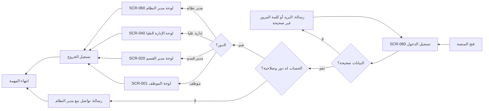

## FLOW-081 · حسابي وتغيير كلمة المرور
- Role: كل الأدوار · Screens: SCR-080، SCR-001/020/040/060، SCR-081 · Requirements: FR-39، NFR-01، NFR-05 · ✅ ADR-1003
- Goal: أن يشوف المستخدم بيانات حسابه ويغيّر كلمة مروره بأمان، وأن يغيّر الكلمة المؤقتة قبل أي شي ثاني.
- Notes: تعديل الاسم والبريد والدور والقسم عند مدير النظام فقط (FLOW-160). الكلمة المؤقتة يعيّنها مدير النظام في SCR-160. شروط كلمة المرور وحد المحاولات: Q-4102.

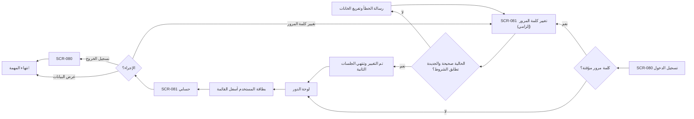

---

## 3. القسم الأول: مسارات الموظف

## FLOW-201 · مسار الموظف: تقديم طلب حتى الإغلاق
- Role: Employee · Screens: SCR-080، SCR-001، SCR-201، SCR-203، SCR-680 · Requirements: FR-01، FR-02، FR-03، FR-04، FR-11 · تلقائي: FR-06 → FR-10
- Goal: أن يقدم الموظف طلبًا أو شكوى ويتابع حالته حتى يُغلق.
- Description: يسجل دخوله ويقدم طلبًا بنص حر مع مرفقات اختيارية. النظام يصنف الطلب ويحدد أولويته ويوجهه للقسم ويحفظه دون تدخل الموظف (✅ Q-09). ثم يتابع الحالة ويصله إشعار عند كل تغيير. لما تصير الحالة «مكتمل» يأكد الحل ويقفل الطلب، ولو ما رد خلال المدة ينقفل تلقائيًا (✅ Q-1201). ⟵ أُضيف بقرار المنسق 2026-11-22.

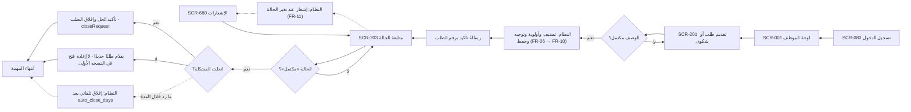

## FLOW-202 · مسار الموظف: متابعة طلباتي
- Role: Employee · Screens: SCR-080، SCR-001، SCR-202، SCR-203، SCR-680 · Requirements: FR-03، FR-04
- Goal: أن يعرف الموظف حالة طلباته ومرفقاتها.
- Description: يفتح قائمة طلباته ويدخل أي طلب ليعرف حالته، أو يصل للتفاصيل مباشرة من إشعار. إذا ما عنده طلبات تظهر حالة فارغة مع زر لتقديم طلب.

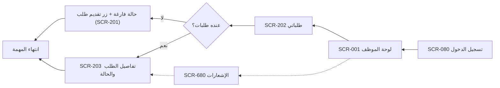

## FLOW-203 · مسار الموظف: تقرير حالة طلباتي
- Role: Employee (✅ Q-08 — التقرير للاثنين، والإدارة العليا تشوف الملخص في FLOW-542) · Screens: SCR-080، SCR-001، SCR-204، SCR-203 · Requirements: FR-05 · Q-08، Q-1206، ADR-1204
- Goal: أن يطلع الموظف على تقرير بحالة طلباته خلال فترة يختارها.
- Description: يفتح التقرير ويختار الفترة، ويقدر يدخل أي طلب منه. التنزيل كملف مشروط بقرار Q-1206 (خط متقطع).

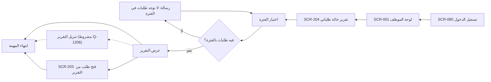

---

## 4. القسم الثاني: مسارات مدير القسم

## FLOW-320 · مسار مدير القسم: استقبال طلب القسم وإسناده
- Role: Department Manager · Screens: SCR-080، SCR-020، SCR-320، SCR-321 · Requirements: FR-12، FR-13، NFR-03 · تلقائي: FR-08
- Goal: أن يراجع المدير طلبًا وُجِّه لقسمه ويحدد من يعالجه.
- Description: يصل الطلب لقسم المدير بتوجيه آلي. المدير يدخل ويفتح الطلب ويراجعه، ثم يقرر: يعالجه بنفسه أو يسنده لموظف في قسمه (✅ Q-09). يظهر له طلبات قسمه فقط (NFR-03).

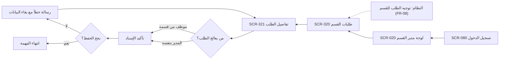

## FLOW-321 · مسار مدير القسم: تحديث حالة الطلب حتى الحل
- Role: Department Manager · Screens: SCR-080، SCR-020، SCR-320، SCR-321 · Requirements: FR-12، FR-14، FR-15، NFR-03 · تلقائي: FR-11
- Goal: أن يحدّث المدير حالة الطلب حتى يُحل.
- Description: يفتح طلبًا من قسمه ويحدّث حالته. النظام يرسل إشعارًا للموظف تلقائيًا. إذا ما انحل الطلب أو احتاج إجراءً إضافيًا يتكرر التحديث، حتى يُحل ويُغلق (حلقة FR-15).

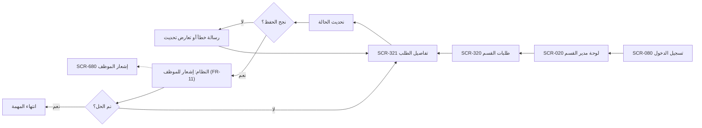

---

## 5. القسم الثالث: مسارات الإدارة العليا

## FLOW-440 · مسار الإدارة العليا: متابعة الأداء والتحليلات والتوصيات
- Role: Top Management · Screens: SCR-080، SCR-040، SCR-440، SCR-441، SCR-442، SCR-443، SCR-444، SCR-541 (ومنها إلى SCR-580 و SCR-542) · Requirements: FR-16، FR-18، FR-19، FR-20، FR-21، FR-22
- Goal: تمكين الإدارة العليا من متابعة أداء الشركة واستعراض التحليلات والتوصيات.
- Description: بعد الدخول تفتح اللوحة الرئيسية ثم تستعرض الرؤى والمؤشرات والأداء التشغيلي والمشكلات والفرص والتوصيات. لا ترتيب إلزامي بين الشاشات، والخطوات مرتبة بالطريقة الأشيع. كل نتيجة تعرض مصدرها وتاريخ تحليلها.

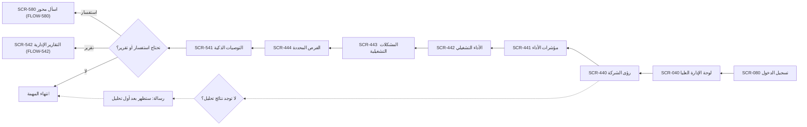

## FLOW-542 · مسار الإدارة العليا: إنشاء تقرير إداري ومراجعته ⚠️ (جديد)
- Role: Top Management · Screens: SCR-080، SCR-040، SCR-542 · Requirements: FR-23، FR-44 (مقترح) · Q-1503، Q-1206، ADR-1204
- Goal: أن تنشئ الإدارة العليا تقريرًا إداريًا أو تراجع تقريرًا محفوظًا.
- Description: تفتح التقارير الإدارية، وتفتح تقريرًا محفوظًا أو تنشئ جديدًا (مشروط بـ Q-1503). التقرير يحفظ ويظهر في القائمة، وفيه ملخص حالة الطلبات (ADR-1204 مقترح).

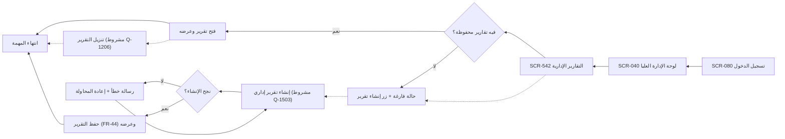

---

## 6. القسم الرابع: مسارات مدير النظام

## FLOW-160 · مسار مدير النظام: إدارة المنصة ومتابعة السجلات
- Role: System Administrator · Screens: SCR-080، SCR-060، SCR-160، SCR-360، SCR-161، SCR-162، SCR-660 · Requirements: FR-33، FR-34، FR-35، FR-36، FR-37، FR-39 · NFR-04
- Goal: إدارة المستخدمين والأقسام والأدوار والإعدادات ومتابعة سجلات النظام.
- Description: بعد الدخول يفتح مدير النظام لوحته، ومنها يصل لأي شاشة إدارية بلا ترتيب إلزامي. كل إجراء إداري يطلب تأكيدًا ويُسجَّل (FR-38) ويظهر في SCR-660. الأقسام تُجهَّز قبل ربط المستخدمين بها.

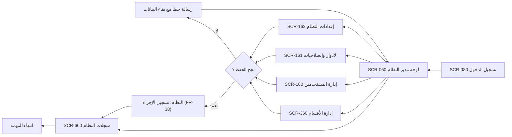

---

## 7. القسم الخامس: المسارات المشتركة (الإشعارات واسأل محور)

## FLOW-680 · مسار الإشعارات
- Role: المستخدمون وفق صلاحياتهم · Screens: SCR-080، SCR-680 · Requirements: FR-04، FR-11، FR-41
- Goal: تمكين المستخدم من الاطلاع على الإشعارات المرتبطة به.
- Description: يفتح المستخدم الإشعارات من لوحته، ويفتح إشعارًا فيُعلَّم مقروءًا. يصل الموظف من الإشعار إلى تفاصيل طلبه SCR-203 (كما في FLOW-202). وجهة الإشعار لدور آخر غير محددة (Q-1601).

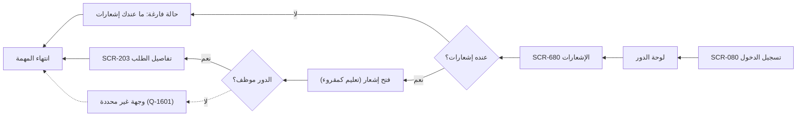

## FLOW-580 · المسار المشترك: اسأل محور (لكل الأدوار)
- Role: كل الأدوار (✅ Q-14) · Screens: SCR-080، SCR-001، SCR-020، SCR-040، SCR-060، SCR-580 · Requirements: FR-17 (موسّع)، FR-32 · NFR-02، NFR-05 · Q-05 (ADR-1502)
- Goal: كل مستخدم يسأل ذكاء محور في محادثته الخاصة عن البيانات المسموحة لدوره، ويستلم إجابة مع مصدرها وتاريخها.
- Description: يفتح المستخدم «اسأل محور» من لوحته، ويكتب سؤاله. الخادم يفحص دوره أولًا ولا يرسل للنموذج إلا البيانات المسموحة. سؤال الإدارة العليا التحليلي يطلق تحليلًا عند الطلب (FR-32، ADR-1504). السؤال خارج صلاحية الدور يُرد عليه برفض مهذب. الموظف يقدر يطلب رفع طلب، فتظهر له مسودة، ولا يُرسل الطلب إلا بعد تأكيده (نفس FLOW-201). ⟵ كان FLOW-540 للإدارة العليا فقط (✅ Q-14 · 2026-11-22).

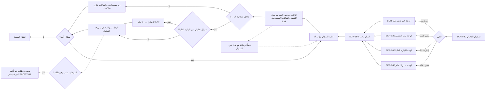

## FLOW-280 · مسار مراجعة الشكاوى الحساسة
- Role: صاحب صلاحية `review_sensitive` (✅ Q-3204) · Screens: SCR-080، لوحة الدور، SCR-280 · Requirements: FR-08، FR-13، NFR-02 · ADR-4203
- Goal: ما توصل شكوى حساسة لأي قسم قبل ما يراجعها شخص مخوّل، والشكوى على المدير ما توصل له.
- Description: الذكاء الاصطناعي يحوّل الشكوى الحساسة لمراجعة بشرية (`human_review`). صاحب الصلاحية يفتح SCR-280 من لوحته، يراجع الشكوى ويحوّلها للقسم المناسب، وبعدها تمشي مثل أي طلب (FLOW-320). ⟵ مسار جديد بقرار المنسق 2026-11-22.

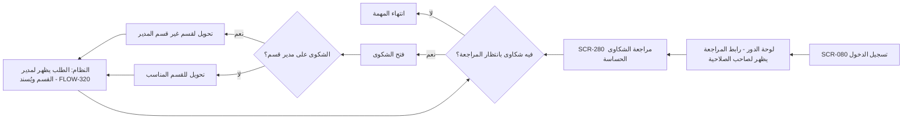

---

## 8. افتراضات

1. نهاية الطلب تتبع الحالات المعتمدة في ✅ Q-02: «مكتمل» بعد الحل ثم «مغلق»، ومن يغلق الطلب سؤال مفتوح (Q-1201 في «نطاق المشروع»).
2. الإشعار عند تقديم الطلب نفسه غير مذكور في المتطلبات، فلا يُرسم؛ المتطلب هو إشعار عند تغير الحالة (FR-11).
3. مسار الموظف الذي يُسند له الطلب غير مرسوم لأنه لا شاشة له في MVP (Q-1301).
4. إعادة الإسناد غير مرسومة بانتظار Q-1302.
5. فروع الأخطاء في الرسومات تعكس حالات error في `docs/screens.md`، وليست تدفقات منفصلة.
6. انتهاء الجلسة تُرجع المستخدم إلى SCR-080 من أي مسار، ولا تُرسم في كل مسار.

## 9. قرارات وأسئلة مفتوحة

| المرجع | الأثر على المسارات |
|---|---|
| ADR-1301 (مقترح) | الإسناد وتحديث الحالة داخل SCR-321، فلا شاشات إضافية في FLOW-320 و FLOW-321 |
| ADR-1002 (مقترح) | FLOW-440 و FLOW-160 و FLOW-542 تبدأ من SCR-040 و SCR-060، و FLOW-580 يبدأ من لوحة كل دور |
| ADR-1504 (مقترح) | سؤال الإدارة العليا التحليلي في FLOW-580 يطلق تحليلًا عند الطلب (FR-32) |
| ADR-1204 ✅ (معتمد 2026-11-22) | FLOW-203 للموظف؛ وملخص حالة الطلبات داخل FLOW-542 للإدارة العليا (Q-08) |
| Q-1203 | يؤثر على خطوة التقديم في FLOW-201 (لا اختيار للفئة، النظام يصنف) |
| Q-1206، Q-08 | شكل التقرير ومن يستفيد منه (FLOW-203، FLOW-542) |
| Q-1503 | إنشاء الإدارة العليا للتقرير وحفظه (FLOW-542) |
| Q-1301 | مسار الموظف المسند له الطلب غير موجود |
| Q-1302 | إعادة الإسناد غير مرسومة |
| Q-1601 | إشعار المدير بوصول طلب جديد غير مرسوم (يؤثر على FLOW-680) |
| ADR-1003 ✅ (معتمد 2026-11-23) | FLOW-081 لكل الأدوار، والدخول بكلمة مؤقتة يمر عليه (Q-1003 محسوم؛ الاستعادة الذاتية Later) |
| Q-02 | أسماء الحالات في FLOW-201 و FLOW-321 |
| ✅ Q-09 | مطبق: النظام يوجه القسم، والمدير يحدد المسؤول |
| ✅ Q-14 | مطبق: FLOW-580 لكل الأدوار |
| ✅ Q-08 | مطبق: FLOW-203 و FLOW-542 (ADR-1204) |

**الأرقام المنشأة في الإصدار 4:** FLOW-081.
**الأرقام المنشأة في الإصدار 2:** FLOW-080، FLOW-542، و FLOW-540 (صار FLOW-580 في الإصدار 3).
**الأرقام من الإصدار 1 (دون تغيير):** FLOW-201 → FLOW-203، FLOW-320، FLOW-321، FLOW-440، FLOW-160، FLOW-680.
