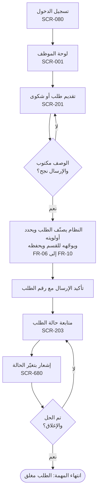
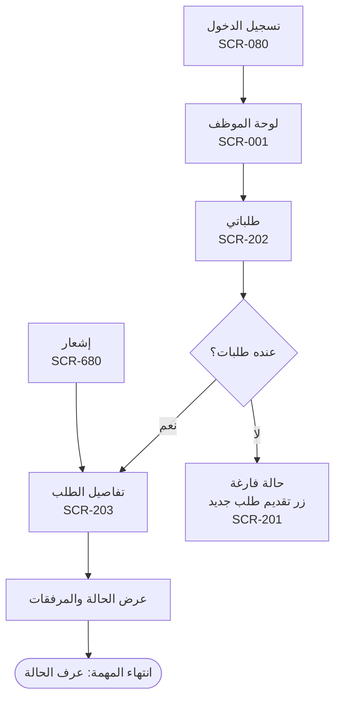
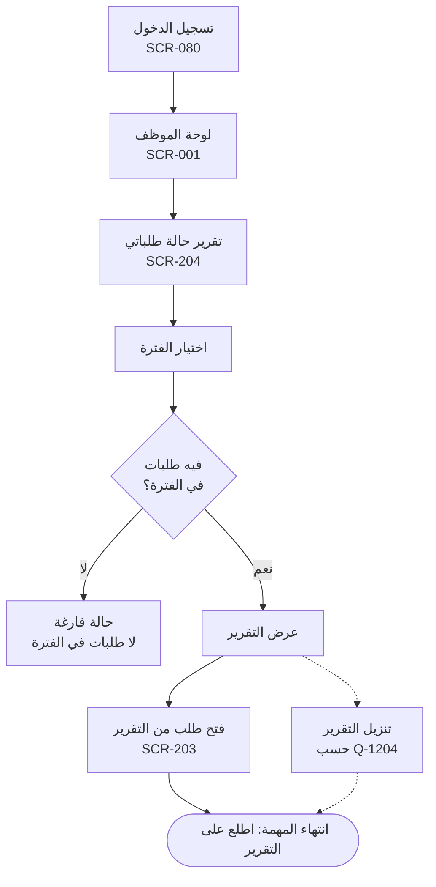
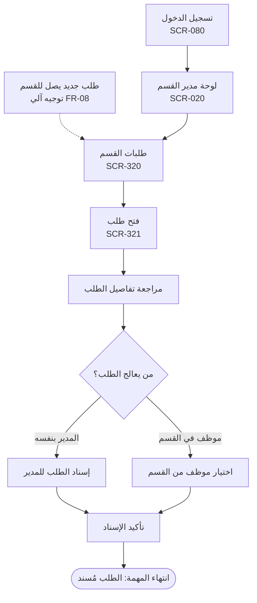
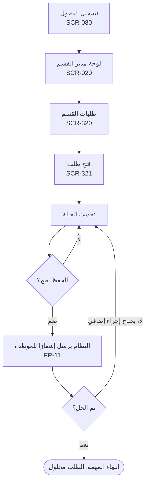
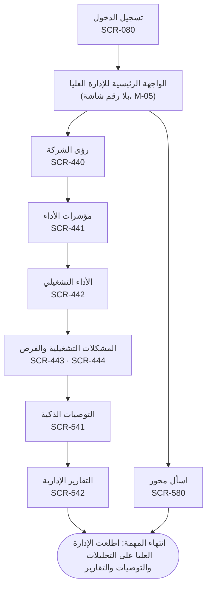
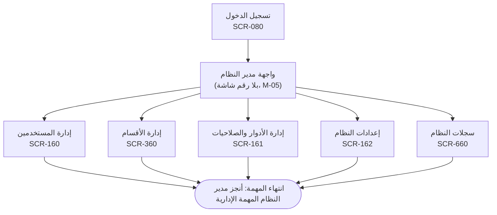
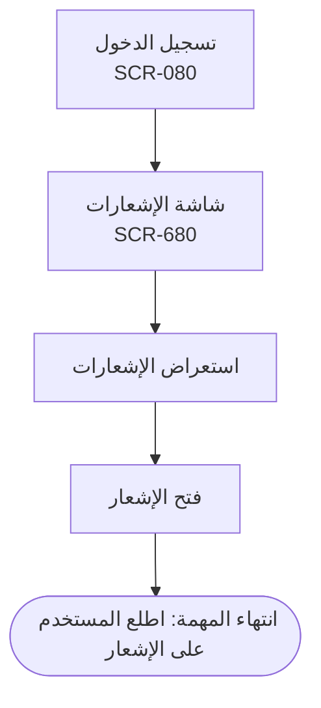
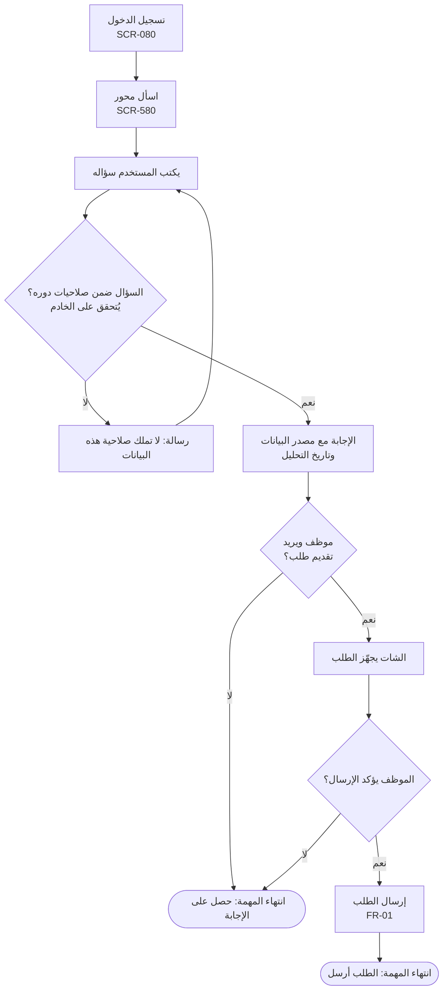

# مسارات المستخدمين

**مشروع محور (Mihwar)** · المجموعة الأولى · `docs/user-flows.md`

> **وصف المستند:** يوثّق مسارات المستخدمين لأدوار محور الأربعة (الموظف، مدير القسم، الإدارة العليا، مدير النظام) مع المسارات المشتركة (تسجيل الدخول والإشعارات واسأل محور). لكل مسار: رقمه واسمه والدور والهدف والشاشات والمتطلبات ورسم Mermaid من الدخول حتى اكتمال المهمة.

| بند | القيمة |
|---|---|
| المجموعة | المجموعة الأولى — تحليل المشروع و MVP |
| المصدر | عمل العضو الثالث (الموظف + مدير القسم) · عمل العضو الرابع (الإدارة العليا + مدير النظام + المشتركة) |
| المرجع الأعلى | `AI_BRIEF.md` (الإصدار 1.1 · 2026-11-06) ثم `docs/requirements.md` و`docs/screens.md` |
| تاريخ الدمج | 2026-11-08 |
| **حالة المستند** | ✅ **دمج كامل** لمسارات الأدوار الأربعة والمسار المشترك. أرقام مسارات العضو الرابع وربط متطلباتها أُسندت بالدمج وتحتاج تأكيده. |
| آخر مراجعة | 2026-11-08 — مراجعة المنسق: تطبيق ✅ Q-14 (مسار اسأل محور لكل الأدوار FLOW-580)، وإرجاع أسماء الحقول للإنجليزية حسب القالب (انظر M-14، M-15) |
| قاعدة الرسوم | الخط المتصل: خطوة عادية · الخط المتقطع: خطوة مشروطة بقرار مفتوح أو حدث تلقائي من النظام · أرقام الشاشات تتبع `docs/screens.md` |

## الفهرس

1. قائمة المسارات
2. القسم الأول: مسارات الموظف
3. القسم الثاني: مسارات مدير القسم
4. القسم الثالث: مسارات الإدارة العليا
5. القسم الرابع: مسارات مدير النظام
6. القسم الخامس: المسارات المشتركة (تسجيل الدخول والإشعارات واسأل محور)
7. الافتراضات
8. أسئلة مفتوحة وملاحظات الدمج

---

# 1. قائمة المسارات

| الدور | عدد المسارات | الأرقام | المصدر |
|---|---|---|---|
| الموظف | 3 | FLOW-201، 202، 203 | العضو الثالث |
| مدير القسم | 2 | FLOW-320، 321 | العضو الثالث |
| الإدارة العليا | 1 | FLOW-440 | العضو الرابع |
| مدير النظام | 1 | FLOW-160 | العضو الرابع |
| مشتركة (الإشعارات، اسأل محور) | 2 | FLOW-680، FLOW-580 | العضو الرابع · المنسق (✅ Q-14) |
| **الإجمالي** | **9** | | |

| ID | المسار | الدور | الشاشات | المتطلبات |
|---|---|---|---|---|
| FLOW-201 | تقديم طلب حتى الإغلاق | الموظف | SCR-080، SCR-001، SCR-201، SCR-203، SCR-680 | FR-01، FR-02، FR-03، FR-04، FR-11 · (تلقائي: FR-06 → FR-10) |
| FLOW-202 | متابعة طلباتي | الموظف | SCR-080، SCR-001، SCR-202، SCR-203، SCR-680 | FR-03، FR-04 |
| FLOW-203 ⚠️ | تقرير حالة طلباتي | الموظف | SCR-080، SCR-001، SCR-204، SCR-203 | FR-05 |
| FLOW-320 | استقبال طلب القسم وإسناده | مدير القسم | SCR-080، SCR-020، SCR-320، SCR-321 | FR-12، FR-13، NFR-03 · (تلقائي: FR-08) |
| FLOW-321 | تحديث حالة الطلب حتى الحل | مدير القسم | SCR-080، SCR-020، SCR-320، SCR-321 | FR-12، FR-14، FR-15، NFR-03 · (تلقائي: FR-11) |
| FLOW-440 | متابعة الأداء والتحليلات والتوصيات | الإدارة العليا | SCR-080، SCR-440 → 444، SCR-541، SCR-542، SCR-580 | FR-16 → FR-23 |
| FLOW-160 | إدارة المنصة ومتابعة السجلات | مدير النظام | SCR-080، SCR-160، 360، 161، 162، 660 | FR-33 → FR-37 · NFR-04 |
| FLOW-680 | الإشعارات | كل الأدوار وفق صلاحياتها | SCR-080، SCR-680 | FR-04، FR-11 |
| FLOW-580 | اسأل محور | كل الأدوار وفق صلاحياتها (✅ Q-14) | SCR-080، SCR-580 | FR-17، FR-32 · NFR-02، NFR-05 · (للموظف: FR-01) |

> إضافات الدمج الموثّقة: M-02 (بداية الدخول) وM-04 (عقد النهاية).

---

# 2. القسم الأول: مسارات الموظف

## FLOW-201 · تقديم طلب حتى الإغلاق

- **Role:** Employee
- **Goal:** أن يقدّم الموظف طلبًا أو شكوى ويتابع حالته حتى يُغلق.
- **Screens:** SCR-080، SCR-001، SCR-201، SCR-203، SCR-680
- **Requirements:** FR-01، FR-02، FR-03، FR-04، FR-11 · (تلقائي: FR-06، FR-07، FR-08، FR-09، FR-10)
- **Description:** يسجّل الموظف دخوله، ويقدّم طلبًا أو شكوى بنص حر مع مرفقات اختيارية. النظام يصنّف الطلب ويحدد أولويته ويوجّهه للقسم ويحفظه دون تدخل الموظف (✅ Q-09). ثم يتابع الحالة ويصله إشعار عند كل تغيير، حتى يُغلق الطلب.

## FLOW-202 · متابعة طلباتي

- **Role:** Employee
- **Goal:** أن يعرف الموظف حالة طلباته ومرفقاتها.
- **Screens:** SCR-080، SCR-001، SCR-202، SCR-203، SCR-680
- **Requirements:** FR-03، FR-04
- **Description:** يفتح الموظف قائمة طلباته ويدخل أي طلب ليعرف حالته. يقدر يصل للتفاصيل مباشرة من إشعار. وإذا ما عنده طلبات تظهر حالة فارغة مع زر لتقديم طلب.

## FLOW-203 · تقرير حالة طلباتي ⚠️

- **Role:** Employee (⚠️ Q-08)
- **Goal:** أن يطّلع الموظف على تقرير بحالة طلباته خلال فترة يختارها.
- **Screens:** SCR-080، SCR-001، SCR-204، SCR-203
- **Requirements:** FR-05 · ⚠️ Q-08، Q-1204
- **Description:** يفتح الموظف تقريرًا بحالة طلباته، ويختار الفترة، ويقدر يدخل أي طلب منه. التنزيل كملف مشروط بقرار Q-1204 (خط متقطع).

---

# 3. القسم الثاني: مسارات مدير القسم

## FLOW-320 · استقبال طلب القسم وإسناده

- **Role:** Department Manager
- **Goal:** أن يراجع المدير طلبًا وُجّه لقسمه ويحدد من يعالجه.
- **Screens:** SCR-080، SCR-020، SCR-320، SCR-321
- **Requirements:** FR-12، FR-13، NFR-03 · (تلقائي: FR-08)
- **Description:** يصل الطلب لقسم المدير بتوجيه آلي. المدير يدخل ويفتح الطلب ويراجعه، ثم يقرر: يعالجه بنفسه أو يسنده لموظف في قسمه (✅ Q-09). يظهر له طلبات قسمه فقط (NFR-03).

## FLOW-321 · تحديث حالة الطلب حتى الحل

- **Role:** Department Manager
- **Goal:** أن يحدّث المدير حالة الطلب حتى يُحل.
- **Screens:** SCR-080، SCR-020، SCR-320، SCR-321
- **Requirements:** FR-12، FR-14، FR-15، NFR-03 · (تلقائي: FR-11)
- **Description:** يفتح المدير طلبًا من قسمه ويحدّث حالته. النظام يرسل إشعارًا للموظف تلقائيًا. إذا ما انحل الطلب أو احتاج إجراءً إضافيًا يتكرر التحديث، حتى يُحل ويُغلق.

---

# 4. القسم الثالث: مسارات الإدارة العليا

## FLOW-440 · مسار الإدارة العليا: متابعة الأداء والتحليلات والتوصيات

- **Role:** Top Management
- **Goal:** تمكين الإدارة العليا من متابعة أداء الشركة واستعراض التحليلات والتوصيات والتقارير.
- **Screens:** SCR-080، (الواجهة الرئيسية بلا رقم شاشة، M-05)، SCR-440، SCR-441، SCR-442، SCR-443، SCR-444، SCR-541، SCR-542، SCR-580
- **Requirements:** FR-16، FR-17، FR-18، FR-19، FR-20، FR-21، FR-22، FR-23 (ربط الدمج، M-06)
- **Steps (من العضو الرابع):**
  1. تسجيل الدخول إلى المنصة.
  2. الانتقال إلى الواجهة الرئيسية للإدارة العليا.
  3. استعراض رؤى الشركة.
  4. الانتقال إلى مؤشرات الأداء والأداء التشغيلي.
  5. استعراض المشكلات التشغيلية والفرص المحددة.
  6. استخدام شاشة اسأل محور عند الحاجة إلى الاستفسار.
  7. مراجعة التوصيات الذكية والتقارير الإدارية.

---

# 5. القسم الرابع: مسارات مدير النظام

## FLOW-160 · مسار مدير النظام: إدارة المنصة ومتابعة السجلات

- **Role:** System Administrator
- **Goal:** إدارة المستخدمين والأقسام والأدوار والإعدادات ومتابعة سجلات النظام.
- **Screens:** SCR-080، (واجهة مدير النظام بلا رقم شاشة، M-05)، SCR-160، SCR-360، SCR-161، SCR-162، SCR-660
- **Requirements:** FR-33، FR-34، FR-35، FR-36، FR-37 · NFR-04 (ربط الدمج، M-06)
- **Steps (من العضو الرابع):**
  1. تسجيل الدخول إلى المنصة.
  2. الانتقال إلى واجهة مدير النظام.
  3. فتح شاشة إدارة المستخدمين.
  4. الانتقال إلى إدارة الأقسام عند الحاجة.
  5. إدارة الأدوار والصلاحيات.
  6. مراجعة إعدادات النظام.
  7. الاطلاع على سجلات النظام.
- **Note:** الخطوات مكتوبة بتسلسل، بينما مخطط العضو الرابع يفرّع الشاشات الخمس من الواجهة نفسها دون ترتيب إلزامي. أُبقي المخطط كما ورد (M-07).

---

# 6. القسم الخامس: المسارات المشتركة

تسجيل الدخول (SCR-080) والإشعارات (SCR-680) واسأل محور (SCR-580) شاشات مشتركة تُعرَّفان في `docs/screens.md` مرة واحدة. تسجيل الدخول نقطة بداية كل المسارات في هذا المستند، ولذلك لا مسار مستقل له.

| الشاشة المشتركة | تظهر في المسارات | دورها |
|---|---|---|
| SCR-080 تسجيل الدخول | FLOW-201، 202، 203، 320، 321، 440، 160، 680، 580 | نقطة بداية المسار |
| SCR-680 الإشعارات | FLOW-680، FLOW-201، FLOW-202 | عرض الإشعارات، ومدخل الموظف المباشر إلى SCR-203 |
| SCR-580 اسأل محور | FLOW-580، FLOW-440 | شات كل مستخدم حسب صلاحيات دوره (✅ Q-14) |

## FLOW-680 · مسار الإشعارات

- **Role:** المستخدمون وفق صلاحياتهم (Employee · Department Manager · Top Management · System Administrator)
- **Goal:** تمكين المستخدم من الاطلاع على الإشعارات المرتبطة به.
- **Screens:** SCR-080، SCR-680
- **Requirements:** FR-04، FR-11 (ربط الدمج، M-06)
- **Steps (من العضو الرابع):**
  1. تسجيل الدخول إلى المنصة.
  2. فتح شاشة الإشعارات.
  3. استعراض الإشعارات.
  4. اختيار إشعار للاطلاع على تفاصيله.
- **Note:** يصل الموظف من الإشعار إلى تفاصيل الطلب SCR-203 كما في FLOW-202. وجهة الإشعار لدور آخر غير محددة (Q-1601).

## FLOW-580 · مسار اسأل محور (لكل الأدوار)

- **Role:** كل الأدوار، وكل مستخدم حسب صلاحيات دوره (✅ Q-14): Employee (طلباته) · Department Manager (طلبات قسمه) · Top Management (الشركة كلها) · System Administrator (بيانات الإدارة)
- **Goal:** أن يسأل المستخدم ذكاء محور عن البيانات التي يسمح بها دوره ويحصل على إجابة واضحة، وأن يقدّم الموظف طلبًا من الشات بعد تأكيده.
- **Screens:** SCR-080، SCR-580
- **Requirements:** FR-17 (موسّع بـ ✅ Q-14) · FR-32 (للإدارة العليا) · NFR-02، NFR-05 · (للموظف: FR-01)
- **Description:** يفتح المستخدم الشات ويكتب سؤاله. يتحقق الخادم من دوره قبل أن تصل أي بيانات للنموذج: إذا كان السؤال خارج صلاحيته تظهر رسالة منع، وإلا تظهر الإجابة مع مصدر البيانات وتاريخ التحليل. الموظف يقدر يجهّز طلبًا من الشات، ولا يُرسل إلا بعد تأكيده.

---

# 7. الافتراضات

مأخوذة من عمل العضو الثالث:

1. نهاية الطلب (محلول أو مغلق) تتبع حالات الطلب المعتمدة في Q-02، وتُحدَّث أسماؤها في الرسومات بعد اعتمادها.
2. الإشعار عند تقديم الطلب نفسه غير مذكور في المتطلبات، فلا يُرسم. المتطلب هو إشعار عند تغيّر الحالة (FR-11).
3. مسار الموظف الذي يُسند له الطلب غير مرسوم، لأنه لا شاشة له في MVP (Q-1301).
4. الخط المتقطع في الرسومات يعني خطوة مشروطة بقرار مفتوح أو حدث تلقائي من النظام.

---

# 8. أسئلة مفتوحة وملاحظات الدمج

## 8.1 ملاحظات الدمج

| الرقم | الملاحظة | المعالجة |
|---|---|---|
| M-01 | ✅ **اكتمل الدمج:** ورد عمل العضو الرابع (مسارات الإدارة العليا ومدير النظام والإشعارات) بعد التسليم الأول وأُدمج. | — |
| M-02 | **مسارات العضو الثالث لا تبدأ من الدخول:** بدأ FLOW-202 وFLOW-203 من SCR-001، وبدأ FLOW-321 من SCR-320. | **تعديل إضافي موثّق (لم يُحذف شيء):** أُضيفت «تسجيل الدخول SCR-080» في بداية الثلاثة، وSCR-020 قبل SCR-320 في FLOW-321، وعُدّلت قوائم الشاشات. للقائد إلغاؤه. |
| M-03 | **دخول بديل:** في FLOW-202 يصل الموظف إلى SCR-203 من الإشعار مباشرة، وفي FLOW-320 يصل الطلب آليًا. | أُبقيا كما في الأصل. |
| M-04 | **مخططات العضو الرابع بلا عقدة نهاية** (وتشترط قواعد الدمج أن ينتهي المسار عند اكتمال المهمة). | **تعديل إضافي موثّق:** أُضيفت عقدة «انتهاء المهمة» لكل مخطط، وأُضيفت أرقام الشاشات إلى العقد، وأُحيطت النصوص بعلامات اقتباس لسلامة Mermaid. بقية العقد والفروع كما وردت. |
| M-05 | **لا شاشة للواجهة الرئيسية:** يبدأ مساراهما بـ «الواجهة الرئيسية للإدارة العليا» و«واجهة مدير النظام» ولا شاشة لهما في `docs/screens.md`. | عُلّمت العقدتان «بلا رقم شاشة». سؤال مفتوح **Q-1001** (يقابل M-10 في screens.md). |
| M-06 | **أرقام المسارات وربطها بالمتطلبات أسندها الدمج** (لم ترد عند العضو الرابع): FLOW-440 وFLOW-160 وFLOW-680 حسب AI_BRIEF 8.4. ربط المتطلبات من عناوين المتطلبات في requirements.md. | يؤكدها العضو الرابع. |
| M-07 | **مسار مدير النظام:** الخطوات متسلسلة والمخطط متفرع من الواجهة دون ترتيب. | أُبقيا معًا كما وردا. |
| M-08 | **FR-05 (Q-08)** ينعكس على FLOW-203؛ ولا مسار لتقرير حالة الطلبات للإدارة العليا. | بانتظار المنسق. |
| M-09 | **لا تكرار** في أرقام المسارات (8 مسارات مختلفة)، وكل شاشة مذكورة موجودة في `docs/screens.md`. | — |
| M-10 | **FR-15** مغطى بحلقة «تم الحل؟ لا ← تحديث الحالة» في FLOW-321. | — |
| M-11 | **أسماء الحالات** في FLOW-201 وFLOW-321 عامة بانتظار Q-02. | تُحدَّث بعد الاعتماد. |
| M-12 | **قرارات الفرع:** مسارات العضو الرابع خطية أو متفرعة بلا نقاط قرار، فلم تُضف فروع غير واردة (مثل فشل الدخول). | تُضاف إن اعتمد العضو الرابع ذلك. |
| M-14 | **تطبيق ✅ Q-14 (مراجعة المنسق 2026-11-08):** «اسأل محور» لكل الأدوار، فأُضيف مسار مشترك **FLOW-580** (كتلة 80–99 لكل الأدوار، وحدة 5)، وتغيّر رقم الشاشة في FLOW-440 من SCR-540 إلى SCR-580. | يطابق screens.md (M-16 هناك). |
| M-15 | **أسماء الحقول** كُتبت بالعربية في الدمج، والقالب في AI_BRIEF 8.3 يكتبها بالإنجليزية (Role، Screens، Requirements). | أُرجعت للإنجليزية. المحتوى نفسه لم يتغيّر. |
| M-13 | **ملاحظات العضو الرابع** (مطابقة الخطوات مع المتطلبات، وإتاحة الشاشات للأدوار المخولة فقط، وتسجيل ما لا يدعمه المرجع كسؤال مفتوح) مطبّقة في هذا الدمج. | — |

## 8.2 المراجع إلى القرارات والأسئلة (من `docs/screens.md`)

| المرجع | الأثر على المسارات |
|---|---|
| ADR-1301 (مقترح) | الإسناد وتحديث الحالة داخل SCR-321، فلا شاشات إضافية في FLOW-320 وFLOW-321 |
| Q-1201 | يؤثر على خطوة التقديم في FLOW-201 (لا اختيار للفئة، النظام يصنّف) |
| Q-1204 + Q-08 | يؤثران على FLOW-203 (شكل التقرير ومن يستفيد منه) |
| Q-1301 | مسار الموظف المُسند له الطلب غير موجود |
| Q-1302 | إعادة الإسناد غير مرسومة بانتظار القرار |
| Q-1601 | إشعار المدير بوصول طلب جديد غير مرسوم (ويؤثر على FLOW-680) |
| Q-02 | أسماء الحالات في FLOW-201 وFLOW-321 |
| ✅ Q-09 | مطبّق: النظام يوجّه القسم، والمدير يحدد المسؤول |
| ✅ Q-14 | مطبّق: مسار اسأل محور لكل الأدوار FLOW-580 |
| Q-1001 | الواجهة الرئيسية للإدارة العليا ولمدير النظام في FLOW-440 وFLOW-160 |

**الأرقام المنشأة في الأجزاء المدمجة:** FLOW-201 → FLOW-203 · FLOW-320، FLOW-321.

**الأرقام المنشأة للعضو الرابع (بالدمج):** FLOW-440 · FLOW-160 · FLOW-680

**أرقام مراجعة المنسق:** FLOW-580 · Q-1001 (في screens.md).
