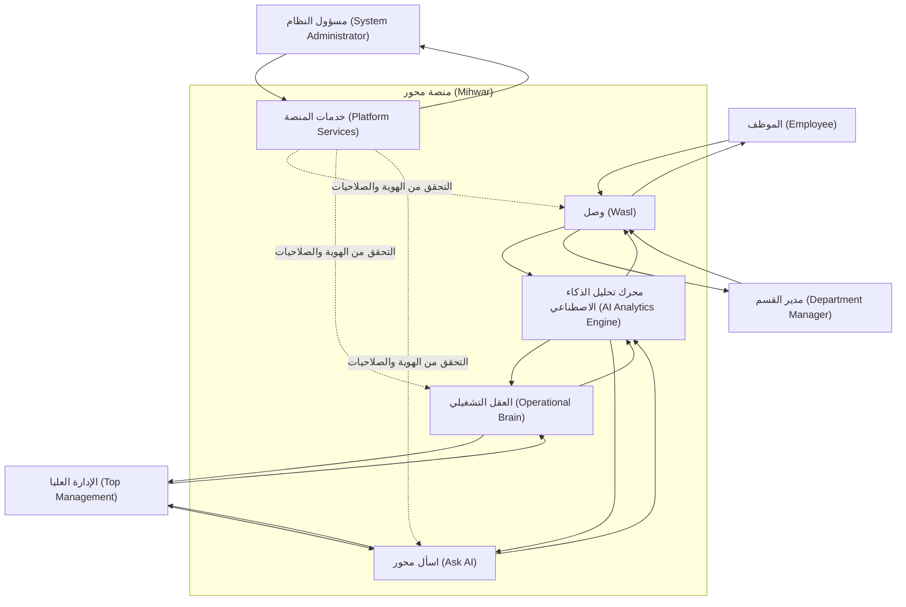
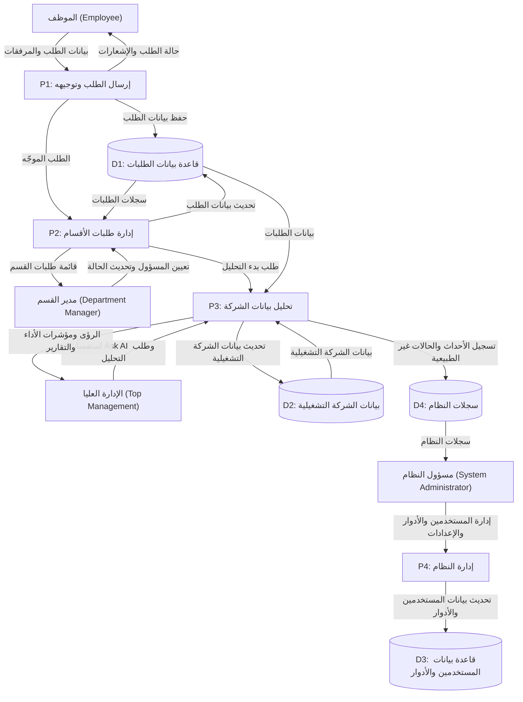

# معمارية النظام

## 1. مقدمة

يهدف هذا المستند إلى توضيح معمارية نظام محور (Mihwar)، من خلال تحديد المكونات الرئيسية للنظام، ومسؤوليات كل مكون، والعلاقات بينها، وآلية تدفق البيانات، والتحقق من صلاحيات المستخدمين.

تعتمد المعمارية على المتطلبات الوظيفية وغير الوظيفية المحددة في وثيقة المشروع AI_BRIEF.md، مع المحافظة على التكامل بين وحدات النظام الرئيسية.

## 2. نطاق المعمارية

تشمل معمارية النظام المكونات التالية:

- وصل (Wasl).
- العقل التشغيلي (Operational Brain).
- اسأل محور (Ask AI).
- خدمات المنصة (Platform Services).

كما توضح المعمارية تفاعل المستخدمين مع هذه المكونات، وآلية انتقال البيانات بينها، وضوابط الوصول إلى وظائف النظام وبياناته.

## 3. المكونات الرئيسية للنظام ومسؤولياتها

يتكون نظام محور (Mihwar) من أربعة مكونات رئيسية، تتكامل فيما بينها لتقديم وظائف المنصة وفق المتطلبات المعتمدة.

### 3.1 وصل (Wasl)

**المسؤولية:**

إدارة طلبات الموظفين وشكاواهم، بدءًا من استقبال الطلبات باللغة الطبيعية، وفهمها وتصنيفها وتحديد أولويتها وتوجيهها إلى القسم المناسب، وصولًا إلى متابعة الطلب حتى إغلاقه.

**المستخدمون:**
- الموظف (Employee).
- مدير القسم (Department Manager).

**المهام الرئيسية:**
- استقبال طلبات الموظفين وشكاواهم.
- استقبال المرفقات الداعمة للطلبات.
- تصنيف الطلبات وتحديد أولويتها باستخدام الذكاء الاصطناعي.
- توجيه الطلب إلى القسم المناسب.
- تمكين الموظف من متابعة حالة طلبه.
- تمكين مدير القسم من الاطلاع على طلبات قسمه.
- تمكين مدير القسم من تعيين الشخص المسؤول عن معالجة الطلب وتحديث حالته.
- إرسال إشعارات عند تحديث حالة الطلب.

**المتطلبات المرتبطة:**

FR-01 إلى FR-15.

### 3.2 العقل التشغيلي (Operational Brain)

**المسؤولية:**

تحليل بيانات الشركة ومؤشرات الأداء بهدف اكتشاف المشكلات التشغيلية والحالات غير الطبيعية والاتجاهات والفرص، وتوليد الرؤى والتوصيات والتقارير التي تساعد الإدارة العليا على اتخاذ قرارات مبنية على البيانات.

**المستخدمون:**
- الإدارة العليا (Top Management).

**المهام الرئيسية:**
- تحليل بيانات الشركة.
- مراقبة مؤشرات الأداء الرئيسية (KPIs).
- اكتشاف المشكلات التشغيلية.
- اكتشاف الحالات غير الطبيعية (Anomalies).
- تحديد الاتجاهات والفرص.
- توليد الرؤى والتوصيات.
- إعداد التقارير الإدارية.
- حفظ عمليات التحليل ونتائجها وربط النتائج بعملية التحليل المقابلة.
- دعم التحليل الدوري والتحليل عند الطلب.

**المتطلبات المرتبطة:**

FR-16، وFR-18 إلى FR-32.

### 3.3 اسأل محور (Ask AI)

**المسؤولية:**

توفير واجهة تتيح للإدارة العليا طرح أسئلة باللغة الطبيعية حول بيانات الشركة، والحصول على إجابات وتحليلات مولدة بالذكاء الاصطناعي.

**المستخدمون:**
- الإدارة العليا (Top Management).

**المهام الرئيسية:**
- استقبال أسئلة الإدارة العليا المتعلقة ببيانات الشركة.
- تمرير طلب التحليل إلى قدرات تحليل الذكاء الاصطناعي.
- تقديم الإجابات والتحليلات للإدارة العليا.
- دعم التحليل عند الطلب بناءً على استفسارات الإدارة العليا.

**المتطلبات المرتبطة:**

FR-17، وFR-32.

### 3.4 خدمات المنصة (Platform Services)

**المسؤولية:**

توفير الخدمات المشتركة اللازمة لتشغيل المنصة وإدارة المستخدمين والأقسام والأدوار والصلاحيات والإعدادات والإشعارات وسجلات النظام.

**المستخدمون:**
- مسؤول النظام (System Administrator).
- المستخدمون الآخرون بحسب صلاحياتهم المحددة.

**المهام الرئيسية:**
- إدارة المستخدمين.
- إدارة الأقسام.
- إدارة الأدوار والصلاحيات.
- إدارة إعدادات النظام.
- إدارة الإشعارات.
- عرض سجلات النظام وتسجيل الأحداث.
- دعم إدارة بيانات المستخدمين والطلبات والبيانات التشغيلية وبيانات التحليل والتقارير الإدارية.

**المتطلبات المرتبطة:**

FR-33 إلى FR-44.

### 3.5 محرك تحليل الذكاء الاصطناعي (AI Analytics Engine)

يعمل محرك تحليل الذكاء الاصطناعي بوصفه مكونًا نظاميًا مساندًا، وليس دورًا لمستخدم بشري.

**مسؤولياته:**
- فهم طلبات الموظفين وتصنيفها وتحديد أولويتها والمساعدة في توجيهها.
- تحليل بيانات الشركة.
- اكتشاف المشكلات والحالات غير الطبيعية والاتجاهات.
- توليد الرؤى والتوصيات ونتائج التحليل.

**المتطلبات المرتبطة:**

FR-06 إلى FR-08، وFR-24 إلى FR-28.

## 4. الرسم المعماري للمكونات (Component Diagram)

## 5. تدفق البيانات (Data Flow)

يوضح تدفق البيانات كيفية انتقال المعلومات بين مكونات نظام محور (Mihwar)، بدءًا من استقبال طلبات الموظفين ومعالجتها، مرورًا بإدارة الطلبات وتحليل بيانات الشركة، وصولًا إلى تقديم النتائج للإدارة العليا.

يعتمد تدفق البيانات على العمليات الرئيسية المحددة في مخطط تدفق البيانات (DFD)، وهي:

- P1: إرسال الطلب وتوجيهه (Submit & Route Request).
- P2: إدارة طلبات الأقسام (Manage Department Requests).
- P3: تحليل بيانات الشركة باستخدام الذكاء الاصطناعي (AI Analyze Company Data).
- P4: إدارة النظام (System Administration).

### 5.1 مخطط تدفق البيانات (Data Flow Diagram)

## 6. التكامل بين وصل والعقل التشغيلي (Wasl and Operational Brain Integration)

يتكامل مكون وصل (Wasl) مع مكون العقل التشغيلي (Operational Brain) من خلال بيانات الطلبات التي يتم تسجيلها وإدارتها داخل النظام.

تتم عملية التكامل وفق التسلسل التالي:

1. يستقبل مكون وصل طلبات الموظفين ويعالجها ويوجهها إلى القسم المناسب.
2. تُحفظ بيانات الطلبات في مخزن البيانات D1.
3. يدير مدير القسم الطلبات الموجهة إلى قسمه، ويقوم بتعيين الشخص المسؤول وتحديث حالة الطلب.
4. يمكن أن يؤدي التعامل مع الطلبات إلى إرسال محفز لبدء عملية التحليل في مكون العقل التشغيلي.
5. يقرأ العقل التشغيلي بيانات الطلبات من D1، إلى جانب بيانات الشركة التشغيلية من D2، لإجراء التحليلات المطلوبة.
6. تُعرض الرؤى ومؤشرات الأداء والتقارير الناتجة على الإدارة العليا.

يراعي هذا التكامل الفصل بين إدارة طلبات الموظفين وتحليل بيانات الشركة، مع الاستفادة من البيانات المتاحة لدعم اتخاذ القرارات.

المتطلبات المرتبطة: FR-01 إلى FR-15، وFR-16، وFR-24 إلى FR-32.

## 7. التحقق من الهوية والصلاحيات (Authentication & Authorization)

تعتمد منصة محور (Mihwar) على التحقق من هوية المستخدم وإدارة صلاحياته لضمان وصول كل مستخدم إلى الوظائف والبيانات المسموح بها وفق دوره في النظام.

تتم آلية التحقق من الهوية والصلاحيات وفق المبادئ التالية:

1. التحقق من هوية المستخدم قبل السماح له بالوصول إلى وظائف النظام.
2. تحديد صلاحيات المستخدم بناءً على الدور المسند إليه (Role-Based Access Control - RBAC).
3. التحقق من الصلاحيات على مستوى النظام والخادم عند تنفيذ العمليات، وليس الاكتفاء بإخفاء الوظائف من واجهة المستخدم.
4. تقييد وصول مدير القسم (Department Manager) على الطلبات التابعة لقسمه فقط.
5. قصر وظائف إدارة المستخدمين والأقسام والأدوار والصلاحيات والإعدادات على مسؤول النظام (System Administrator).
6. حماية بيانات المستخدمين والطلبات والبيانات التشغيلية ونتائج التحليل من الوصول غير المصرح به.
7. التأكد من أن محرك تحليل الذكاء الاصطناعي لا يصل إلا إلى البيانات التي يسمح دور المستخدم الحالي بالوصول إليها.

**المتطلبات المرتبطة:**

- NFR-01: Authentication.
- NFR-02: Role-Based Access Control.
- NFR-03: Department Manager Data Access Restriction.
- NFR-04: Administrative Access Restriction.
- NFR-05: Data Protection.

## 8. معالجة الأخطاء والسجلات والمهام الخلفية (Errors, Logs & Background Jobs)

### 8.1 معالجة الأخطاء (Error Handling)

تراعي معمارية نظام محور (Mihwar) التعامل مع الأخطاء أثناء تنفيذ العمليات المختلفة، مع المحافظة على سلامة البيانات وعدم تأثر السجلات المحفوظة عند حدوث خطأ.

تشمل المبادئ التالية:

- التعامل مع الأخطاء التي تحدث أثناء تنفيذ العمليات.
- منع حدوث تلف أو فقدان للبيانات نتيجة الأخطاء.
- المحافظة على معلومات الطلبات طوال دورة حياتها.
- إتاحة التعامل مع الأخطاء دون التأثير على اتساق بيانات النظام.

**المتطلبات المرتبطة:**

- NFR-12: Error Handling.
- NFR-13: Request Data Preservation.

### 8.2 سجلات النظام (System Logs)

تُستخدم سجلات النظام لتسجيل الأحداث المتعلقة بتشغيل المنصة والعمليات التي تتم داخلها، بما يدعم مراقبة النظام وتتبع الأحداث.

تشمل مسؤوليات السجلات:

- تسجيل أحداث النظام.
- تمكين مسؤول النظام (System Administrator) من الاطلاع على سجلات النظام.
- تسجيل الأحداث والحالات غير الطبيعية الناتجة عن عمليات التحليل وفق تدفق البيانات المعتمد.

**المتطلبات المرتبطة:**

- FR-37: View System Logs.
- FR-38: Record System Logs.
- NFR-22: Logging and Monitoring.

### 8.3 المهام الخلفية (Background Jobs)

تدعم معمارية النظام تنفيذ التحليل الدوري لبيانات الشركة، والتحليل عند الطلب بناءً على طلب الإدارة العليا.

تشمل هذه العمليات:

- تنفيذ التحليل الدوري لبيانات الشركة.
- تنفيذ التحليل عند الطلب بناءً على طلب الإدارة العليا.
- تسجيل عمليات التحليل مع تحديد محفز التنفيذ ووقت التنفيذ.
- حفظ نتائج التحليل وربطها بعملية التحليل المقابلة.

**المتطلبات المرتبطة:**

- FR-29: Store Analysis Runs.
- FR-31: Periodic Analysis.
- FR-32: On-Demand Analysis.
- NFR-14: Analysis Records Retention.
- NFR-26: Defined AI Analysis Workflows.

## 9. القرارات المعمارية والأسئلة المفتوحة (Architecture Decisions & Open Questions)

### 9.1 القرارات التي تتطلب اعتمادًا

لم يتم اعتماد تقنية محددة أو نمط نشر للنظام في هذا المستند. تتم مقارنة التقنيات واختيارها ضمن مخرجات عضو المجموعة المسؤول عن قرار التقنيات.

أي قرار معماري يؤثر في مكونات النظام أو طريقة تكاملها يجب توثيقه واعتماده قبل اعتباره قرارًا نهائيًا.

### 9.2 الأسئلة المفتوحة

- **Q-08: الجهة المسؤولة عن طلب تقرير الحالة (Status Report).** يوجد تعارض في المتطلبات؛ إذ يشير FR-05 إلى الموظف، بينما يذكر جدول حالات الاستخدام الإدارة العليا. لم يُحسم هذا التعارض في وثائق المشروع، ولذلك يُترك للاعتماد من الجهة المسؤولة.

### 9.3 حدود هذا المستند

يركز هذا المستند على معمارية النظام ومكوناته ومسؤولياتها وتدفق البيانات والتحقق من الهوية والصلاحيات ومعالجة الأخطاء والسجلات والمهام الخلفية.

أما المقارنة التفصيلية للتقنيات وتصميم قاعدة البيانات، فهما ضمن مخرجات الأعضاء المسؤولين عنهما في المجموعة الثالثة.