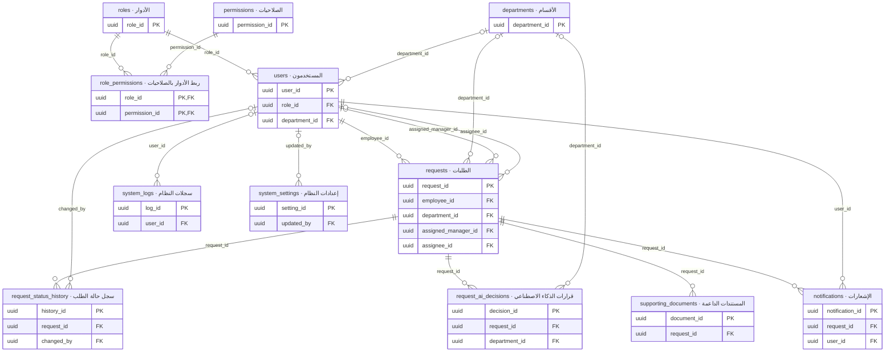

docs/database.md

# تصميم قاعدة البيانات (جزء: المستخدمون والطلبات والإشعارات والسجلات والإعدادات)

> **Group 3 · Member 3 · Week 1 draft** · 2026-11-07 · Status: draft for review · Part 1 of 2
> Depends on: Q-02 (statuses, categories, priorities), Group 1 (MVP scope), Group 3 Member 2 (tech stack). Part 2 (company data, analysis, reports) is with Member 4; the leader merges both into one `docs/database.md`.
> Applies decision ✅ Q-09: the system routes the request to the department; the Department Manager decides who handles it (`assignee_id`).
> Built on Group 4 files: `docs/api.md` (2026-11-04) and `docs/ai.md` (2026-11-06) — operations, AI output fields and decisions ADR-4001, ADR-4201, ADR-4202.
> Phase 2 = documents only — no SQL. This file becomes `db/schema.sql` in phase 3.

---

## 0. نطاق هذا الجزء

يغطي 8 كيانات من الـ ERD، ويضيف 4 جداول مقترحة (ADR-3101 و ADR-3201 و ADR-3202). أما بيانات الشركة وعمليات التحليل ونتائجها والتقارير فهي في الجزء الثاني.

| Table | ERD | Requirements | Data owner |
|---|---|---|---|
| `roles` | Role | FR-35, FR-39, NFR-02 | System Administrator |
| `permissions` | جديد (Q-11) | FR-35, NFR-02, NFR-04 | System Administrator |
| `role_permissions` | جديد (Q-11) | FR-35, NFR-02 | System Administrator |
| `departments` | Department | FR-34, FR-39, FR-40, NFR-03 | System Administrator |
| `users` | User | FR-33, FR-39, NFR-01, NFR-05 | System Administrator |
| `requests` | Request | FR-01, FR-03, FR-06 → FR-09, FR-12 → FR-15, FR-40, NFR-03, NFR-13 | System (Wasl) |
| `request_status_history` | جديد (Q-10) | FR-03, FR-14, FR-15, NFR-08, NFR-20 | System (Wasl) |
| `request_ai_decisions` | جديد (Q-4204) | FR-06 → FR-08, NFR-24, NFR-08, NFR-22 | System (Wasl) |
| `supporting_documents` | SupportingDocument | FR-02, FR-10 | Employee مقدّم الطلب |
| `notifications` | Notification | FR-04, FR-11, FR-41 | System |
| `system_logs` | SystemLog | FR-37, FR-38, NFR-22 | System |
| `system_settings` | SystemSetting | FR-36, NFR-23 | System Administrator |

## 1. قواعد عامة

- **أنواع البيانات منطقية:** `uuid` و `text` و `boolean` و `decimal` و `timestamp` لا تفرض تقنية معينة، وتتحول إلى أنواع قاعدة البيانات المختارة بعد قرار التقنيات (Q-04). كل الأوقات تُحفظ مع المنطقة الزمنية.
- **الأسماء:** أسماء الجداول والأعمدة بالإنجليزية بصيغة `snake_case`، وأسماء الجداول المشتركة مع الجزء الثاني هي `users.user_id` و `requests.request_id`.
- **القيم غير المعتمدة:** قيم `status` و `priority` و `category` و `request_type` تُؤخذ من `docs/glossary.md` فقط، ولم تُعتمد بعد (Q-02). مقترح المجموعة 4 للفئات والأولويات في `docs/ai.md` (Q-4201).
- **الحذف:** لا يُسمح بحذف سجل مرتبط بسجلات أخرى، ولا يوجد حذف متسلسل إلا في `role_permissions` (NFR-07). المستخدمون والأقسام يُوقَفون بدل حذفهم (ADR-4001 · المجموعة 4)، حتى يبقى تاريخ الطلبات صحيحًا.
- **الصلاحيات:** كل صلاحيات القراءة والكتابة المذكورة هنا تُطبَّق في الخادم في كل عملية، ولا تكفي في الواجهة (NFR-02 و NFR-03 و NFR-04).
- **الأعمدة المضافة:** أي عمود غير موجود في الـ ERD مكتوب في وصفه «إضافة».
- **API:** كل جدول مكتوب معه عمليات `docs/api.md` اللي تستخدمه.

## 2. مخطط العلاقات

كل مستطيل جدول، وفيه مفاتيحه فقط (باقي الأعمدة في القسم 3): PK المفتاح الأساسي، و FK عمود الربط بجدول ثاني. والخط يربط الجدول الأصل بالجدول المرتبط فيه، والمكتوب عليه عمود الربط. `||` واحد · `|o` واحد اختياري · `o{` صفر أو أكثر.

---

## 3. الجداول

### 3.1 roles  (ERD: Role · FR-35, FR-39, NFR-02)

| Column | Type | Key / constraint | Description |
|---|---|---|---|
| role_id | uuid | PK | معرّف الدور |
| role_name | text | NOT NULL, UNIQUE | اسم الدور بالإنجليزية كما في `glossary.md` |

- Indexes: `role_name` (فريد)
- Who can read / write: System Administrator يقرأ. يقرأ الخادم الدور للتحقق من الصلاحيات.
- Rules: الأدوار الأربعة ثابتة في النسخة الأولى، ومدير النظام يعدّل صلاحياتها فقط (Q-4101). لا يوجد دور لـ AI Analytics Engine لأنه جزء من النظام وليس مستخدمًا.
- API: `listRoles`
- Retention: يبقى طوال عمر النظام.

### 3.2 permissions  (جديد · Q-11 · FR-35, NFR-02, NFR-04)

| Column | Type | Key / constraint | Description |
|---|---|---|---|
| permission_id | uuid | PK | معرّف الصلاحية |
| permission_key | text | NOT NULL, UNIQUE | اسم العملية في `docs/api.md`، ويستخدمه الخادم للتحقق |
| description | text | NULL | وصف بالعربية يظهر لمدير النظام |

- Indexes: `permission_key` (فريد)
- Who can read / write: System Administrator يقرأ. تُضاف الصلاحيات مع تطوير النظام لأن كل صلاحية يقابلها فحص في الخادم، ولا تُنشأ من الواجهة.
- Rules: مفتاح الصلاحية هو اسم العملية في `docs/api.md` (operationId)، مثل `createRequest` و `assignRequest`، فتطابق الصلاحيات عمليات API مباشرة.
- API: `listPermissions`
- Retention: يبقى طوال عمر النظام.

### 3.3 role_permissions  (جديد · Q-11 · FR-35, NFR-02)

| Column | Type | Key / constraint | Description |
|---|---|---|---|
| role_id | uuid | PK, FK → roles.role_id, NOT NULL | الدور |
| permission_id | uuid | PK, FK → permissions.permission_id, NOT NULL | الصلاحية الممنوحة |

- Indexes: المفتاح الأساسي `(role_id, permission_id)` · `permission_id`
- Who can read / write: System Administrator يقرأ ويكتب (FR-35).
- Rules: يرفض الخادم منح صلاحيات إدارة النظام لأي دور غير System Administrator (NFR-04). يُحذف السطر تلقائيًا عند حذف الدور أو الصلاحية.
- API: `updateRolePermissions`
- Retention: يبقى ما دام المنح قائمًا، ويُسجَّل كل تغيير في `system_logs` (FR-38).

### 3.4 departments  (ERD: Department · FR-34, FR-39, FR-40, NFR-03)

| Column | Type | Key / constraint | Description |
|---|---|---|---|
| department_id | uuid | PK | معرّف القسم |
| department_name | text | NOT NULL, UNIQUE | اسم القسم |
| is_active | boolean | NOT NULL, default true | إضافة (ADR-4001): القسم الموقوف لا تُوجَّه له طلبات جديدة |

- Indexes: `department_name` (فريد)
- Who can read / write: System Administrator يقرأ ويكتب (FR-34). يقرأ النظام الأقسام النشطة لتوجيه الطلبات (FR-08). يرى باقي المستخدمين اسم القسم فقط.
- Rules: مدير القسم يُعرف من `users` (الدور Department Manager مع `department_id`)، فلا يوجد عمود مدير هنا. عدد المدراء لكل قسم: Q-3302. جدول ربط الفئة بالقسم (ADR-4201) يُحفظ في `system_settings`.
- API: `listDepartments` · `createDepartment` · `updateDepartment` · `deactivateDepartment`
- Retention: يبقى طوال عمر النظام، ويُوقَف بدل حذفه.

### 3.5 users  (ERD: User · FR-33, FR-39, NFR-01, NFR-05)

| Column | Type | Key / constraint | Description |
|---|---|---|---|
| user_id | uuid | PK | معرّف المستخدم. يرتبط به الجزء الثاني |
| name | text | NOT NULL | اسم المستخدم |
| email | text | NOT NULL, UNIQUE | البريد الإلكتروني، ولا يتكرر حتى مع اختلاف حالة الأحرف |
| password_hash | text | NOT NULL | بديل `password` في الـ ERD: تُحفظ بصمة كلمة المرور ولا تُحفظ كنص صريح (NFR-05) |
| role_id | uuid | FK → roles.role_id, NOT NULL | دور واحد لكل مستخدم كما في الـ ERD |
| department_id | uuid | FK → departments.department_id, NULL | القسم. فارغ لمن لا يتبع قسمًا، مثل مدير النظام |
| is_active | boolean | NOT NULL, default true | إضافة (ADR-4001): الحساب الموقوف لا يسجّل دخول، وتبقى طلباته القديمة |

- Indexes: `email` (فريد) · `role_id` · `department_id`
- Who can read / write: System Administrator يقرأ ويكتب (FR-33). المستخدم يقرأ بياناته. Department Manager يقرأ أسماء مستخدمي قسمه حتى يسند لهم الطلبات (FR-13). لا تعيد أي عملية `password_hash`.
- Rules: Department Manager يجب أن يكون له `department_id` (NFR-03). إذا اختار قرار التقنيات خدمة مصادقة خارجية، يُعاد النظر في `password_hash`.
- API: `login` · `getCurrentUser` · `listUsers` · `createUser` · `getUser` · `updateUser` · `deactivateUser` · `listDepartmentMembers`
- Retention: يبقى الحساب الموقوف ما دامت سجلاته مرتبطة به. المدة النهائية: Q-3203.

### 3.6 requests  (ERD: Request · FR-01, FR-03, FR-06 → FR-09, FR-12 → FR-15, FR-40)

| Column | Type | Key / constraint | Description |
|---|---|---|---|
| request_id | uuid | PK | معرّف الطلب. يرتبط به الجزء الثاني |
| request_number | text | NOT NULL, UNIQUE | إضافة (SCR-201, SCR-202): رقم قصير يظهر للموظف، يولّده النظام عند التقديم. صيغته تُحدد في `docs/api.md` |
| employee_id | uuid | FK → users.user_id, NOT NULL | مقدّم الطلب |
| department_id | uuid | FK → departments.department_id, NULL | القسم الذي وجّه النظام الطلب إليه. فارغ إلى أن يتحدد (FR-08، Q-3202) |
| assigned_manager_id | uuid | FK → users.user_id, NULL | مدير القسم الذي أسند الطلب (ADR-3301) |
| assignee_id | uuid | FK → users.user_id, NULL | إضافة (Q-09): الشخص المسؤول عن المعالجة، وهو المدير أو موظف في قسمه |
| request_type | text | NULL، القيم من `glossary.md` | إضافة (Q-3201): طلب أو شكوى، يحدده النظام (FR-01). فارغ إلى أن يتم التصنيف |
| category | text | NULL، القيم من `glossary.md` | الفئة التي يحددها النظام (FR-06). فارغة إلى أن يتم التصنيف |
| priority | text | NULL، القيم من `glossary.md` | الأولوية التي يحددها النظام (FR-07). فارغة إلى أن تتحدد |
| status | text | NOT NULL، القيم من `glossary.md` | الحالة الحالية للطلب |
| description | text | NOT NULL | نص الطلب كما كتبه الموظف |
| created_at | timestamp | NOT NULL | وقت التقديم |
| updated_at | timestamp | NOT NULL | وقت آخر تغيير |

- Indexes: `request_number` (فريد) · `(department_id, status)` · `(employee_id, created_at)` · `(assignee_id, status)`
- Who can read / write:
  - Employee: يُنشئ طلبه ويقرأ طلباته فقط (FR-01, FR-03)، ولا يرى `priority` و `assignee_id` في النسخة الأولى (Q-1203).
  - Department Manager: يقرأ طلبات قسمه فقط، ويسند ويحدّث الحالة (FR-12 → FR-14, NFR-03).
  - المعالج (`assignee_id`): لا يحدّث الحالة، ومدير القسم هو من يحدّثها (FR-14, Q-3301, Q-4302).
  - System: يكتب `request_type` و `category` و `priority` و `department_id` (FR-06 → FR-08).
  - AI Analytics Engine: يقرأ للتحليل (DFD P3).
  - System Administrator: لا يقرأ محتوى الطلبات، لأن أدواره في FR-33 → FR-38 لا تشملها.
- Rules:
  - الموظف لا يختار القسم ولا المعالج ولا النوع (Q-09, Q-1201).
  - يُملأ `assigned_manager_id` و `assignee_id` معًا عند الإسناد، ويبقيان فارغين قبله.
  - يجب أن يكون `assigned_manager_id` مدير القسم نفسه، وأن يتبع `assignee_id` قسم الطلب. يفحص الخادم هذا عند الإسناد وعند تغيير قسم الطلب (إعادة التوجيه، Q-4301).
  - كل تغيير في `status` يكتب سطرًا في `request_status_history` في العملية نفسها، فإما ينجحان معًا أو يفشلان معًا (NFR-06, NFR-12).
  - كل إعادة إسناد، وكل تعديل بشري على القسم أو الأولوية أو الفئة بعد قرار الذكاء الاصطناعي، يُسجَّل في `system_logs` (FR-38, Q-1302, Q-4204).
  - ⚠️ الطلبات الحساسة (`sensitive` في `request_ai_decisions.flags`): قواعد الوصول لها بانتظار Q-3204 (ADR-4203).
  - ⚠️ FR-05: تقرير حالة الطلبات يُبنى من هذا الجدول ولا يحتاج عمودًا إضافيًا، وصاحب التقرير غير محسوم رسميًا (Q-08)، والمجموعة 1 اتفقت مبدئيًا إنه للـ Employee و Top Management معًا.
- API: `createRequest` · `listMyRequests` · `getRequest` · `getRequestStatusReport` · `listDepartmentRequests` · `assignRequest` · `updateRequestStatus` · `rerouteRequest`
- Retention: لا يُحذف الطلب بعد إغلاقه (NFR-13). المدة النهائية: Q-3203.

### 3.7 request_status_history  (جديد · Q-10 · FR-03, FR-14, FR-15, NFR-08, NFR-20)

| Column | Type | Key / constraint | Description |
|---|---|---|---|
| history_id | uuid | PK | معرّف السطر |
| request_id | uuid | FK → requests.request_id, NOT NULL | الطلب |
| old_status | text | NULL، القيم من `glossary.md` | الحالة السابقة. فارغة في أول سطر |
| new_status | text | NOT NULL، القيم من `glossary.md` | الحالة الجديدة |
| changed_by | uuid | FK → users.user_id, NULL | من غيّر الحالة. فارغ إذا كان التغيير من النظام |
| changed_at | timestamp | NOT NULL | وقت التغيير |
| note | text | NULL | ملاحظة اختيارية |

- Indexes: `(request_id, changed_at)`
- Who can read / write: يقرأ كل من يحق له قراءة الطلب نفسه. يكتب النظام فقط، ولا يوجد تعديل أو حذف.
- Rules: يُكتب أول سطر عند إنشاء الطلب، فيكون الخط الزمني كاملًا من البداية. يُستخدم أيضًا لحساب متوسط وقت المعالجة في العقل التشغيلي (`docs/ai.md`).
- API: `getRequestHistory`
- Retention: بنفس مدة الطلب (Q-3203).

### 3.8 request_ai_decisions  (جديد · Q-4204 · FR-06 → FR-08, NFR-24, NFR-08, NFR-22)

| Column | Type | Key / constraint | Description |
|---|---|---|---|
| decision_id | uuid | PK | معرّف القرار |
| request_id | uuid | FK → requests.request_id, NOT NULL | الطلب |
| request_type | text | NULL، القيم من `glossary.md` | النوع الذي اقترحه الذكاء الاصطناعي |
| category | text | NULL، القيم من `glossary.md` | الفئة التي اقترحها |
| priority | text | NULL، القيم من `glossary.md` | الأولوية التي اقترحها |
| department_id | uuid | FK → departments.department_id, NULL | القسم الناتج من جدول الربط (ADR-4201) |
| confidence_category | decimal | NULL، من 0 إلى 1 | ثقة التصنيف |
| confidence_department | decimal | NULL، من 0 إلى 1 | ثقة التوجيه |
| decision | text | NOT NULL، القيم: `auto` · `auto_review` · `clarify` · `human_review` | وش سوّى النظام (`docs/ai.md` 1.6 · ADR-4202) |
| flags | text | NULL، القيم: `sensitive` · `urgent` · `unclear` · `multiple_requests` · `not_a_request` · `security_incident` | الإشارات (`docs/ai.md` 1.3) |
| summary_ar | text | NULL | ملخص الطلب في سطر |
| reason_ar | text | NULL | سبب التصنيف، يشوفه مدير القسم |
| model_version | text | NOT NULL | نسخة النموذج المستخدم |
| prompt_version | text | NOT NULL | نسخة التعليمات المستخدمة |
| created_at | timestamp | NOT NULL | وقت القرار |

- Indexes: `(request_id, created_at)` · `(decision, created_at)`
- Who can read / write: يكتب النظام فقط، ولا يوجد تعديل أو حذف. يقرأ Department Manager قرارات طلبات قسمه فقط (NFR-03). يقرأ AI Analytics Engine لقياس الجودة. لا يقرؤه Employee (Q-1203).
- Rules: سطر لكل مرة يحلل فيها الذكاء الاصطناعي الطلب. يُنسخ الناتج المعتمد إلى `requests`. التعديل البشري بعده لا يغيّر هذا الجدول، ويُسجَّل في `system_logs`، فنقارن بين الاثنين لقياس الجودة (`docs/ai.md` القسم 5). لا يُنسخ نص الطلب هنا (NFR-05).
- API: لا توجد عملية مستقلة. يُكتب داخل `createRequest`.
- Retention: بنفس مدة الطلب (Q-3203).

### 3.9 supporting_documents  (ERD: SupportingDocument · FR-02, FR-10)

| Column | Type | Key / constraint | Description |
|---|---|---|---|
| document_id | uuid | PK | معرّف المستند |
| request_id | uuid | FK → requests.request_id, NOT NULL | الطلب المرتبط |
| file_name | text | NOT NULL | اسم الملف كما رفعه الموظف |
| file_path | text | NOT NULL | مكان الملف في التخزين. الملف نفسه لا يُحفظ في هذا الجدول |
| uploaded_at | timestamp | NOT NULL | وقت الرفع |

- Indexes: `request_id`
- Who can read / write: يرفع Employee المستندات على طلبه فقط (FR-02). يقرأ كل من يحق له قراءة الطلب، عبر الخادم وليس برابط مفتوح (NFR-05).
- Rules: أنواع الملفات وحجمها لم تُحدد بعد في `docs/api.md` (Q-1202)، ومكان التخزين يحدده قرار التقنيات. الذكاء الاصطناعي لا يقرأ محتوى الملفات في النسخة الأولى (Q-4205).
- API: `uploadRequestDocument` · `downloadRequestDocument`
- Retention: بنفس مدة الطلب (Q-3203).

### 3.10 notifications  (ERD: Notification · FR-04, FR-11, FR-41)

| Column | Type | Key / constraint | Description |
|---|---|---|---|
| notification_id | uuid | PK | معرّف الإشعار |
| request_id | uuid | FK → requests.request_id, NOT NULL | الطلب المرتبط |
| user_id | uuid | FK → users.user_id, NOT NULL | مستلم الإشعار |
| message | text | NOT NULL | نص الإشعار |
| sent_at | timestamp | NOT NULL | وقت الإرسال |
| is_read | boolean | NOT NULL, default false | هل قرأه المستلم؟ |

- Indexes: `(user_id, is_read, sent_at)` · `request_id`
- Who can read / write: يقرأ المستلم إشعاراته فقط، ولا يغيّر إلا `is_read`. يُنشئ النظام الإشعارات (FR-11).
- API: `listMyNotifications` · `markNotificationRead` · `markAllNotificationsRead`
- Retention: Q-3601.

### 3.11 system_logs  (ERD: SystemLog · FR-37, FR-38, NFR-22)

| Column | Type | Key / constraint | Description |
|---|---|---|---|
| log_id | uuid | PK | معرّف السجل |
| user_id | uuid | FK → users.user_id, NULL | من نفّذ الإجراء. فارغ لإجراءات النظام |
| action | text | NOT NULL | نوع الإجراء |
| details | text | NULL | التفاصيل، مثل القيمة القديمة والجديدة، بدون كلمات مرور أو بيانات سرية (NFR-05) |
| logged_at | timestamp | NOT NULL | وقت التسجيل |

- Indexes: `logged_at` · `(user_id, logged_at)` · `(action, logged_at)`
- Who can read / write: يقرأ System Administrator فقط (FR-37, NFR-04). يكتب النظام فقط في كل عملية تغيّر البيانات، ولا يوجد تعديل أو حذف من الواجهة.
- Rules: تسجيل الحالات الشاذة هنا يعتمد على قرار Q-13 في الجزء الثاني.
- API: `listSystemLogs` · `getSystemLog`
- Retention: Q-3601.

### 3.12 system_settings  (ERD: SystemSetting · FR-36, NFR-23)

| Column | Type | Key / constraint | Description |
|---|---|---|---|
| setting_id | uuid | PK | معرّف الإعداد |
| setting_key | text | NOT NULL, UNIQUE | مفتاح الإعداد |
| setting_value | text | NOT NULL | قيمة الإعداد |
| updated_by | uuid | FK → users.user_id, NULL | آخر من عدّله. فارغ للقيم الأولية |

- Indexes: `setting_key` (فريد)
- Who can read / write: System Administrator يقرأ ويكتب (FR-36, NFR-04). يقرأ الخادم الإعدادات لتشغيل النظام.
- Rules: لا تُحفظ هنا مفاتيح أو كلمات مرور الخدمات الخارجية (NFR-05). كل تعديل يُسجَّل في `system_logs`. أمثلة من `docs/ai.md`: جدول ربط الفئة بالقسم (ADR-4201) وموعد التحليل الدوري (FR-31).
- API: `listSettings` · `updateSetting`
- Retention: تبقى القيمة الحالية، وتاريخ التعديلات في `system_logs`.

---

## 4. الربط مع الجزء الثاني

| From part 2 (العضو 4) | To part 1 | Note |
|---|---|---|
| `request_id` في جدول عمليات التحليل | `requests.request_id` | فارغ حسب الـ ERD، ومعناه في Q-06 |
| `triggered_by_user_id` في جدول عمليات التحليل | `users.user_id` | فارغ حسب الـ ERD (FR-17, FR-32) |

## 5. الترحيلات والبيانات الأولية (وصف فقط)

**ترتيب إنشاء الجداول:**

1. `roles` و `permissions` و `departments`
2. `role_permissions` و `users`
3. `requests` و `system_settings` و `system_logs`
4. `request_status_history` و `request_ai_decisions` و `supporting_documents` و `notifications`
5. جداول الجزء الثاني

**البيانات الأولية (للتشغيل الفعلي):**

- الأدوار الأربعة: Employee و Department Manager و Top Management و System Administrator.
- الصلاحيات: مفتاح لكل عملية من عمليات `docs/api.md` الـ 54، وتُمنح للأدوار حسب عمود Roles فيه.
- أول حساب System Administrator، وتُحدَّد كلمة مروره وقت التشغيل ولا تُكتب في الملفات.
- الأقسام وقيم الإعدادات الأولية تأتي من الشركة، وليست معروفة الآن.

**البيانات التجريبية (للتطوير والاختبار فقط):** أقسام ومستخدمون لكل دور وطلبات بكل حالة، ببيانات وهمية لا تتضمن أي بيانات حقيقية، ولا تُحمَّل في التشغيل الفعلي. يمكن استخدام الـ 50 طلبًا في `docs/ai.md` (القسم 5.2) كطلبات تجريبية.

---

## 6. قرارات وأسئلة مفتوحة

### قرارات مقترحة (Status: proposed)

#### ADR-3101 · إجابة Q-11: الصلاحيات
- Status: proposed
- Context: FR-35 يطلب إدارة الأدوار والصلاحيات، والـ ERD فيه Role فقط.
- Decision: جدولان `permissions` و `role_permissions`، مع بقاء دور واحد لكل مستخدم.
- Reason: يحقق FR-35 من داخل النظام، بينما الصلاحيات الثابتة في الكود لا تحققه. ويتفق مع اقتراح المجموعة 1 ومع Q-4101.
- Consequences: يرفض الخادم منح صلاحيات الإدارة لغير مدير النظام (NFR-04). وقيد القسم في NFR-03 يبقى فحصًا منفصلًا في الخادم، لأن الصلاحية تحدد نوع العملية ولا تحدد القسم.
- Date: 2026-11-05 · Owner group: 3

#### ADR-3201 · إجابة Q-10: سجل حالة الطلب
- Status: proposed
- Context: NFR-08 يطلب تتبّع دورة حياة الطلب، والـ ERD فيه `created_at` و `updated_at` فقط.
- Decision: جدول مستقل `request_status_history`.
- Reason: يسهّل عرض الخط الزمني للموظف (FR-03)، بينما غرض `system_logs` هو المراقبة وحل المشكلات (NFR-22) ولا يقرؤه إلا مدير النظام.
- Consequences: كل تغيير حالة يكتب في جدولين في عملية واحدة.
- Date: 2026-11-05 · Owner group: 3

#### ADR-3202 · إجابة Q-4204: سجل قرارات الذكاء الاصطناعي
- Status: proposed
- Context: `docs/ai.md` (1.8) يطلب حفظ مخرج الذكاء الاصطناعي لكل طلب مع الثقة والنسخة، وأي تعديل بشري بعده.
- Decision: جدول مستقل `request_ai_decisions` لمخرج الذكاء الاصطناعي، والتعديلات البشرية في `system_logs`.
- Reason: يحفظ ما اقترحه الذكاء الاصطناعي بدون ما يضيع عند التعديل، فنقدر نقيس الجودة ونسبة إعادة التوجيه (`docs/ai.md` القسمان 2.3 و 5).
- Consequences: `createRequest` يكتب في `requests` و `request_ai_decisions` في عملية واحدة. القيم مأخوذة من `docs/ai.md` (1.3 و 1.6).
- Date: 2026-11-07 · Owner group: 3

#### ADR-3301 · تطبيق Q-09: حقل الشخص المسؤول عن المعالجة
- Status: proposed (المبدأ محسوم في Q-09، والمقترح هو طريقة التطبيق)
- Context: الـ ERD فيه `assigned_manager_id` فقط، وقرار Q-09 يطلب حقلًا للشخص الذي يعالج الطلب.
- Decision: إبقاء `assigned_manager_id` لمدير القسم الذي أسند الطلب، وإضافة `assignee_id` للشخص المسؤول عن المعالجة.
- Reason: يحفظ من أسند الطلب حتى لو تغيّر مدير القسم، ويغطي علاقة الطلبات بالمدراء في FR-40.
- Consequences: `assignRequest` يكتب الحقلين، ويفحص الخادم تبعية الشخص للقسم.
- Date: 2026-11-05 · Owner group: 3

### أسئلة مفتوحة

| ID | Question | Proposed answer | Raised by | Affects | Status |
|---|---|---|---|---|---|
| Q-3201 | هل التفريق بين «طلب» و«شكوى» (FR-01) عمود مستقل؟ | نعم، عمود `request_type` يحدده النظام، لأن ذكاء وصل يخرجه منفصلًا عن الفئة ويُحسب منه مؤشر نسبة الشكاوى (`docs/ai.md`). الموظف لا يختاره (Q-1201). | Group 3 | `requests`, Q-02, Q-1201, Q-4203 | open |
| Q-3202 | من يتولى الطلب إذا لم يستطع النظام تحديد القسم؟ | التصميم يسمح ببقاء `department_id` فارغًا، والآلية حسب Q-07 (اقتراح المجموعة 4: سؤال توضيحي للموظف قبل الإرسال، ADR-4202). | Group 3 | `requests`, `docs/ai.md`, FR-08 | open |
| Q-3203 | ما مدة حفظ الطلبات ومرفقاتها وسجل حالاتها وقرارات الذكاء الاصطناعي وحسابات المستخدمين الموقوفة؟ | لا حذف تلقائي في النسخة الأولى إلى أن تحددها سياسة الشركة. | Group 3 | `requests`, `request_status_history`, `request_ai_decisions`, `supporting_documents`, `users` | open |
| Q-3204 | من يرى الطلبات الحساسة؟ ADR-4203 (المجموعة 4) يقصرها على «مراجع مختص» ويمنع وصول الشكوى عن المدير له، ولا يوجد دور مراجع في الأدوار الأربعة. | لا يرى مدير القسم الطلب الحساس قبل مراجعته، والمراجع صلاحية تُمنح لمستخدم في الموارد البشرية بدل دور جديد، لأن الأدوار الأربعة ثابتة (Q-4101). يحتاج قرار المنسق قبل إضافة أي عمود. | Group 3 | `requests`, `request_ai_decisions`, `permissions`, ADR-4203 | open |
| Q-3301 | عند إسناد الطلب لموظف، هل يحدّث حالته؟ | لا، مدير القسم هو من يحدّث الحالة (FR-14)، ولا شاشة للمعالج في النسخة الأولى. يتفق مع Q-1301 و Q-4302، ولا يحتاج تغييرًا في الجداول. | Group 3 | `requests`, FR-13, FR-14, Q-1301, Q-4302 | open |
| Q-3302 | هل للقسم مدير واحد أو أكثر؟ وهل يدير المدير أكثر من قسم؟ | إبقاء التصميم الحالي: أكثر من مدير للقسم مسموح، وقسم واحد لكل مدير. | Group 3 | `users`, `departments`, NFR-03 | open |
| Q-3601 | ما مدة حفظ الإشعارات وسجلات النظام؟ | لا حذف تلقائي في النسخة الأولى، وتصبح المدة إعدادًا في `system_settings` بعد أن تحددها سياسة الشركة. | Group 3 | `notifications`, `system_logs`, NFR-22 | open |

**Existing questions this file depends on:** Q-02 (status, priority, category names) · Q-03 (MVP) · Q-04 (technology) · Q-06 · Q-07 · Q-08 (FR-05 actor) · Q-13 · Q-4201 (categories list) · Q-4203 (messages that are not a request) · Q-4301 (re-routing).

**الأرقام المنشأة في هذا الجزء:** ADR-3101 · ADR-3201 · ADR-3202 · ADR-3301 · Q-3201 → Q-3204 · Q-3301 · Q-3302 · Q-3601
