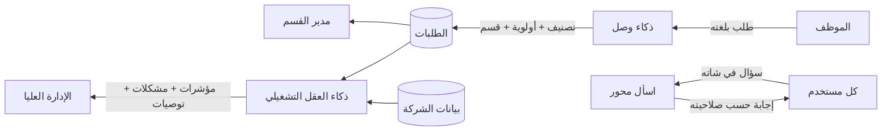
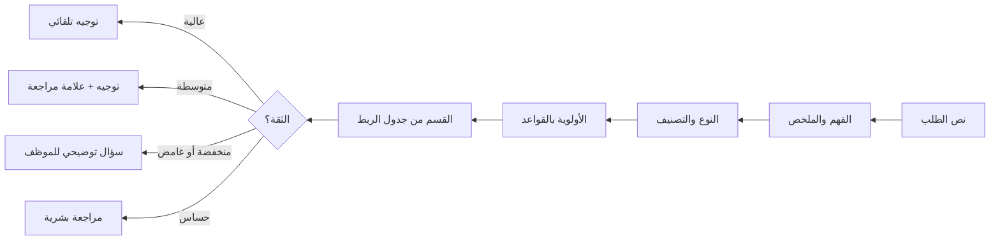

docs/ai.md

# آلية الذكاء الاصطناعي — AI Architecture

> **Group 4 · Member 3 · Week 1 draft** · 2026-11-06 · Status: draft for review
> Depends on: Q-02 (statuses, categories, priorities), Group 1 (MVP scope), Group 3 (database design + tech stack). Items marked ⏳ are completed in week 2.
> Applies decision ✅ Q-09: the system routes the request to the department; the Department Manager decides who handles it.
> Applies decision ✅ ADR-4502: one AI assistant, and «اسأل محور» is a chat for every user, limited by their role.

## 0. نظرة عامة

> **ذكاء اصطناعي واحد يخدم الكل.** محور فيه نموذج ذكاء اصطناعي **واحد** فقط، مو ثلاثة أنظمة. يشتغل بطريقتين:
> - **بالخلفية** بدون ما أحد يكلّمه: يصنّف الطلبات ويوجّهها (وصل)، ويحلل بيانات الشركة (العقل التشغيلي).
> - **بالشات «اسأل محور»**: كل مستخدم عنده محادثته الخاصة معه، زي ChatGPT، ويشوف فيها **حسب صلاحيات دوره بس**.

| الاستخدام | وش يسوي | Unit | FRs |
|---|---|---|---|
| وصل (بالخلفية) | يفهم طلب الموظف، يصنّفه، يحدد أولويته، ويوجّهه للقسم | 2 | FR-01, FR-06 → FR-08, FR-11 |
| العقل التشغيلي (بالخلفية) | يحلل بيانات الشركة، يكتشف المشكلات والفرص، ويقترح توصيات | 4 | FR-16, FR-18, FR-20 → FR-22, FR-24 → FR-31 |
| اسأل محور (الشات) | يجاوب أسئلة **كل مستخدم** عن البيانات اللي يسمح بها دوره | 5 | FR-17 (موسّع · ADR-4502), FR-32 |

### المبادئ الخمسة

1. **الأرقام يحسبها النظام، والذكاء الاصطناعي يشرح ويقترح.** المؤشرات والإحصاءات تُحسب باستعلامات عادية، والذكاء الاصطناعي يفسّرها ويربطها ويكتب التوصية. هذا يمنع اختراع أرقام.
2. **الذكاء الاصطناعي يقترح، والإنسان يقرر.** مدير القسم يقدر يصحّح التوجيه، والإدارة العليا تعتمد التوصيات أو ترفضها.
3. **كل مخرج منظم ومربوط بمصدره** (NFR-24, NFR-25, NFR-27): كل نتيجة معها مصدر البيانات، وتاريخ التحليل، ورقم عملية التحليل.
4. **أقل بيانات ممكنة، وحسب صلاحية الدور** (NFR-05): النموذج ياخذ اللي يحتاجه بس، وما يشوف إلا اللي يسمح به دور المستخدم.
5. **كل قرار للذكاء الاصطناعي مسجّل** (NFR-08, NFR-22): وش قرر، وبأي ثقة، ومين عدّله بعده.

---

## 1. Wasl AI — ذكاء وصل

### 1.1 المدخلات

| Input | الوصف | ملاحظة |
|---|---|---|
| request_text | نص الطلب كما كتبه الموظف (عربي فصيح أو عامي، وأحياناً إنجليزي) | المدخل الأساسي |
| attachments_meta | أسماء وأنواع المرفقات فقط | الذكاء الاصطناعي **ما يقرأ محتوى المرفقات** في النسخة الأولى (Q-4205) |
| employee_department | قسم الموظف | يفيد في السياق وفي الحالات الحساسة |
| submitted_at | وقت الإرسال | لحساب المواعيد القريبة |

> **تقليل البيانات:** النموذج ما يحتاج اسم الموظف أو رقمه. نرسل النص فقط، ونخفي أي أرقام هوية أو حسابات بنكية مكتوبة فيه.

### 1.2 الخطوات

1. **يفهم:** يقرأ النص، ويتعامل مع العامية والأخطاء الإملائية، ويكتب ملخص من سطر.
2. **يصنّف:** يحدد نوع الرسالة (طلب أو شكوى) وتصنيفها من القائمة المعتمدة (1.4).
3. **يحدد الأولوية:** بالقواعد الواضحة في (1.5)، والذكاء الاصطناعي يكتشف الإشارات (موعد قريب، خطر، توقف عمل).
4. **يوجّه:** القسم **ما يختاره الذكاء الاصطناعي بحرية**؛ يطلع من جدول ربط التصنيف بالقسم (1.4)، وهذا الجدول يعدّله مدير النظام من الإعدادات (FR-36).
5. **يتأكد من الثقة:** حسب درجة الثقة يقرر: يمشي تلقائياً، أو يسأل الموظف سؤال توضيحي، أو يحيله لمراجعة بشرية (1.6).
6. **يسجّل ويبلّغ:** يحفظ القرار مع سببه (1.8)، ويرسل للموظف إشعار «تم توجيه طلبك إلى …» (FR-11).

### 1.3 المخرج المنظم (Structured output · NFR-24)

| Field | Type | الوصف |
|---|---|---|
| request_type | `request` · `complaint` | طلب أو شكوى (FR-01) |
| category | من القائمة (1.4) | التصنيف (FR-06) |
| department | من جدول الربط | القسم (FR-08) |
| priority | `low` · `medium` · `high` | الأولوية (FR-07) |
| confidence_category | من 0 إلى 1 | ثقة التصنيف |
| confidence_department | من 0 إلى 1 | ثقة التوجيه |
| summary_ar | نص | ملخص الطلب في سطر |
| reason_ar | نص | ليش صنّفه كذا (يشوفه المدير) |
| flags | قائمة | `sensitive` · `urgent` · `unclear` · `multiple_requests` · `not_a_request` · `security_incident` |
| decision | `auto` · `auto_review` · `clarify` · `human_review` | وش سوّى النظام (1.6) |

### 1.4 التصنيفات والأقسام — مقترح (Q-4201 · Q-02)

> مقترح للاعتماد. الأقسام الفعلية تُدار من مدير النظام (FR-34)، والجدول يُعدّل من الإعدادات.

| # | التصنيف | القسم | الأولوية الافتراضية | أمثلة |
|---|---|---|---|---|
| 1 | الإجازات | الموارد البشرية | متوسطة | إجازة اعتيادية، اضطرارية، مرضية، رصيد |
| 2 | شؤون الموظفين | الموارد البشرية | منخفضة | شهادة راتب، تحديث بيانات، نقل، سياسات |
| 3 | التدريب والتطوير | الموارد البشرية | منخفضة | دورات، تدريب فريق |
| 4 | بيئة العمل والسلوك ⚠️ حساس | الموارد البشرية | عالية | إساءة، تحرش، مخالفات سلوك |
| 5 | الرواتب والمستحقات | الشؤون المالية | متوسطة | نقص راتب، بدلات، سلفة، نهاية خدمة |
| 6 | المصروفات والمدفوعات | الشؤون المالية | متوسطة | استرداد مصروف، فواتير موردين |
| 7 | الحسابات والصلاحيات والبريد | تقنية المعلومات | متوسطة | كلمة مرور، قفل حساب، صلاحية نظام، بريد |
| 8 | الأجهزة والبرامج | تقنية المعلومات | متوسطة | جهاز بطيء، طابعة، برنامج، استرجاع ملف |
| 9 | الشبكة والاتصال | تقنية المعلومات | متوسطة | إنترنت، VPN |
| 10 | أمن المعلومات | تقنية المعلومات | عالية | رسائل احتيال، اختراق |
| 11 | الصيانة والنظافة | الشؤون الإدارية | متوسطة | مكيف، كهرباء، تسريب، أثاث، نظافة |
| 12 | الخدمات الإدارية والنقل | الشؤون الإدارية | منخفضة | سيارة مهمة، مواقف، ضيافة، غرف اجتماعات |
| 13 | المشتريات واللوازم | الشؤون الإدارية | منخفضة | ورق، أحبار، لوازم |

### 1.5 قواعد الأولوية

الأولوية تبدأ من **الافتراضية للتصنيف**، وترتفع حسب هذي القواعد (الأعلى يغلب):

| الأولوية | متى |
|---|---|
| **عالية** | يوقف العمل كلياً · خطر على السلامة أو الأمن · موعد نهائي خلال 48 ساعة · يأثر على قسم كامل أو عدة موظفين · شكوى حساسة · حادثة أمن معلومات |
| **متوسطة** | يأثر على عمل الموظف جزئياً · مطلوب خلال أسبوع |
| **منخفضة** | ما يأثر على العمل الحين · موعده بعيد (أكثر من أسبوع) · طلب روتيني أو استفسار |

> مدير القسم يقدر يعدّل الأولوية، والتعديل ينحفظ (1.8).

### 1.6 الثقة والمراجعة البشرية — مقترح لـ Q-07 (ADR-4202)

| الحالة | الشرط | وش يصير |
|---|---|---|
| تلقائي `auto` | ثقة التصنيف والتوجيه 0.85 أو أكثر | يتوجه مباشرة |
| تلقائي مع مراجعة `auto_review` | الثقة بين 0.60 و 0.85 | يتوجه، ويظهر عند المدير بعلامة «راجع التوجيه» |
| سؤال توضيحي `clarify` | الثقة أقل من 0.60 · نص غامض · أكثر من طلب في رسالة | قبل الإرسال، يسأل الموظف سؤال واحد بخيارات (مثل: «طلبك يخص الإجازات أو الرواتب؟»)، أو يقترح تقسيم الرسالة |
| مراجعة بشرية `human_review` | شكوى حساسة (تصنيف 4) · حادثة أمن معلومات | يروح لمراجع بشري مختص قبل أي إجراء |

**لماذا هذا الحل؟**
- السؤال التوضيحي يحل الغموض **عند الموظف نفسه** بدل ما يضيع الطلب بين الأقسام.
- العلامة عند المدير تخلي التصحيح سهل بدون ما نوقف الطلبات المتوسطة.
- الحساس دايم يمر على إنسان، لأن الخطأ فيه مكلف.

**قاعدة مهمة للشكاوى الحساسة (ADR-4203):** إذا كانت الشكوى **عن مدير الموظف نفسه**، ما تروح لهذا المدير أبداً. تروح لمراجع الموارد البشرية المختص.

### 1.7 الحالات الخاصة

| الحالة | مثال | تصرف النظام |
|---|---|---|
| نص غامض | «عندي مشكلة» | سؤال توضيحي بخيارات |
| أكثر من طلب | «أبي إجازة وسيارة وتصليح المكيف» | يقترح تقسيمها إلى طلبات منفصلة |
| شكوى حساسة | تحرش، إهانة من المدير | مراجعة بشرية + قاعدة ADR-4203 |
| ليست طلب | «مشكورين على سرعة الحل» | ما يُنشئ طلب، وينحفظ كملاحظة (Q-4203) |
| اقتراح | «لو نسوي نظام حجز للغرف» | يُسجّل كاقتراح، والنوع غير موجود في المتطلبات (Q-4203) |
| عامية أو إنجليزي | «My email is not syncing» | يُفهم ويُصنّف عادي، والملخص بالعربي |
| تصنيف مضلل | «تسريب مويه فوق غرفة السيرفرات» | الصيانة (الشؤون الإدارية)، وإشعار لتقنية المعلومات اختياري |
| توجيه خاطئ | المدير يشوف إن الطلب مو لقسمه | المدير **يعيد توجيهه**، والتصحيح يُسجّل لقياس الجودة (Q-4202) |

### 1.8 التسجيل (Logging)

لكل طلب ينحفظ (الحقول الفعلية تحددها المجموعة 3 — Q-4204):
- مخرج الذكاء الاصطناعي كامل (1.3) + نسخة النموذج والتعليمات المستخدمة + الوقت.
- أي تعديل بشري بعده: مين عدّل، وش كان، وش صار (القسم، الأولوية، التصنيف).
- هذي البيانات تُستخدم لقياس الجودة (القسم 5) ولتحسين التعليمات.

---

## 2. Operational Brain AI — ذكاء العقل التشغيلي

### 2.1 مصادر البيانات

| المصدر | وش فيه | في النسخة الأولى؟ |
|---|---|---|
| بيانات الطلبات (D1) | الطلبات، التصنيفات، الأقسام، الأوقات، الحالات | ✅ نعم |
| بيانات الشركة التشغيلية (D2 · CompanyData) | مؤشرات من الأنظمة: source · metric_name · value · recorded_at | مقترح: استيراد ملفات (CSV/Excel) بشكل موحّد، والربط المباشر لاحقاً (Q-4401) |
| بيانات خارجية | مؤشرات السوق وغيرها | ❌ لاحقاً |

### 2.2 فحص جودة البيانات

قبل أي تحليل، النظام يفحص:
- **الاكتمال:** فيه بيانات كافية للفترة؟ (مثلاً أقل من 4 أسابيع = تحليل اتجاهات غير موثوق)
- **الحداثة:** متى آخر تحديث لكل مؤشر؟
- **التكرار والقيم الغريبة:** قيم مكررة أو مستحيلة (مثل وقت معالجة بالسالب).

إذا الجودة ضعيفة، النتيجة تطلع مع تنبيه **«بيانات غير كافية»** بدل استنتاج غير موثوق.

### 2.3 المؤشرات (KPIs)

> تُحسب بالاستعلامات العادية، مو بالذكاء الاصطناعي (المبدأ 1).

| المؤشر | كيف يُحسب | المصدر | FR |
|---|---|---|---|
| عدد الطلبات | حسب القسم والتصنيف والفترة | الطلبات | FR-18, FR-20 |
| متوسط وقت المعالجة | من وقت الإنشاء إلى الإغلاق | الطلبات + سجل الحالة (Q-10) | FR-18 |
| نسبة الطلبات المتأخرة | الطلبات اللي تجاوزت المدة المستهدفة لأولويتها | الطلبات | FR-18 |
| نسبة الشكاوى | الشكاوى ÷ كل الطلبات | الطلبات | FR-20 |
| نسبة إعادة التوجيه | الطلبات اللي صحّح المدير قسمها ÷ الكل | سجل الذكاء الاصطناعي (Q-4202) | جودة وصل |
| مؤشرات تشغيلية | حسب المتوفر في CompanyData | بيانات الشركة | FR-42 |

**المدة المستهدفة المقترحة (Q-4202):** عالية = يوم عمل · متوسطة = 3 أيام عمل · منخفضة = 7 أيام عمل.

### 2.4 الاكتشاف

| النوع | الطريقة | FR |
|---|---|---|
| حالة شاذة (Anomaly) | مقارنة القيمة الحالية بمتوسطها في آخر 8 أسابيع؛ إذا ابتعدت بشكل كبير (أكثر من ضعف التذبذب المعتاد) = حالة شاذة | FR-26 |
| اتجاه (Trend) | ارتفاع أو انخفاض مستمر 3 فترات متتالية أو أكثر | FR-27 |
| مشكلة (Detected Issue) | ربط مؤشرين أو أكثر، مثل: ارتفاع شكاوى «التأخير» + ارتفاع وقت المعالجة في نفس القسم. الذكاء الاصطناعي يلخّص الشكاوى المرتبطة ويحدد الخطورة (منخفضة / متوسطة / عالية) | FR-25 |
| فرصة (Opportunity) | مثل: طلبات روتينية متكررة يمكن أتمتتها (شهادات الراتب)، أو قسم أداؤه ممتاز نستفيد من طريقته | FR-22 (Q-05) |
| رؤية (Insight) | جملة تشرح وش يعني هذا كله للإدارة | FR-28 (Q-12) |

### 2.5 التوصيات (FR-19)

كل توصية لازم يكون فيها:

| الجزء | مثال |
|---|---|
| العنوان | تقليل خطوات الموافقة على الطلبات |
| وش لاحظنا (بالأرقام) | شكاوى «تأخير الموافقات» ارتفعت 40٪ خلال 4 أسابيع |
| السبب المحتمل | 70٪ من وقت المعالجة يضيع في مرحلة الموافقة |
| الإجراء المقترح | تقليل خطوات الموافقة أو إعادة توزيع الصلاحيات |
| الأثر المتوقع | تقليل وقت المعالجة |
| الثقة | متوسطة |
| المصدر · تاريخ التحليل · رقم عملية التحليل | بيانات الطلبات · 2026-11-06 · analysis_id |
| الحالة | مقترحة · معتمدة · مرفوضة (Q-4402) |

### 2.6 متى يشتغل

| النوع | متى | FR |
|---|---|---|
| تحديث المؤشرات | يومياً (بدون ذكاء اصطناعي) | FR-18 |
| تحليل دوري | أسبوعياً | FR-31 |
| تحليل عند الطلب | لما تطلبه الإدارة العليا أو تسأل في «اسأل محور» | FR-32 |

كل تحليل يُحفظ كعملية تحليل (AnalysisRun): نوع التشغيل، والوقت، ومين طلبه (FR-29).

### 2.7 المراجعة البشرية

- التوصيات **اقتراحات**: الإدارة العليا تعتمدها أو ترفضها، ونتابع أثر المعتمد منها.
- الحالات الشاذة والمشكلات تظهر كتنبيهات، والإدارة تقرر هل تحتاج إجراء.

---

## 3. Ask AI — اسأل محور (شات لكل مستخدم)

> **القرار (ADR-4502):** «اسأل محور» شات **لكل الأدوار**، وكل مستخدم عنده محادثته الخاصة. هذا يوسّع FR-17 (المكتوب في المرحلة الأولى للإدارة العليا فقط)، لأن هدف محور إن كل الشركة تستفيد من بياناتها. نفس النموذج ونفس الشاشة للكل، والفرق **في البيانات اللي يوصل لها كل دور**.

### 3.1 كيف يستقبل السؤال

1. المستخدم يكتب سؤاله بالعربي في شاته، مثل: «وين وصل طلبي؟» أو «كم طلب متأخر في قسمي؟»
2. **النظام يحدد دور المستخدم وصلاحياته أولاً** (في الخادم)، وبعدها الذكاء الاصطناعي يفهم السؤال ويحوّله إلى **مؤشر معتمد + فلاتر** من **قائمة المؤشرات المسموحة لدوره**.
3. إذا السؤال غامض، يسأل سؤال توضيحي (مثل: «تقصد هالشهر الميلادي أو آخر 30 يوم؟»).
4. **النظام** يشغّل الاستعلام ويطلع الأرقام (مو الذكاء الاصطناعي).
5. الذكاء الاصطناعي يكتب الإجابة.
6. المحادثة تنحفظ للمستخدم نفسه (Q-4502)، وأسئلة الإدارة العليا التحليلية تنحفظ كعملية تحليل عند الطلب (FR-29, FR-32 · Q-05).

> **ليش قائمة مؤشرات معتمدة بدل ما يكتب الذكاء الاصطناعي استعلام بنفسه؟** أدق وأأمن: ما يقدر يطلع بيانات خارج الصلاحية، وما يخترع أرقام (ADR-4501).

### 3.2 البيانات المسموحة لكل دور

| الدور | أمثلة أسئلة | يوصل لـ | ما يوصل لـ |
|---|---|---|---|
| الموظف | «وين وصل طلبي؟» · «كم باقي على طلب الإجازة؟» · «أبي أرفع طلب صيانة» | طلباته وإشعاراته فقط | طلبات غيره، وأي أرقام عن الأقسام |
| مدير القسم | «كم طلب متأخر عندي؟» · «وش أكثر شكاوى هالشهر؟» | طلبات قسمه فقط (NFR-03) | الأقسام الثانية |
| الإدارة العليا | «ليش زاد وقت المعالجة؟» · «قارن الأقسام» | الشركة كلها، بأرقام مجمّعة (Q-4501) | — |
| مدير النظام | «كم مستخدم بدون قسم؟» · «وش آخر التغييرات في الصلاحيات؟» | بيانات الإدارة والسجلات (NFR-04) | محتوى الطلبات والشكاوى |

**قواعد ثابتة لكل الأدوار:**
- **الصلاحية تنفحص في الخادم قبل** ما توصل أي بيانات للنموذج. يعني النموذج نفسه ما يشوف إلا اللي يسمح به الدور (NFR-02, NFR-05).
- **ممنوع دايماً:** محتوى الشكاوى الحساسة وأسماء أصحابها، إلا للمراجع المختص.
- **الموظف يقدر يرفع طلب من الشات:** الذكاء الاصطناعي يجهّز الطلب من كلامه، ويعرضه عليه، والموظف **يأكد قبل الإرسال**. بعدها يمشي نفس مسار وصل (القسم 1).

### 3.3 شكل الإجابة (مثال من شات الإدارة العليا)

| الجزء | مثال |
|---|---|
| الجواب المباشر | 23 طلب متأخر في الموارد البشرية هذا الشهر |
| الأرقام | جدول صغير حسب التصنيف |
| التفسير | أغلبها في «الإجازات» بسبب مرحلة الموافقة |
| المصدر والتاريخ | بيانات الطلبات · حتى 2026-11-06 |
| رقم عملية التحليل | analysis_id |
| أسئلة مقترحة | «قارنها بالشهر الماضي؟» |

### 3.4 الحدود

- إذا البيانات المطلوبة غير متوفرة، يقول بوضوح **«هذي البيانات غير متوفرة»** ويقترح أقرب مؤشر متوفر.
- ما يجاوب من معلوماته العامة كأنها بيانات الشركة.

---

## 4. قرار RAG والتقنيات

### 4.1 هل نحتاج RAG أو Embeddings؟ (ADR-4001)

| الحالة | الحل | في النسخة الأولى؟ |
|---|---|---|
| أرقام وسجلات منظمة (طلبات ومؤشرات) | استعلامات عادية | ✅ هذا اللي نحتاجه |
| أسئلة عن سياسات ولوائح الشركة (مثل «وش سياسة العمل عن بعد؟») | RAG على مستندات السياسات | ❌ لاحقاً، إذا أُضيفت المستندات |
| اكتشاف الشكاوى المتشابهة والمتكررة | Embeddings | ❌ لاحقاً، كتحسين |

**القرار المقترح:** لا RAG ولا Vector Database في النسخة الأولى.
**Fine-tuning:** مؤجّل. ندرسه فقط إذا طلعت دقة التصنيف ضعيفة بعد التشغيل وتوفرت بيانات حقيقية كافية.

### 4.2 اختيار النموذج — بالتنسيق مع المجموعة 3 (ADR-4002)

القرار النهائي في «قرار التقنيات» (المجموعة 3). من جهتنا، **معايير الاختيار:**

| المعيار | ليش مهم |
|---|---|
| جودة العربي والعامية | الموظفين يكتبون بلغتهم الطبيعية |
| المخرج المنظم (JSON) | المتطلب NFR-24 |
| السرعة | تصنيف الطلب خلال 5 ثواني أو أقل (NFR-10) |
| التكلفة | تكلفة كل 1000 طلب |
| الخصوصية | وين تُعالج البيانات وشروط استخدامها (NFR-05) |
| التوفر | ثبات الخدمة (NFR-15) |

**التوصية المقترحة:** نموذج لغوي جاهز عبر API قوي في العربي، مع تقليل البيانات المرسلة (1.1). يحقق أفضل جودة بأقل جهد تطوير في النسخة الأولى.

---

## 5. قياس الجودة

### 5.1 المقاييس والأهداف

| المقياس | الهدف المقترح |
|---|---|
| دقة التصنيف | 85٪ أو أكثر |
| دقة التوجيه للقسم | 90٪ أو أكثر |
| دقة الأولوية | 75٪ أو أكثر، وبدون أي خطأ بمستويين (عالية ↔ منخفضة) |
| الحالات الغامضة ومتعددة الطلبات | 100٪ تطلع سؤال توضيحي أو اقتراح تقسيم |
| الشكاوى الحساسة | 100٪ تروح مراجعة بشرية، وولا وحدة توصل للمدير المشكو منه |
| نسبة المراجعة البشرية في التشغيل | 20٪ أو أقل |
| زمن التصنيف | 5 ثواني أو أقل |
| العقل التشغيلي | نسبة قبول التوصيات من الإدارة · نسبة الإنذارات الخاطئة |
| اسأل محور | أسئلة اختبار بإجابات معروفة لكل دور ⏳ |
| صلاحيات الشات | 100٪ من أسئلة «خارج الصلاحية» تنرفض، وولا إجابة تكشف بيانات دور ثاني |

### 5.2 مجموعة الاختبار — 50 طلب

> نشغّل كل طلب على ذكاء وصل ونقارن النتيجة بالمتوقع. الأولوية حسب القواعد (1.5).

| # | نص الطلب | النوع | التصنيف | القسم | الأولوية | المتوقع من النظام |
|---|---|---|---|---|---|---|
| 1 | أبغى إجازة اعتيادية من 15 إلى 20 الشهر الجاي | طلب | الإجازات | الموارد البشرية | منخفضة | تلقائي |
| 2 | أحتاج إجازة اضطرارية بكرة، الوالدة تعبانة ومنوّمة بالمستشفى | طلب | الإجازات | الموارد البشرية | عالية | تلقائي (موعد قريب) |
| 3 | راتب هالشهر نزل ناقص 1200 ريال وما أدري ليش | شكوى | الرواتب والمستحقات | الشؤون المالية | متوسطة | تلقائي |
| 4 | ما أقدر أدخل على حسابي في النظام من الصبح، يقول كلمة المرور غلط | طلب | الحسابات والصلاحيات والبريد | تقنية المعلومات | عالية | تلقائي (توقف عمل) |
| 5 | اللابتوب حقي صار بطيء مرة ويعلّق مع الإكسل | طلب | الأجهزة والبرامج | تقنية المعلومات | متوسطة | تلقائي |
| 6 | المكيف في مكتب 304 خربان والجو حار جداً | طلب | الصيانة والنظافة | الشؤون الإدارية | متوسطة | تلقائي |
| 7 | فيه تسريب مويه من السقف فوق غرفة السيرفرات! | طلب | الصيانة والنظافة | الشؤون الإدارية | عالية | تلقائي (خطر) · تصنيف مضلل |
| 8 | أبغى شهادة تعريف بالراتب موجهة للبنك | طلب | شؤون الموظفين | الموارد البشرية | منخفضة | تلقائي |
| 9 | نحتاج ورق طابعة وأحبار للقسم | طلب | المشتريات واللوازم | الشؤون الإدارية | منخفضة | تلقائي |
| 10 | الإنترنت مقطوع في الدور الثاني كامل | طلب | الشبكة والاتصال | تقنية المعلومات | عالية | تلقائي (يأثر على عدة موظفين) |
| 11 | ودي أسجل في دورة إدارة مشاريع PMP اللي تدعمها الشركة | طلب | التدريب والتطوير | الموارد البشرية | منخفضة | تلقائي |
| 12 | قدمت على بدل سكن من شهرين وللحين ما وصلني رد | شكوى | الرواتب والمستحقات | الشؤون المالية | متوسطة | تلقائي |
| 13 | أبغى أسترد 350 ريال دفعتها لضيافة اجتماع العملاء، والفاتورة مرفقة | طلب | المصروفات والمدفوعات | الشؤون المالية | منخفضة | تلقائي |
| 14 | مديري المباشر يرفع صوته علي قدام الزملاء بشكل متكرر ويهينني | شكوى | بيئة العمل والسلوك | الموارد البشرية | عالية | مراجعة بشرية · لا يروح للمدير |
| 15 | طابعة القسم ما تطبع وتطلع خطأ ورق عالق | طلب | الأجهزة والبرامج | تقنية المعلومات | متوسطة | تلقائي |
| 16 | أبي أغيّر رقم جوالي المسجل في النظام | طلب | شؤون الموظفين | الموارد البشرية | منخفضة | تلقائي |
| 17 | مساعدة | — | — | — | — | سؤال توضيحي |
| 18 | عندي مشكلة | — | — | — | — | سؤال توضيحي |
| 19 | الكرسي مكسور وظهري يوجعني من الجلسة | طلب | الصيانة والنظافة | الشؤون الإدارية | متوسطة | تلقائي |
| 20 | أبي برنامج Adobe على جهازي عشان شغل التصاميم | طلب | الأجهزة والبرامج | تقنية المعلومات | منخفضة | تلقائي |
| 21 | انقطعت الكهرباء عن نص المكاتب وفيه ريحة احتراق | طلب | الصيانة والنظافة | الشؤون الإدارية | عالية | تلقائي (خطر سلامة) |
| 22 | حسابي انقفل بعد ما غلطت بالباسوورد 3 مرات وعندي اجتماع بعد ساعة | طلب | الحسابات والصلاحيات والبريد | تقنية المعلومات | عالية | تلقائي |
| 23 | متى تنزل مستحقات نهاية الخدمة؟ آخر يوم لي الأسبوع الجاي | طلب | الرواتب والمستحقات | الشؤون المالية | متوسطة | تلقائي |
| 24 | أبغى إجازة مرضية، مرفق التقرير الطبي | طلب | الإجازات | الموارد البشرية | متوسطة | تلقائي |
| 25 | الحمامات في الدور الأول غير نظيفة من أسبوع | شكوى | الصيانة والنظافة | الشؤون الإدارية | متوسطة | تلقائي |
| 26 | فيه زميل يدخّن داخل المكتب رغم المنع | شكوى | بيئة العمل والسلوك | الموارد البشرية | متوسطة | تلقائي + علامة مراجعة |
| 27 | ودي أعرف رصيد إجاجاتي كم باقي | طلب | الإجازات | الموارد البشرية | منخفضة | تلقائي (خطأ إملائي) |
| 28 | My email is not syncing on my phone since yesterday | طلب | الحسابات والصلاحيات والبريد | تقنية المعلومات | متوسطة | تلقائي (إنجليزي) |
| 29 | أحتاج صلاحية دخول على نظام المشتريات عشان أعتمد الطلبات | طلب | الحسابات والصلاحيات والبريد | تقنية المعلومات | متوسطة | تلقائي (كلمة «المشتريات» مضللة) |
| 30 | اعتماد طلبات الإجازة يتأخر كثير، صار لي أسبوعين أنتظر | شكوى | الإجازات | الموارد البشرية | متوسطة | تلقائي (مفيد للعقل التشغيلي) |
| 31 | أبغى سيارة للمشوار الرسمي لزيارة العميل يوم الأحد | طلب | الخدمات الإدارية والنقل | الشؤون الإدارية | متوسطة | تلقائي |
| 32 | ما فيه مواقف كافية للموظفين وكل يوم أتأخر بسببها | شكوى | الخدمات الإدارية والنقل | الشؤون الإدارية | متوسطة | تلقائي |
| 33 | فاتورة المورد معلقة من شهر والمورد يتصل علي كل يوم | شكوى | المصروفات والمدفوعات | الشؤون المالية | متوسطة | تلقائي |
| 34 | أبي خطاب لمن يهمه الأمر بالراتب والمسمى الوظيفي | طلب | شؤون الموظفين | الموارد البشرية | منخفضة | تلقائي (شبيه بـ 8) |
| 35 | الشاشة الثانية حقت مكتبي ما تشتغل | طلب | الأجهزة والبرامج | تقنية المعلومات | منخفضة | تلقائي |
| 36 | زميلتي تتعرض لتحرش لفظي من موظف بالقسم وخايفة تبلّغ | شكوى | بيئة العمل والسلوك | الموارد البشرية | عالية | مراجعة بشرية (بلاغ عن طرف ثالث) |
| 37 | أبغى أنتقل لقسم التسويق، أشوف خبرتي تناسبهم أكثر | طلب | شؤون الموظفين | الموارد البشرية | منخفضة | تلقائي |
| 38 | النظام كله واقف، ما أحد في الشركة يقدر يسجل دخول | طلب | الحسابات والصلاحيات والبريد | تقنية المعلومات | عالية | تلقائي + تنبيه عاجل (الشركة كلها) |
| 39 | أبي إجازة وسيارة وتصليح المكيف | — | متعدد | متعدد | — | اقتراح تقسيم إلى 3 طلبات |
| 40 | وش سياسة العمل عن بعد في الشركة؟ | طلب | شؤون الموظفين | الموارد البشرية | منخفضة | تلقائي (مرشح لـ RAG لاحقاً) |
| 41 | يا ليت تشوفون موضوع الشاي والقهوة بالمطبخ، خلص من أسبوع | شكوى | الخدمات الإدارية والنقل | الشؤون الإدارية | منخفضة | تلقائي |
| 42 | أبي أسترجع ملف حذفته بالغلط من المجلد المشترك، مهم لاجتماع بكرة | طلب | الأجهزة والبرامج | تقنية المعلومات | عالية | تلقائي (موعد قريب) |
| 43 | انخصم يوم من راتبي غياب وأنا كنت في مهمة رسمية | شكوى | شؤون الموظفين | الموارد البشرية | متوسطة | تلقائي + علامة مراجعة (يحتمل المالية) |
| 44 | أحتاج تدريب لفريقي على نظام الموارد البشرية الجديد | طلب | التدريب والتطوير | الموارد البشرية | منخفضة | تلقائي |
| 45 | الباب الرئيسي للمبنى ما يقفل زين بالليل | طلب | الصيانة والنظافة | الشؤون الإدارية | عالية | تلقائي (أمن) |
| 46 | جاني إيميل غريب يطلب بياناتي البنكية وضغطت الرابط | طلب | أمن المعلومات | تقنية المعلومات | عالية | مراجعة بشرية (حادثة أمنية) |
| 47 | أبغى سلفة على الراتب، ظروف خاصة | طلب | الرواتب والمستحقات | الشؤون المالية | متوسطة | تلقائي |
| 48 | مشكورين على سرعة حل طلبي السابق 👍 | — | — | — | — | ليست طلب (Q-4203) |
| 49 | اقتراح: لو نسوي نظام حجز لغرف الاجتماعات بدل الإيميلات | — | الخدمات الإدارية والنقل | الشؤون الإدارية | منخفضة | اقتراح (Q-4203) |
| 50 | أشتغل عن بعد اليوم والـ VPN ما يتصل | طلب | الشبكة والاتصال | تقنية المعلومات | عالية | تلقائي (توقف عمل) |

**التوزيع:** الموارد البشرية 16 · تقنية المعلومات 13 · الشؤون الإدارية 11 · الشؤون المالية 6 · حالات خاصة 4. وفيها: حالات حساسة (14، 36)، غامضة (17، 18)، متعددة (39)، ليست طلب (48)، اقتراح (49)، إنجليزي (28)، خطأ إملائي (27)، تصنيف مضلل (7، 29)، توجيه محتمل لقسمين (43).

### 5.3 كيف نستخدمها

- **قبل التشغيل:** نشغّل الـ 50 ونحسب الدقة مقابل الأهداف (5.1).
- **بعد أي تعديل** على التعليمات أو النموذج أو جدول التصنيفات: نعيد التشغيل ونتأكد ما نزلت الدقة.
- **أي حالة فاشلة:** نعدّل التعليمات أو القواعد أو جدول الربط، ونضيف أمثلة جديدة للمجموعة مع الوقت.

---

## 6. قرارات وأسئلة مفتوحة

### قرارات مقترحة (Status: proposed)

| ID | القرار | Unit |
|---|---|---|
| ADR-4001 | لا RAG ولا Vector Database في النسخة الأولى، و Fine-tuning مؤجّل | 0 |
| ADR-4002 | نموذج لغوي جاهز عبر API قوي في العربي، مع تقليل البيانات المرسلة · القرار النهائي مع المجموعة 3 | 0 |
| ADR-4201 | الذكاء الاصطناعي يختار **التصنيف**، والقسم يطلع من **جدول ربط** يعدّله مدير النظام | 2 |
| ADR-4202 | حدود الثقة والمراجعة البشرية في (1.6) — اقتراحنا لـ Q-07 | 2 |
| ADR-4203 | الشكاوى الحساسة دايماً مراجعة بشرية، والشكوى عن المدير ما تروح له | 2 |
| ADR-4401 | المؤشرات والاكتشاف بالإحصاء والاستعلامات، والذكاء الاصطناعي للشرح والربط والتوصيات | 4 |
| ADR-4501 | «اسأل محور» يعتمد على قائمة مؤشرات معتمدة، وما يكتب استعلامات حرة | 5 |

### قرار معتمد من المنسق (Status: approved · 2026-11-06)

| ID | القرار | Unit |
|---|---|---|
| ADR-4502 | ذكاء اصطناعي **واحد** لمحور، و«اسأل محور» **شات لكل الأدوار**: كل مستخدم له محادثته، ويشوف حسب صلاحيات دوره. يوسّع FR-17 (كان للإدارة العليا فقط). دخوله نطاق MVP تؤكده المجموعة 1 | 5 |

### أسئلة مفتوحة

| ID | السؤال | Affects | Status |
|---|---|---|---|
| Q-4201 | اعتماد قائمة التصنيفات والأقسام والأولويات (1.4) — مرتبط بـ Q-02 | glossary.md · database.md | open |
| Q-4202 | إضافة «إعادة التوجيه» لمدير القسم + المدد المستهدفة لكل أولوية — غير موجودة في المتطلبات (FR-15) | api.md · screens.md · tasks.md | open |
| Q-4203 | الرسائل اللي مو طلب ولا شكوى (شكر، اقتراح): نحفظها كنوع جديد؟ — المتطلبات فيها طلب وشكوى فقط | requirements.md · database.md | open |
| Q-4204 | حقول سجل قرارات الذكاء الاصطناعي في قاعدة البيانات (الثقة، النسخة، التعديلات البشرية) — مرتبط بـ Q-10 | database.md | open |
| Q-4205 | هل يقرأ الذكاء الاصطناعي محتوى المرفقات في النسخة الأولى؟ (مقترحنا: لا) | ai.md | open |
| Q-4401 | وش مصادر بيانات الشركة المتوفرة فعلياً في النسخة الأولى؟ | ai.md · database.md | open |
| Q-4402 | حفظ حالة التوصية (مقترحة / معتمدة / مرفوضة) ومتابعة أثرها — مرتبط بـ Q-05 | database.md · screens.md | open |
| Q-4501 | هل تشوف الإدارة العليا بيانات فردية في «اسأل محور» أو أرقام مجمّعة فقط؟ | ai.md · api.md | open |
| Q-4502 | حفظ محادثات كل مستخدم في «اسأل محور» (المحادثة، الرسائل، التاريخ): غير موجود في ERD — مرتبط بـ Q-05 | database.md (المجموعة 3) | open |
| Q-4503 | توسيع FR-17 لكل الأدوار (ADR-4502): المجموعة 1 تضيفه في نطاق MVP، والمجموعة 2 تصمم شاشة شات واحدة لكل الأدوار | mvp-scope.md · screens.md | open |

---

## 7. للأسبوع الثاني ⏳

- [ ] مطابقة التصنيفات والأولويات مع القرار المعتمد لـ Q-02 (قاموس المصطلحات).
- [ ] أسماء الحقول من «تصميم قاعدة البيانات» (المجموعة 3)، خصوصاً سجل قرارات الذكاء الاصطناعي.
- [ ] تأكيد النموذج من «قرار التقنيات» (المجموعة 3).
- [ ] «اسأل محور»: قائمة المؤشرات المسموحة **لكل دور** + أسئلة اختبار بإجابات معروفة لكل دور، ومعها أسئلة «خارج الصلاحية» لازم تنرفض.
- [ ] تأكيد ميزات الذكاء الاصطناعي الداخلة في نطاق MVP (المجموعة 1).
- [ ] اعتماد حدود الثقة (Q-07) مع الفريق والمنسق.
