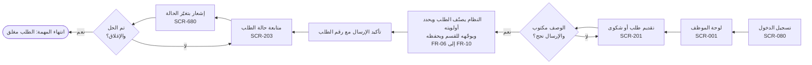
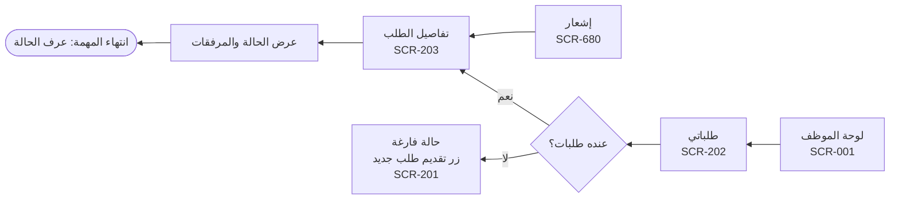
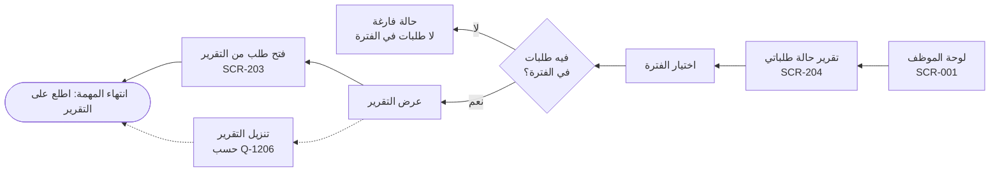
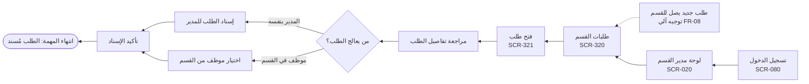
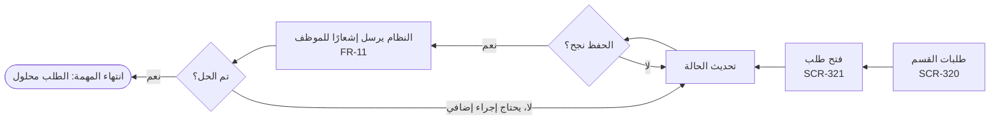

# مسارات المستخدمين (جزء: الموظف ومدير القسم)

> **File:** `docs/user-flows.md` · **Part:** Group 1 · Member 3 (Employee + Department Manager) · **Status:** draft for leader review · **Date:** 2026-11-17
> هذا الجزء يغطي مسارات دورَي **الموظف** و**مدير القسم** فقط. مسارات الإدارة العليا ومدير النظام عند العضو 4، ويدمجها القائد في نفس الملف.
> أرقام الشاشات تتبع `docs/screens.md`. الشاشتان SCR-080 (تسجيل الدخول) وSCR-680 (الإشعارات) يملكهما العضو 4.

---

## 1. قائمة المسارات

| ID | المسار | الدور | الشاشات | المتطلبات |
|---|---|---|---|---|
| FLOW-201 | تقديم طلب حتى الإغلاق | الموظف | SCR-080، SCR-001، SCR-201، SCR-203، SCR-680 | FR-01، FR-02، FR-03، FR-04، FR-11 · (تلقائي: FR-06، FR-07، FR-08، FR-09، FR-10) |
| FLOW-202 | متابعة طلباتي | الموظف | SCR-001، SCR-202، SCR-203، SCR-680 | FR-03، FR-04 |
| FLOW-203 | تقرير حالة طلباتي ⚠️ | الموظف | SCR-001، SCR-204، SCR-203 | FR-05 |
| FLOW-320 | استقبال طلب القسم وإسناده | مدير القسم | SCR-080، SCR-020، SCR-320، SCR-321 | FR-12، FR-13، NFR-03 · (تلقائي: FR-08) |
| FLOW-321 | تحديث حالة الطلب حتى الحل | مدير القسم | SCR-320، SCR-321 | FR-12، FR-14، FR-15، NFR-03 · (تلقائي: FR-11) |

---

## 2. المسارات

## FLOW-201 · تقديم طلب حتى الإغلاق
- Role: Employee · Screens: SCR-080, SCR-001, SCR-201, SCR-203, SCR-680 · Requirements: FR-01, FR-02, FR-03, FR-04, FR-11 (تلقائي: FR-06, FR-07, FR-08, FR-09, FR-10)
- الوصف: يسجّل الموظف دخوله، ويقدّم طلبًا أو شكوى بنص حر مع مرفقات اختيارية. النظام يصنّف الطلب ويحدد أولويته ويوجّهه للقسم ويحفظه دون تدخل الموظف (Q-09 ✅). ثم يتابع الحالة ويصله إشعار عند كل تغيير، حتى يُغلق الطلب.

## FLOW-202 · متابعة طلباتي
- Role: Employee · Screens: SCR-001, SCR-202, SCR-203, SCR-680 · Requirements: FR-03, FR-04
- الوصف: يفتح الموظف قائمة طلباته ويدخل أي طلب ليعرف حالته. يقدر يصل للتفاصيل مباشرة من إشعار. وإذا ما عنده طلبات تظهر حالة فارغة مع زر لتقديم طلب.

## FLOW-203 · تقرير حالة طلباتي ⚠️
- ⚠️ مشروط: FR-05 مؤجَّل (Later) في مسودة نطاق العضو 2 وMust عند العضو 1، فيخرج المسار من الـ MVP إذا اعتُمد التأجيل.
- Role: Employee · Screens: SCR-001, SCR-204, SCR-203 · Requirements: FR-05 (⚠️ Q-08, Q-1206)
- الوصف: يفتح الموظف تقريرًا بحالة طلباته، ويختار الفترة، ويقدر يدخل أي طلب منه. التنزيل كملف مشروط بقرار Q-1206 (خط متقطع).

## FLOW-320 · استقبال طلب القسم وإسناده
- Role: Department Manager · Screens: SCR-080, SCR-020, SCR-320, SCR-321 · Requirements: FR-12, FR-13, NFR-03 (تلقائي: FR-08)
- الوصف: يصل الطلب لقسم المدير بتوجيه آلي. المدير يدخل ويفتح الطلب ويراجعه، ثم يقرر: يعالجه بنفسه أو يسنده لموظف في قسمه (Q-09 ✅). يظهر له طلبات قسمه فقط (NFR-03).

## FLOW-321 · تحديث حالة الطلب حتى الحل
- Role: Department Manager · Screens: SCR-320, SCR-321 · Requirements: FR-12, FR-14, FR-15, NFR-03 (تلقائي: FR-11)
- الوصف: يفتح المدير طلبًا من قسمه ويحدّث حالته. النظام يرسل إشعارًا للموظف تلقائيًا. إذا ما انحلّ الطلب أو احتاج إجراءً إضافيًا يتكرر التحديث، حتى يُحل ويُغلق.

---

## 3. الافتراضات
1. نهاية الطلب (محلول أو مغلق) تتبع حالات الطلب المعتمدة في Q-02، وتُحدَّث أسماؤها في الرسومات بعد اعتمادها.
2. الإشعار عند تقديم الطلب نفسه غير مذكور في المتطلبات، فلا نرسمه. المتطلب هو إشعار عند تغيّر الحالة (FR-11).
3. مسار الموظف الذي يُسند له الطلب غير مرسوم، لأن لا شاشة له في الـ MVP (Q-1301).
4. الخط المتقطع في الرسومات يعني خطوة مشروطة بقرار مفتوح أو حدث تلقائي من النظام.

---

## 4. قرارات وأسئلة مفتوحة

هذا الجزء لا يضيف قرارات جديدة، ويرجع للقرارات والأسئلة المسجلة في `docs/screens.md`:

| المرجع | الأثر على المسارات |
|---|---|
| ADR-1301 | الإسناد وتحديث الحالة داخل SCR-321، فلا شاشات إضافية في FLOW-320 وFLOW-321 |
| Q-1203 | يؤثر على خطوة التقديم في FLOW-201 (لا اختيار للفئة، النظام يصنّف) |
| Q-1206 + Q-08 | يؤثران على FLOW-203 (شكل التقرير ومن يستفيد منه) |
| Q-1301 | مسار الموظف المُسند له الطلب غير موجود |
| Q-1302 | إعادة الإسناد غير مرسومة بانتظار القرار |
| Q-1601 | إشعار المدير بوصول طلب جديد غير مرسوم |
| Q-02 | أسماء الحالات في FLOW-201 وFLOW-321 |
| Q-1201 (العضو 2) | من يغلق الطلب بعد الحل: يؤثر على نهاية FLOW-201 (الموظف) وFLOW-321 (المدير) |
| Q-1202 (العضو 2) | ربط الفئات بالأقسام: يؤثر على التوجيه الآلي في FLOW-201 وFLOW-320 |

**الأرقام المنشأة في هذا الجزء:** FLOW-201 → FLOW-203 · FLOW-320، FLOW-321
