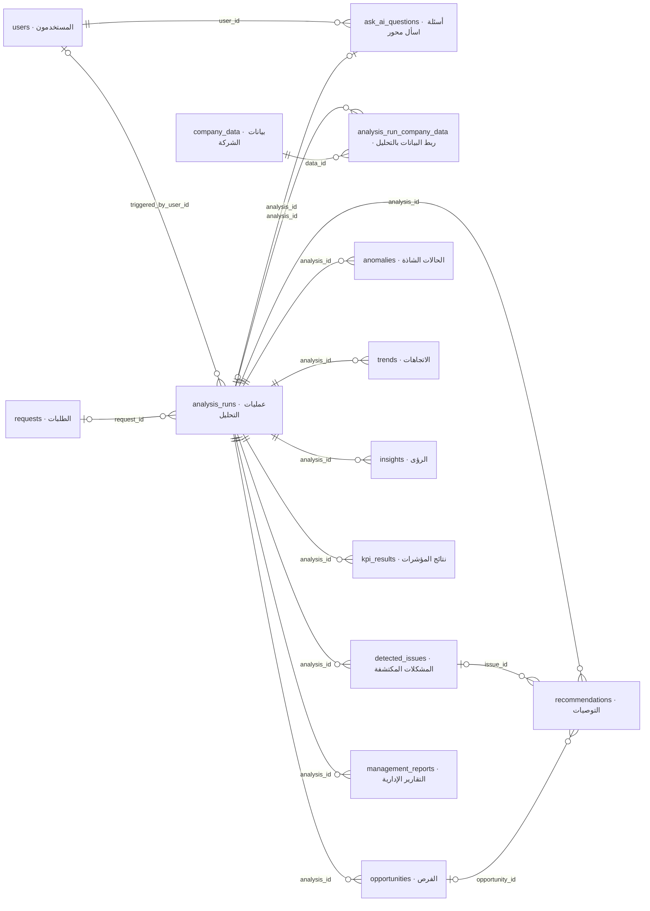

# تصميم قاعدة البيانات (جزء: بيانات الشركة وعمليات التحليل ونتائجها والتقارير)

> **Group 3 · Member 4 · Week 3 check** · 2026-11-22 · Status: draft for review · Part 2 of 2
> Applies: Q-05, Q-06, Q-12, Q-13 (proposed answers below) · Built on Group 1 `docs/mvp-scope.md` (MVP) · Group 3 `docs/tech-stack.md` (approved: ADR-3003 PostgreSQL, ADR-3004, ADR-3005) · Part 1 by Member 3 (`users.user_id`, `requests.request_id`, `system_logs`, `system_settings`).
> Checked against: Part 1 (Member 3) and Group 1 `docs/screens.md` + `docs/user-flows.md` (version 2, 2026-11-12). `docs/api.md` and `docs/ai.md` (Group 4) were not available for this check.
> Phase 2 = documents only — no SQL. This file is merged with Part 1 into `docs/database.md` by the Group 3 leader.

---

## 0. نطاق هذا الجزء

يغطي 7 كيانات من الـ ERD، ويضيف جدول ربط و4 جداول مقترحة (ADR-3401 و ADR-3405 و ADR-3406 و ADR-3501 و ADR-3502). أما المستخدمون والطلبات والإشعارات والسجلات والإعدادات فهي في الجزء الأول.

| Table | ERD | Requirements | Data owner | MVP |
|---|---|---|---|---|
| `company_data` | CompanyData | FR-24, FR-42 | System (AI Analytics Engine) | Must |
| `analysis_runs` | AnalysisRun | FR-24, FR-29, FR-32 (FR-31 Later) | System (AI Analytics Engine) | Must |
| `analysis_run_company_data` | جديد (Q-06) | FR-43, NFR-25, NFR-27 | System | Must |
| `detected_issues` | DetectedIssue | FR-21, FR-25, FR-30 | System | Must |
| `insights` | Insight | FR-16, FR-28, FR-30 | System | Must |
| `kpi_results` | جديد (Q-05) | FR-18, FR-20 | System | Must |
| `ask_ai_questions` | جديد (Q-05) | FR-17, FR-32 | Top Management صاحب السؤال | Must (مشروط) |
| `anomalies` | Anomaly | FR-26, FR-30 | System | Should |
| `trends` | Trend | FR-27, FR-30 | System | Should |
| `management_reports` | ManagementReport | FR-23, FR-44 | System | Should |
| `recommendations` | جديد (Q-05) | FR-19 | System | Should |
| `opportunities` | جديد (Q-05) | FR-22 | System | Later |

عمود MVP حسب مسودة نطاق المجموعة 1 (النسخة 0.1 في الملف المرفق ما زالت مسودة وأولويات FR فيها مؤقتة). `ask_ai_questions` مشروط لأن النطاق لا يعتمد حفظ نص السؤال والجواب إلا بعد حسم Q-05. و`anomalies` و`trends` `Should` لأن الكشف مؤجل، لكن FR-30 (`Must`) يذكر حفظهما، فيبقى تصميمهما كاملًا. لا يُحذف أي جدول، ويُعلَّم المؤجل فقط (ADR-3408).

## 1. قواعد عامة

- القواعد العامة في الجزء الأول تنطبق هنا: PostgreSQL (`decimal` يصير `numeric`، و`timestamp` يصير `timestamptz`)، والأسماء `snake_case`، والصلاحيات تُطبَّق في الخادم.
- **الحذف:** لا يُحذف سجل مرتبط بسجلات أخرى، ولا يوجد حذف متسلسل في هذا الجزء.
- **القيم الجديدة:** قيم `trigger_type` و`status` و`severity` غير موجودة في `docs/glossary.md`، وهي مقترحة وتُضاف له بعد الاعتماد (Q-3404).
- **الأعمدة المضافة:** أي عمود غير موجود في الـ ERD مكتوب في وصفه «إضافة».
- **API:** ⚠️ لم نطابق هذا الجزء مع عمليات `docs/api.md` بعد. تُضاف عمليات كل جدول عند وصوله. والمطابقة مع الشاشات تمت في القسم 4.2.

## 2. مخطط العلاقات

كل مستطيل جدول، وأعمدته ومفاتيحه (PK و FK) في القسم 3. والمكتوب على كل خط عمود الربط. الجدولان `users` و`requests` من الجزء الأول وذُكرا للربط فقط. `||` واحد · `|o` واحد اختياري · `o{` صفر أو أكثر.

---

## 3. الجداول

### 3.13 company_data  (ERD: CompanyData · FR-24, FR-42)

| Column | Type | Key / constraint | Description |
|---|---|---|---|
| data_id | uuid | PK | معرّف السجل |
| source | text | NOT NULL | مصدر البيانات (اسم النظام أو الملف الذي جاءت منه) |
| metric_name | text | NOT NULL | اسم المقياس، مثل المبيعات أو زمن التسليم |
| value | decimal | NOT NULL | قيمة المقياس. افتراض: قيم رقمية فقط (Q-3401) |
| recorded_at | timestamp | NOT NULL | وقت تسجيل القيمة في مصدرها |
| created_at | timestamp | NOT NULL | إضافة: وقت دخول السجل إلى محور، للتمييز عن وقت القيمة |

- Indexes: `(metric_name, recorded_at)` · `(source, recorded_at)` · فريد `(source, metric_name, recorded_at)`
- Who can read / write: System (AI Analytics Engine) يكتب ويقرأ (DFD: P3 ↔ D2). لا يقرؤه أي مستخدم مباشرة، والإدارة العليا ترى نتائج التحليل فقط. جهة تحميل البيانات غير محسومة (Q-3401).
- Rules: الفهرس الفريد يمنع تكرار القيمة عند إعادة التحميل (NFR-06)، وقد يتغير حسب Q-3401. لا يُحذف سجل مرتبط بتشغيل تحليل. وبيانات الطلبات التي يحتاجها التحليل تدخل هنا بمصدر مستقل ولا تُقرأ مباشرة من `requests` (Q-3405).
- API: بانتظار المطابقة مع `docs/api.md`
- Retention: لا حذف تلقائي في النسخة الأولى، والمدة النهائية Q-3402.

### 3.14 analysis_runs  (ERD: AnalysisRun · FR-24, FR-29, FR-32 · FR-31 Later)

| Column | Type | Key / constraint | Description |
|---|---|---|---|
| analysis_id | uuid | PK | معرّف التشغيل |
| trigger_type | text | NOT NULL، القيم أدناه | سبب التشغيل |
| run_at | timestamp | NOT NULL | وقت بدء التشغيل |
| completed_at | timestamp | NULL | إضافة (ADR-3407): وقت الانتهاء. فارغ ما دام التشغيل جاريًا. به يُحسب زمن التنفيذ (FR-29) |
| status | text | NOT NULL، القيم أدناه | إضافة (ADR-3407): حالة التشغيل (NFR-14) |
| request_id | uuid | FK → requests.request_id, NULL | الطلب الذي أطلق التشغيل (ADR-3402) |
| triggered_by_user_id | uuid | FK → users.user_id, NULL | مستخدم الإدارة العليا الذي طلب التحليل (FR-17, FR-32) |

- Indexes: `(trigger_type, run_at)` · `(status, completed_at)` · `triggered_by_user_id` · `request_id`
- Who can read / write: System (AI Analytics Engine) يكتب ويحدّث الحالة. Top Management يقرأ. بقية الأدوار لا وصول لها، ومنهم System Administrator لأن أدواره في FR-33 → FR-38 لا تشمل التحليل.
- Rules:
  - `trigger_type` (مقترحة): `periodic` (FR-31، مؤجل) · `on_demand` (FR-32، ADR-1501 عند المجموعة 1) · `request` (DFD: P2 يشغّل P3).
  - `status` (مقترحة): `running` · `completed` · `failed`.
  - `periodic`: `request_id` و`triggered_by_user_id` فارغان. `on_demand`: `triggered_by_user_id` إلزامي و`request_id` فارغ. `request`: `request_id` إلزامي و`triggered_by_user_id` فارغ.
  - `completed_at` لا يسبق `run_at`.
  - «تاريخ آخر تحليل» في SCR-040 يؤخذ من آخر تشغيل `completed`.
  - ⚠️ لو حُسم Q-3204 بقيود على الطلبات الحساسة، يُراجع الربط بـ `request_id` حتى لا يكشف تشغيلٌ وجود طلب حساس لمن لا يحق له.
- API: بانتظار المطابقة مع `docs/api.md`
- Retention: لا حذف تلقائي في النسخة الأولى (Q-3402).

### 3.15 analysis_run_company_data  (جديد · Q-06 · FR-43, NFR-25, NFR-27)

| Column | Type | Key / constraint | Description |
|---|---|---|---|
| analysis_id | uuid | PK, FK → analysis_runs.analysis_id, NOT NULL | التشغيل |
| data_id | uuid | PK, FK → company_data.data_id, NOT NULL | سجل البيانات الذي استخدمه التشغيل |

- Indexes: المفتاح الأساسي `(analysis_id, data_id)` · `data_id`
- Who can read / write: System (AI Analytics Engine) يكتب عند بدء التشغيل ويقرأ. الخادم يقرؤه لعرض «مصدر البيانات» مع كل نتيجة. لا وصول مباشر للمستخدمين.
- Rules: يسجل أي بيانات أنتجت كل نتيجة (ADR-3401). لا حذف متسلسل: لا يُحذف تشغيل أو سجل بيانات ما دام مرتبطًا هنا.
- API: لا توجد عملية مستقلة. يُكتب مع بدء التشغيل.
- Retention: بنفس مدة التشغيل (Q-3402).

### 3.16 detected_issues  (ERD: DetectedIssue · FR-21, FR-25, FR-30)

| Column | Type | Key / constraint | Description |
|---|---|---|---|
| issue_id | uuid | PK | معرّف المشكلة |
| analysis_id | uuid | FK → analysis_runs.analysis_id, NOT NULL | التشغيل الذي اكتشفها |
| description | text | NOT NULL | وصف المشكلة التشغيلية |
| severity | text | NOT NULL، القيم: `low` · `medium` · `high` · `critical` | درجة الخطورة. مقترحة (Q-3404) |
| detected_at | timestamp | NOT NULL | وقت الاكتشاف |

- Indexes: `analysis_id` · `(severity, detected_at)`
- Who can read / write: System (AI Analytics Engine) يكتب فقط، ولا يوجد تعديل أو حذف. Top Management يقرأ (FR-21).
- Rules: مقياس `severity` منفصل عن أولوية الطلب (Q-02). SCR-443 يرتب بالخطورة ثم بالأحدث، والنص لا يرتّب `low` و`high` ترتيبًا صحيحًا، فيحوّل الخادم القيمة إلى رتبة معرّفة في `glossary.md` (Q-3404). والحالات الشاذة المعروضة معها هي حالات نفس التشغيل (`analysis_id`).
- API: بانتظار المطابقة مع `docs/api.md`
- Retention: بنفس مدة التشغيل (Q-3402).

### 3.17 anomalies  (ERD: Anomaly · FR-26, FR-30 · Q-13)

| Column | Type | Key / constraint | Description |
|---|---|---|---|
| anomaly_id | uuid | PK | معرّف الحالة الشاذة |
| analysis_id | uuid | FK → analysis_runs.analysis_id, NOT NULL | التشغيل الذي اكتشفها |
| description | text | NOT NULL | وصف القيمة أو السلوك الشاذ |
| detected_at | timestamp | NOT NULL | وقت الاكتشاف |

- Indexes: `analysis_id` · `detected_at`
- Who can read / write: System (AI Analytics Engine) يكتب فقط. Top Management يقرأ ضمن نتائج التشغيل (SCR-443).
- Rules: هذا الجدول هو المصدر الوحيد لتفاصيل الشذوذ، و`system_logs` يحمل إشارة مختصرة فقط (ADR-3404).
- API: بانتظار المطابقة مع `docs/api.md`
- Retention: بنفس مدة التشغيل (Q-3402).

### 3.18 trends  (ERD: Trend · FR-27, FR-30)

| Column | Type | Key / constraint | Description |
|---|---|---|---|
| trend_id | uuid | PK | معرّف الاتجاه |
| analysis_id | uuid | FK → analysis_runs.analysis_id, NOT NULL | التشغيل الذي استخرجه |
| description | text | NOT NULL | وصف الاتجاه |
| period | text | NOT NULL | الفترة التي يغطيها. الصيغة تُتفق مع المجموعة 4 (NFR-24) |

- Indexes: `analysis_id`
- Who can read / write: System (AI Analytics Engine) يكتب فقط. Top Management يقرأ (SCR-442).
- API: بانتظار المطابقة مع `docs/api.md`
- Retention: بنفس مدة التشغيل (Q-3402).

### 3.19 insights  (ERD: Insight · FR-16, FR-28, FR-30 · Q-12)

| Column | Type | Key / constraint | Description |
|---|---|---|---|
| insight_id | uuid | PK | معرّف الرؤية |
| analysis_id | uuid | FK → analysis_runs.analysis_id, NOT NULL | التشغيل الذي ولّدها. بدون قيد UNIQUE |
| description | text | NOT NULL | نص الرؤية |

- Indexes: `analysis_id`
- Who can read / write: System (AI Analytics Engine) يكتب فقط. Top Management يقرأ (FR-16).
- Rules: ⚠️ العلاقة 1:M، والـ ERD الأصلي يجعلها 1:1. تعديل مقترح ينتظر المنسق (ADR-3403). تاريخ الرؤية في SCR-440 هو `analysis_runs.run_at` للتشغيل المرتبط، فلا عمود تاريخ هنا.
- API: بانتظار المطابقة مع `docs/api.md`
- Retention: بنفس مدة التشغيل (Q-3402).

### 3.20 management_reports  (ERD: ManagementReport · FR-23, FR-44)

| Column | Type | Key / constraint | Description |
|---|---|---|---|
| report_id | uuid | PK | معرّف التقرير |
| analysis_id | uuid | FK → analysis_runs.analysis_id, NOT NULL | التشغيل الذي بُني عليه التقرير. بدون UNIQUE (ADR-3409) |
| generated_at | timestamp | NOT NULL | وقت إنشاء التقرير |
| summary | text | NOT NULL | ملخص التقرير الإداري |

- Indexes: `analysis_id` · `generated_at`
- Who can read / write: System ينشئه بطلب من Top Management (FR-23، SCR-542). Top Management يقرأ فقط.
- Rules: ⚠️ العلاقة 1:M، والـ ERD الأصلي يجعلها 1:1 (ADR-3409). نص فقط، والعرض داخل المنصة (Q-1204 عند المجموعة 1). `summary` يتضمن ملخص حالة الطلبات (ADR-1201 عند المجموعة 1)، ويُحسب من `requests` وقت `generated_at` دون ربط مباشر بالجدول (Q-3405). حفظ ملف سؤال مفتوح Q-3501.
- API: بانتظار المطابقة مع `docs/api.md`
- Retention: بنفس مدة التشغيل (Q-3402).

### 3.21 kpi_results  (جديد · Q-05 · FR-18, FR-20)

| Column | Type | Key / constraint | Description |
|---|---|---|---|
| kpi_result_id | uuid | PK | معرّف النتيجة |
| analysis_id | uuid | FK → analysis_runs.analysis_id, NOT NULL | التشغيل الذي حسبها |
| kpi_name | text | NOT NULL | اسم المؤشر |
| value | decimal | NOT NULL | قيمة المؤشر |
| source | text | NOT NULL | إضافة: مصدر البيانات الذي حُسب منه المؤشر، ويعرضه SCR-441 |
| unit | text | NULL | وحدة القياس إن وجدت |
| period | text | NOT NULL | الفترة التي تغطيها القيمة |
| calculated_at | timestamp | NOT NULL | وقت الحساب |

- Indexes: `analysis_id` · `(kpi_name, calculated_at)`
- Who can read / write: System (AI Analytics Engine) يكتب فقط. Top Management يقرأ (FR-18, FR-20).
- Rules: تعريف المؤشرات ومصدرها مفتوح عند المجموعة 1 (Q-1401). الجدول يحفظ نتائجها فقط (ADR-3405). «التغير عن القراءة السابقة» و«القراءات السابقة» في SCR-441 تُقرأ من نفس `kpi_name` عبر الفهرس.
- API: بانتظار المطابقة مع `docs/api.md`
- Retention: بنفس مدة التشغيل (Q-3402).

### 3.22 opportunities  (جديد · Q-05 · FR-22)

| Column | Type | Key / constraint | Description |
|---|---|---|---|
| opportunity_id | uuid | PK | معرّف الفرصة |
| analysis_id | uuid | FK → analysis_runs.analysis_id, NOT NULL | التشغيل الذي حدد الفرصة |
| description | text | NOT NULL | وصف الفرصة |
| expected_impact | text | NULL | إضافة: الأثر المتوقع إن وُجد في المصدر (SCR-444) |
| identified_at | timestamp | NOT NULL | وقت تحديد الفرصة |

- Indexes: `analysis_id`
- Who can read / write: System (AI Analytics Engine) يكتب فقط. Top Management يقرأ (FR-22).
- Rules: `Later` في النطاق، ويُنشأ في المرحلة 3 (ADR-3406).
- API: بانتظار المطابقة مع `docs/api.md`
- Retention: بنفس مدة التشغيل (Q-3402).

### 3.23 recommendations  (جديد · Q-05 · FR-19, NFR-25, NFR-27)

| Column | Type | Key / constraint | Description |
|---|---|---|---|
| recommendation_id | uuid | PK | معرّف التوصية |
| analysis_id | uuid | FK → analysis_runs.analysis_id, NOT NULL | التشغيل الذي ولّدها |
| issue_id | uuid | FK → detected_issues.issue_id, NULL | المشكلة التي تعالجها التوصية إن وجدت |
| opportunity_id | uuid | FK → opportunities.opportunity_id, NULL | الفرصة التي تبنيها التوصية إن وجدت |
| description | text | NOT NULL | نص التوصية |
| explanation | text | NOT NULL | سبب التوصية والدليل عليها |
| created_at | timestamp | NOT NULL | وقت الإنشاء |

- Indexes: `analysis_id` · `issue_id` · `opportunity_id`
- Who can read / write: System (AI Analytics Engine) يكتب فقط. Top Management يقرأ (FR-19، SCR-541).
- Rules: لا يُملأ `issue_id` و`opportunity_id` معًا في الصف نفسه، ويجوز أن يكونا فارغين (توصية عامة). ويتبع المرتبط منهما نفس `analysis_id`. المصدر وتاريخ التحليل يُعرضان عبر `analysis_run_company_data` و`analysis_runs.run_at`، فلا يتكرران هنا. ويبقى `opportunity_id` غير مستخدم حتى تُنشأ `opportunities` (ADR-3408).
- API: بانتظار المطابقة مع `docs/api.md`
- Retention: بنفس مدة التشغيل (Q-3402).

### 3.24 ask_ai_questions  (جديد · Q-05 · FR-17, FR-32)

| Column | Type | Key / constraint | Description |
|---|---|---|---|
| question_id | uuid | PK | معرّف السؤال |
| user_id | uuid | FK → users.user_id, NOT NULL | من سأل |
| question_text | text | NOT NULL | نص السؤال |
| answer_text | text | NULL | نص الإجابة. فارغ حتى تكتمل المعالجة |
| analysis_id | uuid | FK → analysis_runs.analysis_id, NULL, UNIQUE | التشغيل `on_demand` الذي أنتج الإجابة |
| status | text | NOT NULL، القيم: `pending` · `answered` · `insufficient_data` · `failed` | حالة السؤال. مقترحة. `insufficient_data` للرسالة المستقلة في FLOW-540 |
| asked_at | timestamp | NOT NULL | وقت السؤال |
| answered_at | timestamp | NULL | وقت الإجابة |

- Indexes: `(user_id, asked_at)` · `status`
- Who can read / write: Top Management يقرأ أسئلته هو فقط. System يكتب السؤال والجواب. لا يراها مستخدم آخر ولو بنفس الدور (افتراض لحماية الخصوصية، يحتاج تأكيد).
- Rules: عند `answered` تكون `answer_text` و`answered_at` و`analysis_id` معبّأة، ويطابق `user_id` قيمة `analysis_runs.triggered_by_user_id`. يُرسل للنموذج ما يحق لدور السائل رؤيته فقط (NFR-02). الجدول مشروط بحسم Q-05 (ADR-3502). SCR-540 يعرض «أسئلة هذه الجلسة» فقط، فإن لم يُعتمد الحفظ يكفي حفظ التشغيل `on_demand`.
- API: بانتظار المطابقة مع `docs/api.md`
- Retention: بنفس مدة التشغيل (Q-3402).

---

## 4. الربط مع الجزء الأول ومع الشاشات

### 4.1 الربط مع الجزء الأول

| From part 2 | To part 1 | Note |
|---|---|---|
| `analysis_runs.request_id` | `requests.request_id` | فارغ حسب الـ ERD. يُعبّأ فقط عند `trigger_type = request` (ADR-3402) |
| `analysis_runs.triggered_by_user_id` | `users.user_id` | يُعبّأ عند `on_demand` (FR-17, FR-32) |
| `ask_ai_questions.user_id` | `users.user_id` | صاحب السؤال |
| إجراءات التحليل | `system_logs.action` | `analysis_run_failed` و`anomaly_detected`، مختصرة مع `analysis_id` أو `anomaly_id` في `details` (ADR-3404) |
| موعد التحليل الدوري (FR-31، مؤجل) | `system_settings` | المفتاح يحدده `docs/ai.md` |

### 4.2 مطابقة الشاشات (Group 1 · `docs/screens.md` الإصدار 2)

| Screen | يقرأ من | Result |
|---|---|---|
| SCR-040 لوحة الإدارة العليا | `analysis_runs` (آخر تشغيل `completed`) · `detected_issues` · `opportunities` · `insights` · `kpi_results` | ✅ بعد الفهرس `(status, completed_at)` |
| SCR-440 رؤى الشركة | `insights` · `analysis_runs.run_at` · `kpi_results` | ⚠️ «ملخص حالة الشركة» و«تنبيهات مهمة» بلا حقل (Q-3406) |
| SCR-441 مؤشرات الأداء | `kpi_results` | ✅ بعد إضافة `source`. ⚠️ لو جعل Q-1401 المؤشرات صفوفًا من `company_data` فالجدول غير لازم للـ MVP |
| SCR-442 الأداء التشغيلي | `trends` · `kpi_results` | ✅ |
| SCR-443 المشكلات التشغيلية | `detected_issues` · `anomalies` | ✅ مع قاعدة ترتيب الخطورة |
| SCR-444 الفرص المحددة | `opportunities` | ✅ بعد إضافة `expected_impact` |
| SCR-540 اسأل محور | `analysis_runs` (`on_demand`) · `ask_ai_questions` | ✅ مشروط بـ Q-05، والحالة `insufficient_data` أُضيفت |
| SCR-541 التوصيات الذكية | `recommendations` · `detected_issues` · `opportunities` | ✅ |
| SCR-542 التقارير الإدارية | `management_reports` · جداول النتائج | ✅ بعد جعل العلاقة 1:M (ADR-3409) |
| SCR-660 سجلات النظام | `system_logs` (الجزء الأول) | ✅ إجراءان جديدان فقط |

بقية الشاشات (SCR-001 إلى SCR-204 وSCR-020 إلى SCR-321 وSCR-060 إلى SCR-162 وSCR-360 وSCR-080 وSCR-680) لا تقرأ من جداول هذا الجزء.

## 5. الترحيلات والبيانات الأولية (وصف فقط)

**ترتيب إنشاء الجداول** (بعد جداول الجزء الأول، ومعها `users` و`requests`):
1. المرحلة 1 (Must): `company_data` ثم `analysis_runs` ثم `analysis_run_company_data` ثم `detected_issues` و`insights` و`kpi_results` و`anomalies` و`trends`، و`ask_ai_questions` إن اعتُمد Q-05.
2. المرحلة 2 (Should): `management_reports` ثم `recommendations`.
3. المرحلة 3 (Later): `opportunities`.

**البيانات الأولية (للتشغيل الفعلي):** لا توجد بيانات أعمال. القيم المسموحة (`trigger_type` و`status` و`severity`) بعد اعتمادها، ومصادر بيانات الشركة تأتي من الشركة وليست معروفة الآن (Q-1401).

**البيانات التجريبية (للتطوير والاختبار فقط):** سجلات `company_data` وهمية تكفي لتشغيل تحليل `on_demand` واحد، وتحددها المجموعة 4 في خطة الاختبار.

## 6. قرارات وأسئلة مفتوحة

### قرارات مقترحة (Status: proposed)

#### ADR-3401 · إجابة Q-06: جدول الربط
- Status: proposed
- Context: علاقة `CompanyData` و`AnalysisRun` M:M ولا يكفيها مفتاح أجنبي مباشر.
- Decision: جدول `analysis_run_company_data` بمفتاح مركّب `(analysis_id, data_id)`.
- Reason: يحقق NFR-25 وNFR-27: نعرف أي بيانات أنتجت كل نتيجة.
- Consequences: لا حذف لتشغيل أو سجل بيانات مرتبط.
- Date: 2026-11-22 · Owner group: 3

#### ADR-3402 · إجابة Q-06: معنى `request_id` في التشغيل
- Status: proposed
- Context: الحقل اختياري في الـ ERD، ومعناه غير مكتوب. والـ DFD يظهر أن P2 يشغّل P3.
- Decision: يُعبّأ فقط عند `trigger_type = request`، وفي بقية الأنواع يبقى فارغًا.
- Reason: يمنع الاستخدام الملتبس للحقل.
- Consequences: يلزم تأكيد المجموعة 4 هل يشغّل تحديث الطلب تحليلًا (Q-3403).
- Date: 2026-11-22 · Owner group: 3

#### ADR-3403 · إجابة Q-12: الرؤى 1:M
- Status: proposed
- Context: الـ ERD يجعل `Insight` 1:1 مع `AnalysisRun`، وFR-28 يتكلم عن «رؤى».
- Decision: علاقة 1:M، و`insights.analysis_id` بدون UNIQUE.
- Reason: التشغيل الواحد ينتج أكثر من رؤية، ودمجها في نص واحد يضيّع الفصل بينها.
- Consequences: تعديل على الـ ERD المعتمد يحتاج المنسق.
- Date: 2026-11-22 · Owner group: 3

#### ADR-3404 · إجابة Q-13: الشذوذ والسجلات
- Status: proposed
- Context: الـ DFD يسجل الشذوذ في سجلات النظام، والـ ERD فيه `Anomaly` مستقل.
- Decision: `anomalies` هو المصدر الوحيد للتفاصيل. و`system_logs` يحمل إشارة مختصرة فقط (`anomaly_detected`، `analysis_run_failed`) مع المعرّف في `details`.
- Reason: بدون تكرار للمحتوى، والنتائج تبقى مرتبطة بتشغيلها (NFR-25)، والمراقبة التشغيلية تبقى في السجلات (NFR-22).
- Consequences: العضو 3 يوافق على اسمي الإجراءين.
- Date: 2026-11-22 · Owner group: 3

#### ADR-3405 · إجابة Q-05: المؤشرات
- Status: proposed
- Context: الـ ERD لا فيه كيان للمؤشرات (FR-18).
- Decision: جدول `kpi_results` يحفظ قيمة كل مؤشر كما حسبها كل تشغيل، مع مصدره.
- Reason: القيم تتغير مع الزمن، وحفظها مع تشغيلها يجعلها قابلة للتتبع. حسابها وقت العرض يعطي أرقامًا تتغير بأثر رجعي.
- Consequences: شاشة SCR-441 مكتوبة الآن على أن المؤشرات تُقرأ من `company_data` مباشرة، والتصميمان يخدمانها. الحسم عند Q-1401 والمجموعة 4.
- Date: 2026-11-22 · Owner group: 3

#### ADR-3406 · إجابة Q-05: الفرص
- Status: proposed
- Context: الـ ERD لا فيه كيان للفرص (FR-22)، والنطاق يجعلها `Later`.
- Decision: جدول `opportunities` مرتبط بالتشغيل على نمط `detected_issues`، ويُنشأ في المرحلة 3.
- Reason: FR-22 يعرض الفرص للإدارة العليا، وFR-30 يربط النتائج بتشغيلها.
- Consequences: جدول جديد خارج الـ ERD الأصلي.
- Date: 2026-11-22 · Owner group: 3

#### ADR-3407 · حقلا الحالة في `analysis_runs`
- Status: proposed
- Context: FR-29 يطلب زمن التنفيذ، والـ ERD فيه `run_at` فقط. وNFR-14 يطلب موثوقية التحليل. وSCR-040 يعرض تاريخ آخر تحليل.
- Decision: إضافة `completed_at` و`status`.
- Reason: زمن التنفيذ = `completed_at − run_at`، والحالة تفرّق بين الجاري والمكتمل والفاشل.
- Consequences: تفاصيل الخطأ تذهب إلى `system_logs`.
- Date: 2026-11-22 · Owner group: 3

#### ADR-3408 · ترتيب إنشاء الجداول حسب النطاق
- Status: proposed
- Context: النطاق يجعل التوصيات والتقارير والفرص والتحليل الدوري `Should` أو `Later`.
- Decision: يبقى التصميم كاملًا، وتُنشأ الجداول على ثلاث مراحل (القسم 5).
- Reason: يقلل عمل النسخة الأولى دون تغيير التصميم لو تغيّر النطاق.
- Consequences: عند تغيّر النطاق تُراجع المراحل فقط.
- Date: 2026-11-22 · Owner group: 3

#### ADR-3409 · التقارير الإدارية 1:M
- Status: proposed
- Context: الـ ERD يجعل `ManagementReport` 1:1 مع `AnalysisRun`. لكن SCR-542 وFLOW-542 (Q-1503) يسمحان بإنشاء التقرير عند الطلب وحفظه، وملخص حالة الطلبات فيه يتغير بين مرة وأخرى (ADR-1201).
- Decision: علاقة 1:M، و`management_reports.analysis_id` بدون UNIQUE.
- Reason: مع 1:1 يفشل إنشاء تقرير ثانٍ من نفس التشغيل، ولا يصح تشغيل تحليل جديد عند كل ضغطة.
- Consequences: تعديل على الـ ERD المعتمد يحتاج المنسق، مثل ADR-3403.
- Date: 2026-11-22 · Owner group: 3

#### ADR-3501 · إجابة Q-05: التوصيات
- Status: proposed
- Context: الـ ERD لا فيه كيان للتوصيات (FR-19)، وكل توصية تعرض مصدر بياناتها وتاريخ التحليل.
- Decision: جدول `recommendations` مرتبط بالتشغيل، وبمشكلة أو فرصة اختياريًا، وفيه `explanation`.
- Reason: يربط التوصية بسببها ويحقق NFR-25 وNFR-27.
- Consequences: المصدر والتاريخ يُستخرجان من التشغيل ولا يتكرران في الجدول.
- Date: 2026-11-22 · Owner group: 3

#### ADR-3502 · إجابة Q-05: أسئلة «اسأل محور»
- Status: proposed
- Context: الـ ERD يربط التشغيل بالمستخدم فقط، ولا يحفظ نص السؤال ولا الجواب. والنطاق يشترط حسم Q-05 قبل حفظهما، وSCR-540 يعرض أسئلة الجلسة فقط.
- Decision: جدول `ask_ai_questions` يحفظ السؤال والجواب وحالتهما، ويشير لتشغيل `on_demand`.
- Reason: يرجع الـ Top Management لأسئلته السابقة، وتبقى الإجابة مع تشغيلها.
- Consequences: النص قد يحوي بيانات حساسة، فالقراءة لصاحب السؤال فقط. وإن لم يُعتمد الحفظ في النسخة الأولى، تُعرض الإجابة دون حفظ نصها ويكفي التشغيل مع `triggered_by_user_id`، ويبقى الجدول للمرحلة التالية.
- Date: 2026-11-22 · Owner group: 3

### أسئلة مفتوحة

| ID | Question | Proposed answer | Raised by | Affects | Status |
|---|---|---|---|---|---|
| Q-3401 | من أين تأتي بيانات الشركة (FR-42) وكيف تدخل محور وبأي حجم؟ وهل القيم رقمية فقط، وهل لها أبعاد مثل القسم؟ | نفترض قيمًا رقمية بلا أبعاد حتى تحدد المجموعة 1 المصادر (Q-1401). | Group 3 | `company_data` | open |
| Q-3402 | ما مدة حفظ بيانات الشركة ونتائج التحليل والتقارير وأسئلة «اسأل محور»؟ | لا حذف تلقائي في النسخة الأولى حتى تحدد سياسة الشركة، وتُجاب مع Q-3203 وQ-3601 في الجزء الأول. | Group 3 | كل جداول هذا الجزء | open |
| Q-3403 | هل كل تحديث لحالة طلب يشغّل تحليلًا (`trigger_type = request`)؟ | لا يُستخدم في النسخة الأولى، والقيمة محجوزة حتى تقرر المجموعة 4. | Group 3 | `analysis_runs` · `docs/ai.md` | open |
| Q-3404 | ما قيم `severity` وترتيبها؟ | `low` · `medium` · `high` · `critical` بهذا الترتيب، وتُضاف إلى `glossary.md` مع رتبة لكل قيمة (مرتبط بـ Q-02). | Group 3 | `detected_issues` · SCR-443 | open |
| Q-3405 | الجزء الأول يقول إن التحليل يقرأ الطلبات (DFD P3) ويحسب متوسط وقت المعالجة، وملخص حالة الطلبات داخل التقرير (ADR-1201). فمن أين تأتي بيانات الطلبات ولا يوجد ربط بينها وبين التشغيل؟ | بيانات الطلبات التي يحتاجها التحليل تدخل `company_data` بمصدر مستقل (مثل `wasl`)، فيكفي جدول الربط. وملخص الطلبات في التقرير يُحسب من `requests` وقت الإنشاء. | Group 3 | `company_data` · `management_reports` · `docs/ai.md` | open |
| Q-3406 | من أين تأتي «ملخص حالة الشركة» و«تنبيهات مهمة» في SCR-440؟ لا يوجد حقل لهما. | يجمعهما الخادم من آخر الرؤى والمؤشرات، والتنبيهات هي المشكلات `high` و`critical`، دون عمود جديد. | Group 3 | SCR-440 · `insights` | open |
| Q-3501 | هل يُحفظ التقرير الإداري كنص فقط أم كملف أيضًا؟ | نص فقط والعرض داخل المنصة، ويتبع Q-1204 عند المجموعة 1. | Group 3 | `management_reports` · SCR-542 | open |

أسئلة قائمة يعتمد عليها هذا الملف: Q-02 (القيم) · Q-05 · Q-06 · Q-12 · Q-13 · Q-1204 · Q-1401 (مصادر البيانات والمؤشرات) · Q-1503 · Q-3204 (الطلبات الحساسة).

الأرقام المنشأة في هذا الجزء: ADR-3401 → ADR-3409 · ADR-3501 · ADR-3502 · Q-3401 → Q-3406 · Q-3501.
